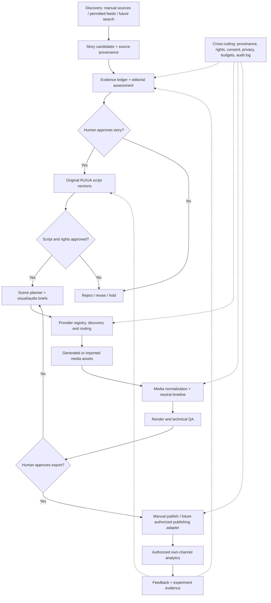

# Story Studio RU/UA — Global Architecture Blueprint
**Version:** 0.1 (design proposal) | **Date:** 2026-11-04
**Status:** DRAFT FOR USER REVIEW — documentation only. Product direction is approved, detailed technical choices are **not yet approved for implementation**.
**Baseline:** `main` = Sprint 26; docs branch = `docs/codex-handoff-audit-20261104`; CPU Lip Sync PR #5 remains experimental and unmerged.

## 0. Scope, verified baseline, and non-goals

**Goal:** A Windows-first, local-first, modular production system for finding promising RU/UA stories, verifying claims, creating editorial scripts, producing and assembling video, and learning from authorized post-publication analytics. The user controls approvals, provider selection, rights, spend and publication.

**Observed in current code (2026-11-04):**
- `core/project_schema.py`: neutral project/timeline **schema v3**, `Scene`, `Track`, `Subtitle`, `Clip`, `MediaAsset`, `Project`; locales ru/uk.
- `scripts/first_video.py`: scene-plan -> optional local images -> voice WAV (local Silero or supplied WAV) -> v3 timeline -> MP4. Supports a small 1–20 scene plan, existing output overwrite protection and scene-level captions.
- `core/mp4_render.py`: **still-image-only video track** with optional audio and SRT/burn-in. It explicitly rejects video media for video clips. It does NOT yet assemble arbitrary AI-generated MP4 clips. Do not claim it does.
- `README.md` and `project-log/CODEX_HANDOFF.md`: Sprint 25.1 Silero Voice Studio preview verified by user on Windows; full Sprint 26 Windows end-to-end MP4 playback remains a separate acceptance gate.
- Original upstream Chinese code and corpus are isolated as references. Pinned source CC BY-NC-SA 4.0, not cleared for commercial use. Independently develop original RU/UA editorial content.
- Codex is currently auditing external retention/A-B/prediction technologies; its findings are pending and must not be pre-judged.

**Non-goals for this design phase:** no runtime changes; no PR merge; no Sprint ZIP; no paid calls; no publishing; no scraping private analytics; no claim of working CapCut International export, cloud service, predictive retention, automated fact-check accuracy or commercial license clearance.

## 1. Architectural thesis

**Choose a modular local application (modular monolith), not a distributed microservice system for the initial product.** Use independent domain modules, explicit versioned contracts and replaceable provider adapters. Long-running AI jobs can execute through a local job runner; a remote worker/cloud deployment can be considered later. This avoids infrastructure overhead on Windows 10/11 while preserving future macOS/Linux portability.

Separate **content intelligence**, **media production**, **distribution/learning**, and **governance**. The media renderer must not know how stories were discovered; discovery must not know which video provider is used; providers must not silently decide rights or spend; post-publication metrics must not be confused with pre-publication editorial scores.

### Conceptual data flow



The dotted feedback edges mean **recommendations for a future production**, not automatic changes to an already approved/published script.

## 2. Domain modules and boundaries

| Module | Owns | Inputs | Outputs | MVP priority |
|---|---|---|---|---|
| **Project/Workspace** | project ID, production config, state, immutable versions | user settings | production manifest | P0 |
| **Discovery** | permitted source connectors, deduplication, candidates | manual URLs, future official/public sources | `StoryCandidate` | P1 |
| **Evidence** | claims, citations, contradiction/uncertainty, rights flags | candidate and source references | `EvidenceLedger` | P1 |
| **Editorial** | explainable rubric, human selection, original RU/UA narrative templates | evidence, audience profile | `EditorialDecision`, `ScriptVersion` | P1 |
| **Scene Planning** | scene IDs, shot briefs, duration, reference frames, audio/subtitle language | approved script | `ScenePlan` | P0/P1 |
| **Provider Intelligence** | search for new providers, verify terms, track offers/quotas, human approval | official sources, user config | `ProviderRecord`, recommendation | P2 |
| **Generation Router** | select approved adapter, enforce budget, retry and manual fallback | scene media request | `GenerationJob` | P2 |
| **Media Library** | imported/generated media, metadata, hashes, usage rights | assets from local/cloud | `MediaAssetRecord` | P0 |
| **Speech/Localization** | locale-specific narration, TTS/ASR, pronunciation, captions | scene text, voice selection | WAV, subtitle data | P0 |
| **Timeline/Render** | map approved assets to schema v3, FFmpeg, export | normalized assets | MP4/SRT/render manifest | P0 |
| **Quality Gate** | technical and editorial checks, review decisions | production artifacts | `QAReport` | P0 |
| **Publishing** | explicit platform metadata, upload adapters only after permission | approved export | `PublicationRecord` | P3 |
| **Analytics & Experiments** | own-channel authorized metrics, cohort/time-window, genuine experiments | publication ID and OAuth | `MetricSnapshot`, `ExperimentResult` | P3 |
| **Governance** | rights, privacy, consent, credentials, spend, provenance, audit trail | all module events | gates and audit log | P0 |

P0 = baseline preservation and core contracts; P1 = editorial pipeline; P2 = AI-provider discovery/media extension; P3 = publication/learning. Priorities are a proposed sequence, not approved sprint numbers.

## 3. Canonical contracts (design proposal, NOT implemented)

Keep `core/project_schema.py` **v3 unchanged initially**. Introduce a separate **versioned production manifest / sidecar** to avoid breaking existing CLI, tests, user projects and renderer.

### 3.1 Proposed artifact types

- `Production`: id, title, creation date, content locale, UI locale, narration locale, subtitle locale, target aspect/resolution, intended audience, project status, approval references.
- `StoryCandidate`: id, short summary, topic, source IDs, original discovery method, provenance, duplicates, candidate editorial score (not retention probability), status.
- `SourceReference`: URL/author/publication date/access date, quoted evidence within permitted limits, license/access status, source reliability assessment and confidence; source text is untrusted input.
- `Claim`: exact assertion, references for/against, confidence, unresolved status, fact-check reviewer and timestamp. **No citation = not verified**.
- `EvidenceLedger`: claim IDs, source IDs, conflicts, human decisions and reason; factual corrections must be traceable.
- `ScriptVersion`: id, source evidence ledger ID, language, text, scene outline, model/prompt version if applicable, user edits, approval status. Never silently overwrite an approved version.
- `ScenePlan`: stable scene IDs, narration text, target duration, desired visual action, prompt/ref images, aspect, source/rights references, media status.
- `ProviderRecord`: provider identity, official evidence URLs, capabilities, access mode (local/API/manual), free offer and verified date, terms, rights, region, quality, confidence and approval.
- `GenerationJob`: idempotency key, scene ID, provider/model/version, prompt version, input hashes, authorization, quota/cost estimate, status, retry metadata and outputs.
- `MediaAssetRecord`: immutable asset ID, content hash, type/codec/duration/size, storage URI, origin, provider and model, input refs, usage rights, consent, attribution and validation.
- `RenderManifest`: schema v3 project reference, asset IDs, output hash, FFmpeg/version, subtitles, parameters, QA report.
- `PublicationRecord`: platform, authorized account reference, published video ID, timestamp, script/export version and permissions.
- `MetricSnapshot`: source/platform, owned video ID, collection time, metric definitions, time window, aggregation granularity, missingness and provenance.
- `ExperimentRecord`: hypothesis, variants, actual allocation mechanism, randomization evidence if any, outcome, confidence and limitations.

### 3.2 Shared interface rules
- IDs are stable and unique; schema versions explicit; timestamps ISO 8601 UTC, locale codes explicit; paths stored as safe project-relative references where possible.
- Every generated asset points back to its scene, input assets, provider, model/version, prompt revision, consent and rights status.
- Human edits create a new version or revision, never silently mutate evidence/provenance of approved artifacts.
- Input/output validators reject unsupported codecs, malformed paths, wrong durations, unknown locales, missing rights and incomplete provider metadata.
- All modules return structured status/errors; no undocumented silent fallback from RU to UK, from local to cloud, or from free to paid.
- An external API can be added only via a versioned adapter; the core is agnostic to vendor names.

### 3.3 Sample production sidecar (illustrative, not a deployed schema)
```json
{
  "manifest_version": "0.1-proposal",
  "production_id": "story-0001",
  "content_locale": "uk",
  "ui_locale": "ru",
  "narration_locale": "uk",
  "subtitle_locale": "uk",
  "approved_script_version": "script-v3",
  "scene_plan_id": "plan-v2",
  "timeline_schema_version": 3,
  "media_asset_ids": ["asset-img-01", "asset-wav-01"],
  "export_status": "not_started",
  "commercial_use_intended": false
}
```

## 4. Workflow, gates and resumability

Proposed stage sequence:
1. **NEW** — user creates production, chooses content language, output, privacy, budget and intended use.
2. **CANDIDATES_READY** — discovery/manual intake has at least one provenance-tagged story candidate.
3. **EVIDENCE_REVIEW** — claims, sources, conflicts and uncertainties inspected. Unsupported claims must be removed, qualified or marked for review.
4. **STORY_APPROVED** — user selects a candidate and signs off editorial constraints.
5. **SCRIPT_DRAFTED** -> **SCRIPT_APPROVED** — original RU/UA narrative with source-linked claims and human review.
6. **SCENES_PLANNED** — each scene has timing, narration, media strategy and continuity constraints.
7. **ASSETS_READY** — image/video/audio outputs imported/generated, validated, rights checked and assigned to scenes.
8. **TIMELINE_READY** -> **RENDERED** — render manifest and MP4/SRT produced using a compatible renderer.
9. **QA_APPROVED** — checks for factual accuracy, media continuity, subtitle timing, codec, audio, watermark and rights.
10. **PUBLISHED** (optional and user authorized) -> **METRICS_COLLECTED** (authorized own-channel data) -> **LEARNING_REVIEWED** (suggestions for next content).

Every stage can enter **NEEDS_REVIEW**, **BLOCKED**, **FAILED_RETRYABLE**, or **CANCELLED** with a reason. Failed cloud generation must not discard approved scripts or previously verified assets. Use job IDs and idempotency for retries; no duplicated paid generation without fresh approval. A paused production can resume from the last verified artifact.

**Human approval gates (mandatory in initial design):** choice of story, publication of factual script, external transfer of sensitive/owned media, new provider activation, spending/paid calls, commercial rights uncertainty, public upload. Optional user-configurable automation only for safe/reversible steps after trust is established.

## 5. Media strategy and compatibility with Sprint 26

**Current constraint:** `core/mp4_render.py` only renders still-image video clips. Its existing `MediaAsset.kind` accepts video in the neutral model, but **the renderer rejects video media on the video track**. Therefore the architecture needs a future media normalization and video-capable renderer before claiming mixed AI clips are supported.

**Compatibility sequence:**
- Phase A: keep `scripts/first_video.py` and schema v3 unchanged; generate/import still images and WAV into current pipeline.
- Phase B: sidecar `MediaAssetRecord` and import/validation, without modifying timeline v3.
- Phase C: separately design/test a video-clip normalization adapter (codec, fps, dimensions, duration, audio policy, timestamps, aspect, frame rate, provenance); add video-capable render path behind feature flag after approval.
- Phase D: optional pan/zoom, transitions, multi-clip audio and finer caption alignment; verify separately.
- Phase E: native editor export Kdenlive/DaVinci only after actual round-trip tests. CapCut International remains feasibility-only.

**Fallback:** if no approved cloud service, no credits, no GPU or video generation fails, still images + FFmpeg + voice + subtitles must remain functional. This is a release-level invariant.

## 6. Provider intelligence integration

See `docs/AI_PROVIDER_DISCOVERY_AND_ORCHESTRATION_SPEC.md` for the dedicated detailed specification.

Integration rule: Provider Discovery produces **candidates and evidence**, not automatic active adapters. Research/verification/approval must precede routing. The router takes a **media job specification**, not a whole script; it returns an asset or an actionable manual-import request. Track web-only versus API-free quotas distinctly, verify rights and region, never fabricate remaining credits, and never use ToS-violating automation. Provider-specific secrets stay outside the project repository.

Suggested media job envelope:
`scene_id`, `modality`, `prompt_version`, `reference_asset_ids`, `target_duration_sec`, `aspect`, `locale`, `budget_cap`, `commercial_use`, `privacy_class`, `preferred_provider_ids`, `fallback_policy`.

## 7. Editorial integrity, analytics and learning

- **Editorial ranking** is a transparent heuristic with reasons and uncertainty. It is not a verified prediction of YouTube retention.
- **Evidence ledger** is separate from creative script. Fictionalized dialogue or speculative reconstructions must be marked as such. Do not generate fabricated citations.
- **Analytics** may use only the user's authorized channels/exports and available public metadata. Private third-party retention curves are not assumed accessible.
- **A/B tests** require actual platform-supported allocation or another defensible experimental design; merely creating two thumbnails/videos is NOT an A/B experiment.
- **Learning loop** starts as human-reviewed recommendations and comparative reports; only after adequate real data, holdout evaluation, leakage controls and uncertainty reporting should predictive models be considered.
- Codex independently researches retention, experiments and prediction; this blueprint defines the interfaces and acceptance criteria, not conclusions about candidate external projects.

## 8. Storage, jobs, security, observability (design proposal)

- **Storage:** local project folder with human-readable manifests and content-addressed media assets; use SQLite for searchable indexes, state and job queue only when implementation is approved. Do not make SQLite a new runtime dependency during design.
- **Jobs:** background runner with state `queued/running/waiting_user/completed/retryable_failed/blocked/cancelled`; explicit progress and cancellation, capped retries, rate limits and crash recovery.
- **Observability:** local audit trail of stage transitions, warnings, costs, generation latency, asset hashes and software/model versions. Avoid storing API keys or full private content in logs.
- **Security:** protect project paths (including Cyrillic/Unicode), OAuth tokens, cloud uploads, model downloads and untrusted web text; no execution of retrieved instructions. User consent before external data transfer.
- **Reproducibility:** approved source/evidence snapshot, script revision, prompt version, model version, provider parameters, render parameters, hashes and timestamps. Remote nondeterministic generation may not be exactly reproducible; document that limitation.
- **Portability:** isolate OS-specific paths, binaries and GUI wrappers; Windows 10/11 first, macOS/Linux later.

## 9. Proposed execution roadmap and deliverables

**A0 — Architecture review (NOW, documentation only).**
Deliver: context map, boundaries, contracts, workflow gates, current-vs-target matrix, risk register and user decisions. Gate: no contradictions with Sprint 26; user approves architecture direction. No code changes.

**A1 — Baseline preservation & contracts (future, after approval).**
Deliver: reproducible Sprint 26 smoke tests, documented v3 compatibility, sidecar schema, fixture samples and contract tests. Gate: existing CLI/render regression tests pass; Windows end-to-end acceptance separately verified.

**A2 — Human-guided story-to-script vertical slice.**
Deliver: manual story intake, SourceReference/EvidenceLedger, original RU/UA scripts, approvals, scene plan mapped to existing still-image renderer. Gate: one complete Ukrainian and one Russian example with explicit sources, review and MP4; no fabricated citations.

**A3 — Media library & provider prototype.**
Deliver: provenance/rights manifest, local/manual image adapter, simulated quota router, approved real adapter only if rights/API verified. Gate: safe fallback, no secret leakage, no surprise spend, no breaking v3.

**A4 — Mixed-media renderer (after explicit separate approval).**
Deliver: normalized AI video clips, duration/fps/aspect handling, clip audio policy, transition tests, captions and export. Gate: one reproducible mixed still/video Windows MP4 test and regression suite.

**A5 — Discovery & intelligent provider research.**
Deliver: authorized source connectors, provider candidate research and update monitoring, human approval queue. Gate: demonstrate detecting offer changes and declining unverified services.

**A6 — Publishing, analytics and feedback (only after Codex research and consent).**
Deliver: manual publication manifest first; then optional official OAuth integration, owned-channel metrics and transparent feedback reports. Gate: provenance, consent, valid metric definitions, no unverified retention prediction.

**A7 — Release/legal/productization.**
Deliver: SBOM, license matrix, Windows installer/update overlay, privacy and security documentation, Community release gate; Professional/Cloud only after separate rights/economics approval.

Roadmap stages are logical work packages, **not Sprint numbers or delivery-time promises**. Workstreams may overlap after their contracts are agreed.

## 10. Decision register: defaults proposed for user review

| Decision | Proposed default | Why |
|---|---|---|
| D01: Deployment | Local-first modular monolith, opt-in cloud | Windows usability, privacy, low overhead |
| D02: Human control | Approve story, script, provider, spend and publication | Editorial integrity, rights, safety |
| D03: First vertical slice | One RU and one UK factual short video, human-selected story | End-to-end proof without premature scraping |
| D04: Media baseline | Preserve schema v3 and still-image renderer; sidecar metadata | Avoid breaking Sprint 26 |
| D05: Providers | Verified local/free first; web-manual fallback; paid opt-in | Resilience, cost control, ToS |
| D06: Source integrity | Every factual claim must have source references or be marked unverified | Traceability |
| D07: Analytics | Only own authorized channel data; recommendations before ML | Privacy and statistical validity |
| D08: Publishing | Manual export/upload initially | Avoid premature OAuth/publishing complexity |
| D09: First UI | Guided wizard + advanced settings and clear approvals | Ease of use with controllability |
| D10: Commercial release | Block until rights and dependencies cleared | Current upstream license uncertainty |

### User choices needed next (only three)
1. **First target content genre:** history/biography, factual explainers, science/technology, or mixed? The system can support all later, but the first fixtures and rubrics need a concrete genre.
2. **Initial control level:** default human approvals at each editorial gate (recommended), or an optional fully automatic draft run that still stops before paid calls/publication?
3. **Primary target format:** vertical 9:16 shorts (recommended first) or simultaneous 9:16 + 16:9? This affects scene framing and visual generation costs.

## 11. Risk register and evidence gates

| Risk | Mitigation / acceptance |
|---|---|
| Upstream CC BY-NC-SA and third-party restrictions | Keep upstream isolated; original RU/UA reimplementation; per-component license gate before distribution |
| False factual claims or fabricated sources | Evidence ledger, explicit uncertainty, human review, no invented citations |
| Cloud service ToS, free-tier changes, watermarks | Official-source checks, time-stamped terms, human approval, manual mode and fallback |
| Provider dependency / API outage | Replaceable adapters, cached local artifacts, no silent provider switching |
| Mixed-video support incorrectly assumed | Explicit new renderer workstream and Windows acceptance tests |
| Untrusted source prompt injection / malicious media | Data-only ingestion, validation, sandboxing as feasible, safe path handling |
| Metric leakage / fake A-B tests | Distinguish observational metrics from randomized experiments; Codex review |
| Uncontrolled compute spend | Cost estimates, per-job limits, human confirmation and budget logs |
| Scope creep / overengineering | One local application, vertical slices, mock adapters before remote dependencies |
| Windows/Unicode incompatibility | Windows 10/11 path and smoke tests, existing CLI regression gate |

## 12. Work boundaries with Codex

**Our architecture track:** product boundaries, contracts, workflows, user control, cost/rights policies, staged acceptance criteria, diagrams and decisions.

**Codex's ongoing track:** actual code-level verification of external retention, A/B, prediction and upstream discovery technologies, datasets, methods, licenses and reproducibility.

**Integration point:** Codex may propose module implementations and changes to interface contracts, but findings are reviewed against this blueprint; do not prematurely approve candidate technologies or alter Sprint 26.

## 13. Definition of done for this architecture phase

- [x] Current/target capabilities separated; real still-only renderer constraint recorded.
- [x] End-to-end workflow and human approval gates proposed.
- [x] Versioned data contracts and provider integration points proposed.
- [x] Rights, privacy, cost, provenance, and analytics boundaries proposed.
- [x] Roadmap and acceptance gates drafted without runtime edits.
- [ ] User confirms first genre, autonomy mode and target format.
- [ ] Cross-check future Codex research findings and amend blueprint with evidence.
- [ ] User explicitly approves implementation work packages before any runtime changes.
