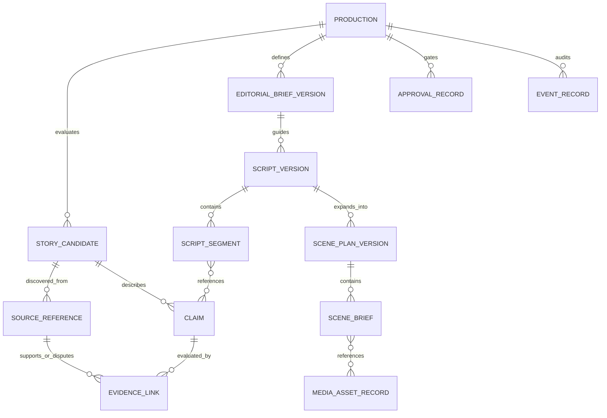

# Story Studio RU/UA — Editorial Data Contracts and Storage
**Version:** 0.1 | **Date:** 2026-11-04 | **Status:** design-only, no runtime schema changes
**Related:** [Universal Editorial Pipeline](EDITORIAL_PIPELINE_V0_1.md), [Global Blueprint](../GLOBAL_ARCHITECTURE_BLUEPRINT_V0_1.md), `core/project_schema.py` v3.

## 1. Contract strategy

**Preserve the working schema v3 exactly.** Editorial objects are a new, versioned **sidecar manifest** that references the current v3 project and media outputs. A separate adapter can later emit the existing `scripts/first_video.py` input format. This prevents incompatible fields from being injected into `Project.from_dict`, whose v3 parser requires exact field sets.

The design uses stable IDs, explicit versioning and referential integrity, but **does not imply** these Python classes, JSON Schemas, migrations or SQLite tables have been implemented.

### Proposed relationship map



A production can contain many candidates, but only a specifically approved candidate/brief/script revision is active for the current export. A source can be referenced by multiple claims; source metadata and factual assertion are **different entities**. A scene can refer to multiple claims; a media asset may be reused in multiple scenes with rights and provenance retained.

## 2. Shared conventions

| Property | Rule |
|---|---|
| `id` | stable opaque identifier (e.g. UUID/ULID in future), not a title or filename |
| `schema_version` | version of **editorial sidecar**, independent of timeline schema v3 |
| `revision` | monotonically increasing positive integer or immutable revision ID |
| `created_at`, `updated_at` | timezone-aware ISO 8601 timestamps in UTC |
| `locale` | explicit `ru` or `uk` for script/narration/subtitles; UI locale separate |
| `content_mode` | `factual`, `fictional`, `hybrid` |
| `status` | enum per object, never overloaded across stages |
| `source_url` | canonical external URL only when supplied/verified; no invented source URLs |
| `file_ref` | validated project-relative path or managed asset ID; no unsafe traversal |
| `rights_status` | `approved`, `restricted`, `unknown`, `blocked`; explicit intended use |
| `confidence` | evidence assessment with basis; no uncalibrated pseudo-probability |
| `approval` | references exact object revision/hash and actor/time, invalidated by edits |
| `provenance` | source/provider/model/version, capture time and applicable terms where known |
| `missing` | absent data stays null/unknown, never replaced by guessed zero/false |

Use UTF-8, Unicode-safe paths (including Cyrillic Windows profiles), predictable ordering, strict validation, capped input sizes and atomic writes in future implementation. Source text and provider output are untrusted.

## 3. Object definitions

### 3.1 `Production`
Required: `production_id`, `schema_version`, `title`, `genre_profile_id`, `genre_profile_version`, `content_mode`, `content_locale`, `narration_locale`, `subtitle_locale`, `ui_locale`, `intended_use`, `stage`, `created_at`. Optional: audience, target platform, aspect, target duration, output directory, active candidate/brief/script/scene revisions, approved budget, media constraints.

`intended_use` distinguishes personal/test and commercial; it is **not** a statement of legal permission. `target_duration_sec` is editorial planning, not guaranteed render length.

### 3.2 `StoryCandidate`
`candidate_id`, `production_id`, `title`, `summary`, `discovery_method` (manual URL/topic/authorized connector), `source_ids[]`, `duplicate_of` (optional), `genre_profile_id`, `content_mode`, `eligibility_flags[]`, `assessment_id`, `status`. A manually entered topic may have zero sources initially but cannot pass factual evidence approval on that basis.

### 3.3 `SourceReference`
`source_id`, `canonical_url` (nullable for locally provided documents), `title`, `publisher`, `author`, `published_at`, `accessed_at`, `source_type`, `capture_method`, `rights_status`, `access_restrictions`, `snapshot_hash` (optional), `reliability_notes`. Store minimal permitted excerpts or offsets; not copyrighted full-page copies by default. Source citation is not equivalent to factual verification.

### 3.4 `Claim` + `EvidenceLink`
`Claim`: `claim_id`, `candidate_id`, `statement`, `claim_type` (factual/interpretation/fictionalized), `materiality` (material/context), `review_status`, `reviewer_notes`, `last_reviewed_at`.
`EvidenceLink`: `link_id`, `claim_id`, `source_id`, `relation` (supports/contradicts/context/insufficient), `locator` (section/page/paragraph), `explanation`, `assessed_by`, `assessed_at`.
`supported` is a review conclusion with basis, not something the presence of one URL grants automatically. Unsupported material factual claims block approval or must be qualified/removed.

### 3.5 `CandidateAssessment`
`assessment_id`, `candidate_id`, `rubric_id`, `rubric_version`, `ratings` (six 0–5 components), `weights`, `weighted_score` (nullable if hard gate fails), `hard_gate_results[]`, `reasoning`, `reviewed_at`. Score is editorial prioritization, **not** predicted retention or virality.

### 3.6 `EditorialBriefVersion`
`brief_id`, `revision`, `candidate_id`, `genre_profile_id`, `content_mode`, `audience`, `editorial_angle`, `audience_promise`, `tone`, `duration_target_sec`, `format`, `language_policy`, `must_include_claim_ids[]`, `must_avoid[]`, `approval_status`.

### 3.7 `ScriptVersion` and `ScriptSegment`
`ScriptVersion`: `script_id`, `revision`, `brief_id`, `locale`, `segments[]`, `model_id` (nullable), `prompt_template_id` (nullable), `generation_parameters` (optional), `editorial_notes`, `approval_status`, `content_hash`.
`ScriptSegment`: `segment_id`, `role` (opening/body/closing/other), `text`, `claim_ids[]`, `estimated_duration_ms` (optional), `pronunciation_notes`, `visual_notes`, `disclosure_marker` (optional). The script must not rely on citations embedded only in an LLM answer; claim IDs are canonical.

### 3.8 `ScenePlanVersion` and `SceneBrief`
`ScenePlanVersion`: `scene_plan_id`, `revision`, `script_id`, `script_revision`, `content_locale`, `scenes[]`, `approval_status`.
`SceneBrief`: `scene_id`, `order`, `script_segment_ids[]`, `narration_text`, `claim_ids[]`, `estimated_duration_ms`, `visual_kind` (still/ai_video/imported_video/graphics), `visual_prompt` (optional), `reference_asset_ids[]`, `character_ids[]`, `rights_flags[]`, `status`. Exact rendered duration depends on TTS/FFmpeg and may differ from estimate.

### 3.9 `ApprovalRecord` + `EventRecord`
`ApprovalRecord`: `approval_id`, `gate_id`, `object_type`, `object_id`, `revision_hash`, `actor`, `decision` (approve/reject/revise), `at`, `reason`, `policy_version`.
`EventRecord`: `event_id`, `production_id`, `event_type`, `object_ref`, `at`, `actor`, `summary`, `error_code` (optional). Never log credentials, private OAuth tokens or full sensitive source text.

### 3.10 External contracts (references, not duplicates)
- `ProviderRecord`, `GenerationJob`, `MediaAssetRecord` follow `docs/AI_PROVIDER_DISCOVERY_AND_ORCHESTRATION_SPEC.md` and the global blueprint; editorial objects reference their IDs rather than owning provider quotas.
- `RenderManifest` references current v3 project, asset IDs and outputs; analytics records reference `PublicationRecord` only after authorized publication.

## 4. Illustrative sidecar JSON (NOT a deployed schema or publishable script)

The example intentionally contains an **unverified** factual claim. It demonstrates why a draft cannot be approved solely because an AI system wrote it.

```json
{
  "editorial_schema_version": "0.1-proposal",
  "production": {
    "production_id": "prod-demo-001",
    "title": "Как работает термос?",
    "genre_profile_id": "science_technology",
    "genre_profile_version": "0.1-proposal",
    "content_mode": "factual",
    "content_locale": "ru",
    "narration_locale": "ru",
    "subtitle_locale": "ru",
    "ui_locale": "ru",
    "intended_use": "test",
    "stage": "EVIDENCE_REVIEW",
    "created_at": "2026-11-04T12:00:00Z"
  },
  "candidates": [
    {
      "candidate_id": "cand-001",
      "production_id": "prod-demo-001",
      "title": "Принцип работы термоса",
      "summary": "Короткое объяснение принципа",
      "discovery_method": "manual_topic",
      "source_ids": [],
      "duplicate_of": null,
      "genre_profile_id": "science_technology",
      "content_mode": "factual",
      "eligibility_flags": ["sources_missing"],
      "assessment_id": null,
      "status": "needs_research"
    }
  ],
  "sources": [],
  "claims": [
    {
      "claim_id": "claim-001",
      "candidate_id": "cand-001",
      "statement": "Для объяснения устройства термоса необходимо проверить утверждения о способах теплопередачи.",
      "claim_type": "factual",
      "materiality": "material",
      "review_status": "unverified",
      "reviewer_notes": "Учебный пример; нет проверенных источников",
      "last_reviewed_at": null
    }
  ],
  "evidence_links": [],
  "active_script_id": null,
  "approvals": []
}
```

All timestamps, IDs, titles and content in this JSON are **illustrative**, not evidence of research or implementation. This draft must remain at evidence review until actual source checks and human approval.

## 5. Referential integrity and versioning rules

1. Every referenced `candidate_id`, `claim_id`, `source_id`, `script_id`, `scene_id` and `asset_id` must exist in the same production or an explicitly authorized shared library.
2. An `EvidenceLink` cannot refer to a non-existent source or claim. A `ScriptSegment.claim_ids[]` must point to actual claims or be empty only when it contains no material factual assertion.
3. `ScriptVersion.locale` must match intended narration for the chosen handoff, unless an explicit translated/dual-language workflow is approved.
4. Approved objects are immutable snapshots. Edits create new revisions; approvals bind to a content hash and do not carry over automatically.
5. Changing a claim's factual status invalidates dependent script approval where the claim is material; changing only visual styling need not invalidate factual approval.
6. Scene plans link to exact script revisions; media jobs link to exact scene revisions. No stale outputs silently replace current versions.
7. For user-supplied assets, rights are `unknown` until assessed; never default to commercial approval.
8. Record `missing`, `unverified`, `disputed` and `not_applicable` separately; zero is a valid measured value and must not stand in for unknown.
9. A genre profile update changes `genre_profile_version`; prior productions remain reproducible with their previous profile snapshot.

## 6. Proposed storage layout (future; do not create at runtime now)

```text
workspace/
  productions/
    <production-id>/
      editorial/
        production.json
        candidates.json
        sources.json
        evidence.json
        briefs/
        scripts/
        scene-plans/
        approvals.jsonl
        events.jsonl
      assets/
        originals/
        generated/
        imported/
      render/
        project-v3.json
        render-manifest.json
        exports/
```

The `<production-id>` directory is illustrative. In implementation, generated paths must be validated for traversal/symlinks and collision; user-managed private data should not be committed to Git. SQLite can later index searchable metadata and job states, but human-readable portable manifests remain the interchange format. Atomic write and backup strategy is a separate design gate.

## 7. Compatibility mapping to Sprint 26

| Editorial object | Existing destination | Restriction |
|---|---|---|
| `Production.title` | `first_video_plan.title` | string |
| `ScenePlanVersion.content_locale` | `first_video_plan.locale` | ru or uk |
| `SceneBrief.narration_text` | `scenes[i].text` | nonempty, ≤2000 characters |
| approved still-image filename | `scenes[i].image` | optional simple PNG/JPG/JPEG/PPM filename in images directory |
| scene list | `scenes[]` | **1–20** in current `scripts/first_video.py` |
| approved WAV or local TTS | `--audio-dir` or `--silero-model` | mutually exclusive in current script; voice required for Silero |
| claim links, source URLs, genre, rights, approvals | **sidecar only** | not accepted by strict v3 parser |
| AI-generated MP4 scene | **no current mapping** | requires separately approved video-capable render path |

A script/scene plan may be valid editorially yet not be compatible with Sprint 26's media renderer; present this as a capability warning, not a factual/editorial failure.

## 8. Contract-test checklist for future implementation

- Schema versions rejected when unsupported; old v3 project loads unchanged.
- Invalid foreign keys, duplicate IDs, unsafe paths and stale approval hashes rejected.
- Factual draft with unverified material claim cannot pass G3.
- Fictional draft does not require invented citations; hybrid dramatization markers are preserved.
- RU and UK content/localization are not silently swapped; Cyrillic file paths are handled.
- 20-scene first-video plan allowed; 21-scene plan produces clear compatibility error.
- Existing still-image/WAV flow preserved; generated video clip is not sent to still-only renderer.
- Edited source/claim invalidates dependent approvals with an audit event.
- Media asset rights unknown blocks commercial output; provider credits unknown are not fabricated.
- Interrupted job resumes from last valid revision without duplicating paid generation.

**Status:** specification only; no files or tables of this layout have been created in the application.
