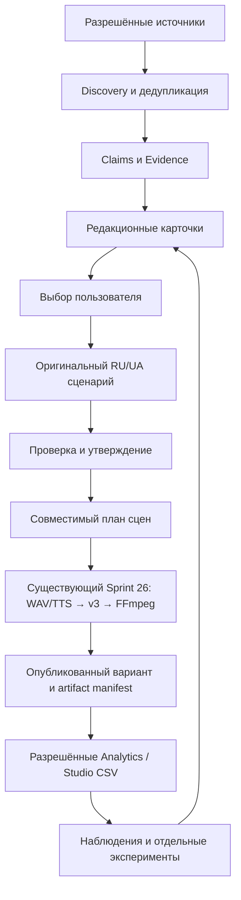

# Предлагаемая архитектура и дорожная карта

Дата: 2026-11-04. Статус: **PROPOSED — требует отдельного утверждения; реализация не начата**. Сохранение документов/создание PR не является таким утверждением.

## Цель и существующий интерфейс

Нужен local-first Windows10/11 продукт, который находит истории, проверяет claims/provenance, объяснимо предлагает варианты, пишет оригинальные RU/UA сценарии, производит видео и учится на разрешённых измерениях. UI locale, script/narration language и subtitles должны быть раздельны.

Сохраняем [Sprint26 first_video](https://github.com/olegale-ctrl/Story-Studio-RU-UA-WORK/blob/e1f4efb0fb5ff290bb198349213c004b4667ef0f/scripts/first_video.py#L25-L152): ru/uk scene-plan,1..20scenes, непустой текст<=2000 символов/scene, WAV или доверенный localSilero, optional images → typed timelinev3 → FFmpeg. Сейчас это scene-level timing, не word alignment.

[Project.from_dict](https://github.com/olegale-ctrl/Story-Studio-RU-UA-WORK/blob/e1f4efb0fb5ff290bb198349213c004b4667ef0f/core/project_schema.py#L202-L234) требует точных наборов полей. Evidence/experiments не добавляются произвольными полями в v3. [Renderer](https://github.com/olegale-ctrl/Story-Studio-RU-UA-WORK/blob/e1f4efb0fb5ff290bb198349213c004b4667ef0f/core/mp4_render.py#L27-L74) имеет собственные ограничения still images/audio/timing; предложение не объявляет новые editor/video capabilities.

## Поток

## Контракты — проект, не реализованные классы

| Сущность | Основные поля/правила |
|---|---|
| SourceRecord | URL, publisher/author, published/fetched_at, language, rights/status, locator, raw hash; unknown даты/права сохраняются явно |
| StoryCandidate | Сюжет, конфликт, novelty, sources, duplicate cluster, audience/genre fit, ограничения |
| ClaimEvidence | Claim text, source locator/excerpt, support/contradiction, reviewer/status, допустимая формулировка |
| EditorialAssessment | Versioned rubric/weights, explanation, evidence quality, novelty/diversity; не вероятность вирусности |
| UserDecision | Выбор сюжета/жанра/языка/варианта, время, version/hash, явное утверждение |
| NarrativeVariant | Original text,ru/uk, hook promise/payoff, claim-to-text mapping, revision, approval |
| ArtifactManifest | Script/plan/project/media hashes, scene timings, provider/model/version, generation settings, rights |
| PublishedAsset | Platform/channel/videoid, upload artifact hash, publication_at, durations, edit version/time transform |
| MetricObservation | Raw source/hash, export/query_at, report period/timezone/cohort, metric definition/version, units/axis/denominator, points, availability/error |
| ReviewInterval | Actual sample interval, magnitude/resolution, matching scenes/text, association-only status, review result |
| PackagingVariant | Immutable title/image/version/hash, facts bundle, creative settings, preflight/review, exposure validity interval |
| ExperimentSpec | Question, variants, eligibility, randomization/seed, exposures, primary outcome/window, stopping, analysis, validity |
| FeatureSnapshot | Values/source/available_at/cutoff, frozen definition, group/time split provenance; labels отдельно |

Предлагаемое хранение — локальная SQLite+sidecar manifests вне существующего v3payload. Идентификаторы и hashes связывают слои. Изменение текста/asset снимает прежнее approval. Hash подтверждает версию, не факт/смысл.

## Контент и редактура

- Source text — недоверенные данные; найденные инструкции не исполняются и не передаются как system authority.
- Discovery providers opt-in, с поддерживаемыми API/RSS/ручным вводом, rate limits, bounded downloads, дедупликацией и provenance.
- Hard gates по источникам/правам до ranking; editorial score объясняет интерес, не заменяет фактчекинг.
- Original NarrativeDNA: конфликты, ясное обещание, конкретные проверяемые детали, хронология, payoff. Не переводить wholesale китайские корпуса.
- Человек выбирает сюжет и утверждает существенные claims/финальную редакцию. Противоречия и неизвестное видимы; invented quotes/numbers запрещены.

## Связь retention с нашим видео

Начать с собственных known scene timings/script/subtitles; не добавлять ASR ради повторного распознавания уже утверждённого текста. ASR для legacy видео — отдельный лицензированный provider с явным ru/uk и revision/performance gate.

Normalized curve x переводится в seconds по документированной duration. Затем применяется подтверждённая связь uploaded artifact ↔ project. Platform trimming, новый montage, speed changes и другие edits требуют time transform либо статуса alignment unknown. Равенство длительностей не доказывает тождество.

Показывать интервал изменения и исходное разрешение сетки, не притворную точность до слова. Raw non-monotone curve сохраняется; smoothing и derivative — отдельные производные. Missing metrics не становятся 0, formatShorts не определяется через outcome.

## Packaging и эксперименты

Разделить generation, structural preflight, editorial review и empirical evaluation. Geometric/pixel guard не подтверждает смысл/правду/CTR. Все title variants опираются на один evidence bundle; image/fonts/assets rights отдельны.

Начальный localCPU compositor с original templates проще тяжёлой модели; cloud image provider только после проверки terms/cost/privacy и разрешения. Частичный успех, no silent retry/provider switch, spend limits и asset hashes обязательны.

Manual comparable Studio observations допустимы как observational triage. Настоящий experimental layer — отдельный controlled player/site/panel либо подтверждённая native platform функция. GrowthBook reference ограничен тем, что действительно контролирует продукт. Два organic uploads не объявляются randomized A/B.

## Безопасность и права

- Credentials в поддерживаемом защищённом Windows storage; minimal scopes и отдельное opt-in revenue. Secret values не попадают в reports/media/manifests.
- URL/host/protocol allowlist, timeout/size limits, containment paths, validated ids, безопасные CSV/images, no shell sourcing.
- Pickle/PT/joblib/npy artifacts загружаются лишь после отдельного trust/provenance gate; без автоматического скачивания/исполнения.
- Три реестра: code/dependencies; content/data/models; API/services/output. Grant одного слоя не одобряет остальные.
- Platform permissions, privacy/consent, retention/delete/export policies обязательны до реальных пользовательских данных.

## Приоритеты

| Этап | Содержание | Критерий готовности / зависимость |
|---|---|---|
| P0 | Утвердить contracts, права, определения метрик и этот план | Понятны source/metric ownership, missing states, коммерческие blockers; approval отдельно |
| P1 | Небольшой Discovery→Evidence→editorial cards→human choice | Реальные локаторы, contradictions visible, duplicate cases, explainability; без обещаний вирусности |
| P1 | Original RU/UA narrative и scene-plan adapter | Claims прослеживаются, quotes проверены, hook выполняется; v3/media workflow сохранён |
| P1 | Media acceptance | Targeted regression checks после реальных code changes; отдельно WindowsUnicode/Silero/end-to-end playback |
| P2 | Append-only measurement+StudioCSV | Explicit units/cohorts/windows, no missing0, actual timestamps, variant hashes |
| P2 | OAuth adapter | Актуальный API contract, protected tokens, pagination, permitted live comparison со Studio; feature detection |
| P2 | Controlled experiments | A/A, SRM, assignment/exposure distinction, stopping/power; observational status для остальных |
| P3 | Predictive model | Разрешённые real mature labels, as-of data, creator/time outer holdout, useful baseline gain и calibration |
| Отдельно | ASR/editor export/lip-sync | Rights/model/version/WindowsCPU/user acceptance; не блокирует editorial/measurement foundation |

## Проверки будущей реализации

1. Flat/rising curve → no drops; nonuniform/73points grid не заменяется 100 искусственными точками.
2. 1percent и ratio1.2 различаются; APV120 допустим в своём типе; completion ограничен собственным контрактом.
3. Missing reference, APIerror, withheld data иреальный 0 различаются.
4. Два монтажа одинаковой длины не получают автоматический verified content join.
5. 168h snapshot не доступен в историческом as-of1h.
6. Обновление title/image создаёт новый variant, не стирает старые exposures.
7. Shortsvsother классификация имеет независимый источник и unknown status.
8. Synthetic tests проверяют кодовые контракты, не эффективность видео; causal conclusions требуют подходящего дизайна.

## Пять наиболее ценных направлений

1. Claims & Evidence с оригинальной редакционной методикой.
2. Разрешённая first-party аналитика собственного канала.
3. Версионный журнал сценариев, packaging и observations.
4. Пререгистрация и корректный отдельный экспериментальный слой.
5. Original RU/UA NarrativeDNA и audio-first mediaQA при сохранении Sprint26.

Готовая внешняя модель вирусности сейчас не является рекомендуемой зависимостью.
