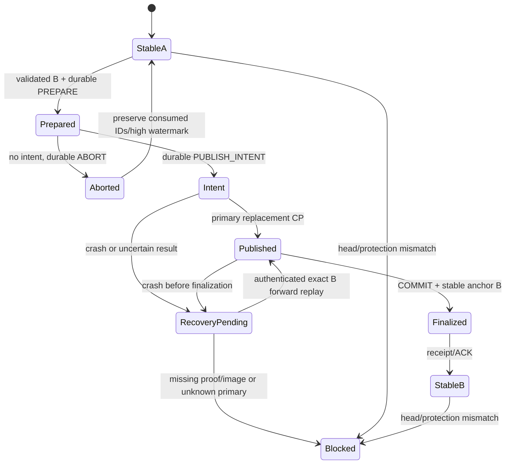

# E01.3.9.1 — Atomic Storage, Protected Head Anchor and Transaction Sequence

Статус: **DESIGN PROPOSAL — НЕ УТВЕРЖДЁН**. Ревизия: E01.3.9.1a, 2026-11-05.

Этот документ не разрешает реализацию storage, broker, journal, anchor,
authority evaluation или recovery. Рекомендации D1–D12 в конце требуют отдельного
решения владельца. A1–A14 и O1–O10 не пересматриваются.

## 1. Основание и границы

- Репозиторий: `olegale-ctrl/Story-Studio-RU-UA-WORK`.
- База уточнения: `docs/story-intelligence-architecture-decision-2026-11-05`.
- Точный base SHA: `aeef7435e85538ed2b83c0cb6e6513b999b8c062`.
- Ветка уточнения: `docs/editorial-e01-3-9-1a-storage-clarifications`.
- Единственный изменяемый файл: этот документ. Исходное предложение E01.3.9.1
  сохранено и уточняется на месте; его публикация не означала approval.

Изучены E00/1 из нормативного коммита
`e520648411b99264688ff66dc61ad0e974201ed3`, утверждённые
`E01_3_7_3_APPROVED_CONTRACT.md`, `E01_3_8_1_APPROVED_CONTRACT.md`, существующие
schema-2 models/codec/attestation/integrity/migration, snapshot integrity,
approval consistency/history. Исполняемый код не создаётся и не меняется.

[Story Intelligence architecture decision от 2026-11-05](../architecture/STORY_INTELLIGENCE_ARCHITECTURE_DECISION_2026-11-05.md)
учитывается как согласованная **концепция**: Discovery/Evaluation/Creative
рекомендуют, а Production Brief передаёт версионированное задание через
редакционные проверки. Они не получают privileged storage endpoint, право
создавать approvals или обходить blockers через высокий score. Этот документ
не меняет утверждённые границы и не добавляет Story Intelligence schemas/API.
Концептуальный decision прямо не утверждает storage D1–D12.

Сохраняются следующие границы:

1. E00: authoritative editorial state — один canonical JSON snapshot;
   snapshot commit point — замена primary; один writer на production;
   expected_generation, постоянный lock file, проверенный backup.
2. A1/A2: principal определяется OS adapter; права задаёт отдельная явная
   allow-list. Ни actor, ни наличие OS session не предоставляют все права.
3. A4: Ed25519 не обязателен для offline MVP. Внутренний storage MAC ниже —
   отдельный механизм защиты journal, не подпись ApprovalAuthorityEvidence.
4. A8–A10/O10: reconsideration, REVOKE и идемпотентность требуют проверенного
   контекста транзакций; UUID, timestamp и массив approvals его не заменяют.
5. A11: missing/unavailable/mismatched anchor блокирует effective authority,
   но не безопасное чтение и диагностику. Текущий snapshot не становится
   доверенным автоматически.
6. O5/O8: migration увеличивает generation один раз и не создаёт evidence.
   Исторические approvals не получают новых полномочий.

### 1.1 Три разных результата

| Результат | Что означает | Чего не означает |
|---|---|---|
| Snapshot integrity | Кодек, checksum, graph, hashes, rights bindings, evidence согласованы | Подлинность, доверенный head, authority |
| Verified storage head/order | OS-protected lineage связывает exact snapshot с подтверждённой транзакцией | Разрешение конкретному человеку принять решение |
| Effective editorial authority | Будущий evaluator проверил также principal, policy, session, declarations, историю и актуальность | Rights authorization, render/export/commercial readiness |

Предложение проектирует второй слой и границы его взаимодействия с остальными.
Никакой новый флаг в schema 2 не объявляет snapshot доверенным.

## 2. Рассмотренные варианты

### 2.1 Сравнение

| Критерий | A: JSON + файловый journal + внешний anchor | B: SQLite authoritative state + внешний anchor | C: JSON primary + SQLite metadata/journal + внешний anchor |
|---|---|---|---|
| Crash consistency | Явный WAL-протокол ниже; framing/replay надо доказать тестами | DB transaction защищает DB; связь с anchor требует отдельного протокола | DB упрощает metadata, но JSON/DB/anchor всё равно раздельны |
| Durability | Flush файлов и публикации; зависит от OS/накопителя | `synchronous=FULL` в WAL или обоснованный rollback mode; зависит от VFS/диска | Обе стратегии flushing плюс протокол внешних файлов |
| Multi-file atomicity | Не заявляется; pending intent + recovery | DB COMMIT не атомарен с отдельным anchor | SQLite COMMIT не атомарен с primary JSON и anchor |
| Windows | NTFS и service adapter, реальные Windows tests обязательны | SQLite поддерживает Windows, но ACL/service/anchor остаются задачей приложения | Windows SQLite и файловый adapter; больше состояний |
| Backup/restore | Exact snapshot + защищённый journal/checkpoint; старый backup не равен current head | Нужен согласованный DB backup, не копирование только main DB при активном WAL | Согласованный bundle из JSON, DB и anchor receipt |
| Rollback detection | Внешний anchor и authenticated chain; полная пара/система может быть откатана привилегированным противником | SQLite сам не обнаруживает восстановление старой корректной DB/anchor | Аналогично; SQLite metadata не внешняя монотонная опора |
| Complexity | Свой небольшой journal, replay и crash matrix; высокая цена доказательства корректности | Меньше собственного journal кода, но смена authority/layout и E00 commit point | SQL schema/migrations плюс тот же файловый commit/recovery |
| Testing | Framing, torn writes, порядок flush, rename, ACL, все переходы | DB failure injection плюс anchor/IPC/security tests | Все cross-file окна и SQLite lifecycle |
| Maintenance | Versioned storage envelope и ограниченный parser; без DB dependency | Версии SQLite/VFS, DB schema, migrations, WAL/checkpoint policy | Обслуживание двух форматов и согласованности их индексов |
| Portability | Общая state machine, отдельные native adapters | SQL переносим, security/durability adapters всё равно разные | Переносимая модель, больше платформенных поверхностей |
| Совместимость с E00 | Сохраняет authoritative JSON и commit point primary replacement | DB как authority вместо JSON потребовала бы отдельного изменения E00 | Может сохранить E00, если DB COMMIT не объявляется snapshot commit point |

SQLite WAL требует учёта `-wal`/`-shm`, checkpoint и backup semantics. Его
атомарность не распространяется на произвольный внешний JSON или anchor.
Свой файловый WAL также не получает таких гарантий только от названия WAL.

### 2.2 Рекомендация

Рекомендуется **A с отдельным Windows service broker**, а не библиотека,
пишущая anchor от имени интерактивного пользователя. Причины: сохраняются E00,
точные codec/integrity API и один authoritative JSON; путь от pure migration к
storage остаётся явным; защищённая последовательность не зависит от редактируемой
DB или дополнительных полей schema 2.

B не отклоняется как ненадёжная технология: для текущего проекта он меняет
утверждённый источник authoritative state и commit point. C — допустимая
альтернатива при отдельном согласовании; она уменьшает риск собственного
framing parser, но не устраняет основной cross-file протокол. Если последующая
проверка покажет, что собственный journal нельзя убедительно протестировать,
следует вернуться к C, а не ослаблять инварианты A ради простоты.

## 3. Trust boundary и Windows layout

### 3.1 Исполнитель

Предлагается локальная Windows service `StoryStudioBroker` под выделенной
service identity с service SID, без интерактивного входа. Не запускать весь CLI
как Administrator и не делать LocalSystem обязательной identity приложения.
Установка/первичное ACL provisioning требует администратора; обычная работа —
standard user без elevation, сети, GPU или облака.

Доверенная граница: OS, установленный broker и его binaries, service identity,
ACL-protected state, явно установленная policy. Приложение UI/CLI передаёт
типизированные команды; endpoint «сделать присланный JSON доверенным» отсутствует.
Подмена actor или principal_id в клиентском payload не заменяет OS principal.

Same-user directory ACL, hidden attribute, checksum, hash chain без секрета и
DPAPI сами по себе не защищают anchor от приложения, работающего под тем же
пользователем. Dedicated service — существенное требование рекомендуемого уровня
защиты, а не косметическая настройка каталога.

Установка/repair/upgrade/uninstall broker и provisioning его identity, binaries,
ACL и key storage — отдельная операция installer с UAC elevation администратора.
Она не назначает установившему пользователю gate/recovery permissions по умолчанию:
владелец явно задаёт principals и policy. Обычный reviewer запускает UI/CLI и
разрешённые команды без elevation; recovery permission также не равна правам
локального администратора. Привилегированный maintenance и содержательная
авторизация recovery — разные проверки.

Upgrade выполняется в maintenance mode после остановки новых запросов и
проверки state; штатный upgrade допустим только после stable finalization.
При unresolved pending обычное обновление отклоняется: сначала exact recovery
совместимым adapter либо явное диагностическое обслуживание без изменения store.
Несовместимый software/protocol downgrade не получает разрешения писать state.
Upgrade сохраняет registry, epoch, keys, journal,
reservations и policy versions. Нельзя «починить установку» удалением protected
state или пересозданием anchor. Uninstall останавливает writes, но не стирает
историю/ключи автоматически; их уничтожение требует отдельной явной процедуры
с предупреждением о потере проверяемости, без обещания последующего trust recovery.
Сбой запуска, несовместимая protocol version или утрата доступа оставляют
защищённые операции заблокированными, а не переводят их в unprotected writer.

Без установленного/доступного сервиса обычный пользователь может создавать и
сохранять **локальные drafts**, редактировать proposals, читать доступные export/
snapshot copies и запускать pure codec/integrity diagnostics. Это обычные
пользовательские файлы, не authenticated storage commit и не authoritative
save зарегистрированной production. Запрещены protected writes, initial trust,
effective approvals и upgrade draft → trusted head без отдельной процедуры.
Не нужно устанавливать сервис/получать admin rights только ради таких черновиков.

Diagnostics работают offline, без elevation и без executing imported content.
Если primary/service-owned данные недоступны по ACL, можно проверить выбранную
пользовательскую копию; UI сообщает, что active protected state не прочитан.
Он не повышает права и не ослабляет ACL автоматически. Показываются integrity,
service/protection availability, head/pending/history uncertainty и конкретные
коды; keys, full private journal/политики и полномочия другого principal не
раскрываются. `DIAGNOSTICS_OK` никогда не означает `AUTHORIZED`.

### 3.2 Конкретное расположение

`<P>` — canonical production UUID; `<E>` — отдельный storage epoch UUID;
`<S>` — storage transaction sequence, не timestamp.

```text
%ProgramFiles%\StoryStudio\
  broker\                         установленный доверенный broker, standard user без записи

%ProgramData%\StoryStudio\
  Projects\<P>\
    editorial.json                единственный authoritative editable-content snapshot
    editorial.json.bak            предыдущий проверенный snapshot, не доверенный head сам по себе
    .write.lock                   постоянный OS lock file, никогда не удаляется для unlock
    .pending\<E>-<S>.tmp          sibling temp для публикации на том же volume
  Protected\
    registry\<P>.json             регистрация production/path/file-system identity/epoch
    anchors\<P>.json              внешний authenticated stable/pending anchor
    journals\<P>\<E>\000001.log  защищённый framed transaction journal
    images\<P>\<E>\<full_hash>    проверенные immutable before/after images, не второе authority
    keys\<key_id>.protected        локальный storage MAC key, не в snapshot и не в export
    recovery\<P>\                 quarantined artifacts и явные recovery records
    policies\<policy_id>\<version>.json
                                  отдельная versioned authority/recovery allow-list
    policies\active.json          защищённый выбор policy, не editorial policy_version

%LOCALAPPDATA%\StoryStudio\
  drafts\                         пользовательские editable proposals/imports, не trusted head
  diagnostics\                    без секретов/полных review texts

<пользовательский выбранный каталог>\
  exports\ backups\               переносимые копии; происхождение и head не выводятся из пути
```

Editable-content primary редактируется поддерживаемыми командами broker.
Рекомендуется service-owned registered project directory: standard users имеют
чтение primary, но не запись в active primary, temp, backup и parent directories.
Произвольные пользовательские JSON drafts остаются редактируемыми и читаемыми,
но импортируются как предложения. Это решение о расположении/способе записи
требует согласования D1; оно не делает JSON источником identity или authority.

Если владелец требует raw user-writable primary в произвольном Documents folder,
такой файл можно читать/проверять, но нельзя обещать эту же защищённую запись:
неподконтрольные handles, memory mappings и reparse/parent replacement создают
TOCTOU. До отдельно проверенного adapter такой режим не выдаёт effective
authority. Второй «более доверенный JSON» вместо primary не вводится.

### 3.3 ACL и namespace

- Protected root, keys, journals, anchor и policy: explicit protected DACL;
  запись service SID и SYSTEM; административное обслуживание отдельно.
  Обычный reviewer не получает WRITE_DAC, WRITE_OWNER, DELETE или DELETE_CHILD.
- Service binaries и все ancestor directories защищены от standard-user write.
  Service SID не равен reviewer SID. Наличие Administrator в системе не делает
  каждый его обычный запрос разрешённым на любой gate.
- Не использовать унаследованные широкие ACL пользовательского каталога.
  Перед публикацией temp получает проверенный intended descriptor; replacement
  не должен случайно открыть запись в primary или закрыть доступ service.
- Registry привязывает production к machine/storage identity и проверенному
  local NTFS volume/path. Открывать и проверять native handles, file identity,
  final path и reparse status; отвергать junction/symlink/hard-link escapes,
  UNC, сетевые/синхронизируемые roots и разные volumes. Не полагаться на string
  prefix path check. Использовать только managed UUID-derived names.
- Отсутствие/изменение ожидаемых ACL или ownership означает
  `ANCHOR_UNAVAILABLE` с причиной `PROTECTION_INVALID`, а не предупреждение.

### 3.4 IPC и OS principal

Локальный named pipe имеет явный DACL, remote clients запрещены; client права
ограничены конкретными connect/read/write rights без создания pipe instances.
Broker использует first-instance protection, а client проверяет service endpoint.
На каждом запросе adapter извлекает TokenUser SID из OS-verified client token
с проверкой impersonation success; caller-supplied SID/username/env не принимается.
Impersonation всегда завершается RevertToSelf; privileged storage operations
выполняются в контролируемом service context после проверки policy.

Открытая OS session не доказывает человеческое понимание review. Malware или
скомпрометированная session разрешённого principal может посылать разрешённые
команды от его имени; против этого базовый offline MVP не обещает защиты.

## 4. Отдельный versioned storage envelope

Ни одно поле ниже не добавляется в schema 1/2. Это **предлагаемый**
`storage_protocol_version = 1`, требующий своего approved contract и golden
vectors до реализации. Не менять смысл snapshot_checksum или attestation_digest.

### 4.1 HeadState

| Поле | Предложенный смысл |
|---|---|
| `production_id`, `machine_binding_id`, `storage_epoch_id` | Production и явно созданная локальная lineage |
| `snapshot_schema_version`, `generation` | Exact snapshot version/generation |
| `snapshot_checksum` | Уже утверждённый checksum соответствующей schema |
| `canonical_file_sha256`, `canonical_file_length` | SHA-256 **полных** canonical bytes, включая snapshot_checksum; не заменяет его |
| `tx_seq` | Sequence данного content head; у finalized head это committed transaction, у pending B — reserved sequence |

Никакой timestamp не входит в ключ упорядочивания. Для registered writes
canonical file bytes обязательны; portable input сначала строго декодируется,
проверяется и явно принимается только отдельной процедурой import/genesis.

Чтобы исключить самоссылочное хэширование, различаются **ContentHead** (ровно
поля таблицы) и **CommittedHead** (ContentHead + `commit_record_index` и
`commit_record_mac`). PREPARE/INTENT содержат уже известный CommittedHead A и
новый ContentHead B; у B ещё нет ссылки на собственный будущий COMMIT.
Payload SNAPSHOT_COMMIT содержит ContentHead B и ссылку на предыдущую chain,
его MAC вычисляется после сериализации. Только затем anchor связывает B с
полученной commit reference. Собственный MAC записи не входит в её payload.
Для GENESIS применяется тот же принцип. Эти типы — storage envelope, не
изменения snapshot-моделей; термин HeadState далее означает соответствующую
content/committed форму, а не структуру с циклическими hash references.

### 4.2 AnchorState

Anchor содержит version, production/machine/epoch, `stable_head` (CommittedHead),
`reserved_tx_high_watermark`, authenticated journal tail `(index, mac)`,
`pending` или explicit null, authenticated `history_guard` (§9.3), `key_id`, `mac`.

`pending` содержит `tx_seq`, `request_id`, `review_session_id` или null для
не-review операций, command digest, exact old CommittedHead/new ContentHead, prepared-image
reference, prepare record reference и phase `PREPARED`/`PUBLISH_INTENT`.
В stable head нельзя молча подставлять текущий primary при несовпадении.

Один atomically replaced anchor-файл содержит stable и pending одновременно;
два независимых файла stable/pending не считаются атомарной парой. MAC покрывает
все поля, кроме собственного `mac`, включая explicit null и journal tail.

Commit reference в stable head и journal tail — **разные указатели**: tail может
включать PREPARE/ABORT после последнего committed head. Поэтому high watermark
может быть больше stable head tx_seq; это не основание увеличить generation или
считать reserved transaction committed. Расхождения проверяются по §6.1,
а не правилом «самое большое число победило».

### 4.3 Journal frames и аутентичность

Поток состоит из frames: fixed magic, version, bounded payload length,
canonical UTF-8 payload, fixed-size MAC. Предлагаемые пределы: metadata frame
до 1 MiB; full snapshot image отдельно, не более действующего snapshot limit.
Не принимать trailing garbage как новый record. Unknown version/fields,
неcanonical bytes, повтор sequence/index и неверная длина блокируют replay.

Каждый payload содержит `record_index`, `previous_record_mac`, identity epoch,
record type, transaction/request identity, exact before/after state и относящиеся
к типу поля. Записи `GENESIS`, `PREPARE`, `ABORT`, `PUBLISH_INTENT`,
`SNAPSHOT_COMMIT` и явные administrative recovery records имеют отдельные
closed schemas. Order задаётся authenticated record chain, не именем сегмента.

Рекомендуется HMAC-SHA-256 с независимыми domain prefixes для journal, anchor,
command и recovery metadata. Canonical JSON использует существующее точное
правило сериализации; integers без float, строки без normalization.
MAC не помещается в schema-2 signature fields и не выдаётся за Ed25519,
non-repudiation или proof of human review.

Секрет генерируется один раз будущим trusted provisioning adapter, защищается
service-only ACL; Windows DPAPI защищает его сохранённое представление на этой
машине. DPAPI machine scope не ограничивает доступ одному service без ACL.
Ключ не экспортируется с проектом и не хранится в пользовательском environment.
Не предполагается неподтверждённая non-exportable symmetric-key возможность
любого Windows KSP. Потеря/недоступность ключа блокирует проверку; новый ключ
не создаётся как автоматическое восстановление прежнего доверия.

### 4.4 Проверяемый transaction order

`record_index` — последовательность journal frames. `tx_seq` — независимая
последовательность **snapshot transactions**, резервируемая PREPARE; generation
увеличивается только при committed snapshot write. У abort возможны gaps в
`tx_seq`; номер принятой reservation никогда не используется повторно.
GENESIS использует committed sequence 0. Administrative metadata не притворяется
ApprovalRecord и не создаёт historical approval sequence.

Каждый SNAPSHOT_COMMIT связывает предыдущий head, новый head, request/command,
`tx_seq`, introduced revision/approval IDs и exact approval/evidence digests.
Для каждой новой approval пара `(approval_id, tx_seq)` уникальна; MVP-команда
решения добавляет ровно одну approval/evidence pair. Batch decisions с несколькими
новыми approvals одного exact key в одной транзакции до отдельного контракта
запрещены: array order не может заменять их ordering.

Protected replay строит индекс `approval_id → epoch, tx_seq, full record digest,
evidence digest, exact decision key`. Индекс восстанавливается из authenticated
chain, а не считается доверенным потому, что лежит рядом с snapshot. Проверяется
полное совпадение записей с текущим validated snapshot и append-only lineage.
Изменение/удаление старых approvals через «save snapshot» запрещено. Новые
decision commands обязаны атомарно добавить matching evidence по O8.

Imported/migrated pre-genesis approvals не получают выдуманные sequence values.
Их происхождение/порядок остаются непроверенными, даже если у schema-2 input
были format-valid signatures и digests.

## 5. Writer protocol и commit point

### 5.1 Предусловия и lock

Broker serializes writers per production. OS lock удерживается с reread primary,
anchor и journal до stable finalization либо фиксации unresolved состояния.
Постоянный `.write.lock` использует Windows msvcrt byte-range locking по E00;
native adapter обязан выбрать и протестировать ровно один совместимый lock
convention. Не смешивать flock/msvcrt/LockFileEx ranges без контракта. Process
death освобождает lock; удаление файла или «stale PID timeout» — не unlock.
Busy означает `LOCK_BUSY`, не force recovery. Malicious raw file writers не
считаются соблюдающими advisory lock; защиту дополняют service ACL и handles.

Под lock проверяются native path/ACL, strict integrity, stable anchor chain,
отсутствие pending, exact current HeadState и expected_generation. Head mismatch
не исправляется из caller JSON. Будущий service проверяет principal/policy,
current package, history и session по разрешённому command contract. Для retry
сначала lookup существующего request после аутентификации, потом generation
check для **нового** request; иначе потерянный ответ превратился бы в ложный CAS
conflict после уже выполненного коммита.

### 5.2 Три разных момента

1. **Intent barrier**: полный authenticated PUBLISH_INTENT записан и flush
   подтверждён; после restart полный valid record также нельзя игнорировать
   из-за отсутствия прежнего ACK. Операцию уже нельзя отменить или заменить
   другой: crash recovery может только завершить тот же B либо заблокироваться.
   Barrier начинается на journal record, а не на следующем anchor replacement.
   Это ещё не snapshot commit point.
2. **Snapshot commit point CP**: замена primary `editorial.json` полными bytes B.
   Сохраняется E00. До этого primary A остаётся committed data; после этого B
   committed, даже если клиент не получил ответ.
3. **Finalization/ACK**: journal COMMIT и stable anchor B сохранены и перечитаны.
   Только после этого можно вернуть successful receipt. Это не переносит CP
   на anchor и не объявляет разные записи одной атомарной операцией.

Любой unresolved PREPARE/intent/finalization блокирует новые решения и effective
authority. Успешный receipt допустим только после W8; ошибка/таймаут после
потенциального intent/CP возвращает `PENDING_RECOVERY`/`OUTCOME_UNKNOWN`, а не
окончательное «не committed». Отмена до intent возвращает terminal abort только
после authenticated ABORT и согласованного anchor/high watermark.
Даже если
старый A читабелен, pending нельзя игнорировать и считать A безопасным current
head для новых решений.

### 5.3 Точная последовательность A → B

| Шаг | Действие под writer lock |
|---|---|
| W0 | Проверить предусловия; выбрать S=high watermark+1 под lock; сохранить frozen canonical command/review context/IDs и deterministic receipt data; построить B через pure APIs, generation A+1; validate B и round-trip. Reservation становится постоянной при полном valid PREPARE, а не по имени temp |
| W1 | Сохранить exact A/B в protected content-addressed image archive; temp/write/flush, проверить длину и hash. Создать sibling `.pending/<E>-<S>.tmp` с B на volume primary; flush и reread |
| W2 | Проверенный A сохранить в backup temp и заменить `editorial.json.bak`; никогда не копировать corrupt primary поверх backup. Append/flush PREPARE с request binding, reserved S, heads и images |
| W3 | Заменить/flush anchor на stable A + pending PREPARED, high watermark S, journal PREPARE tail; reread/MAC проверить. Anchor никогда не ссылается на ещё не flush-подтверждённый record |
| W4 | Append/flush PUBLISH_INTENT — intent barrier; затем заменить/flush anchor на pending PUBLISH_INTENT с соответствующим journal tail. Нормальный writer не выполняет W5 до подтверждения обеих операций; valid journal intent при отстающем anchor уже требует forward recovery |
| W5 — CP | Повторно проверить exact A/native identity и выполнить same-volume replacement sibling temp → primary B; не in-place rewrite |
| W6 | Открыть primary, проверить exact full hash/length/checksum/integrity B и flush опубликованный file handle. Не откатывать primary к A при ошибке после CP |
| W7 | Append/flush SNAPSHOT_COMMIT: frozen receipt, S, old CommittedHead/new ContentHead, newly introduced approval mapping и session consumption; MAC frame формирует новую commit reference. Reconcile только тот же transaction |
| W8 | Заменить/flush anchor на stable B, pending null, high watermark ≥S, journal COMMIT tail; reread и проверить primary/journal/anchor вместе |
| W9 | Освободить lock; вернуть сохранённый receipt. Удаление лишних temp допустимо после finalization, не является условием коммита |

ABORT разрешён только при полностью проверенном journal prefix **без** complete
PUBLISH_INTENT, без неопределённого tail и при exact primary A. Нужно append/flush
ABORT, затем заменить/flush anchor с pending null и tail ABORT; reserved S и
request/session остаются consumed tombstones. На crash в этом переходе replay
завершает тот же ABORT. После появления complete authenticated PUBLISH_INTENT —
только forward recovery exact B; нельзя трактовать отсутствие ответа как отмену.

После ошибки write/flush нельзя предполагать, что record отсутствует: результат
сверяется under lock по строгому parser и §6.1. Если нельзя доказать отсутствие
intent, запрещено выбирать ABORT ради возвращения к A. Изменение policy после
accepted intent не превращает replay в новую авторизацию: завершается прежняя
transaction, а current authority позже проверяется отдельно по действующим правилам.

Запись valid PREPARE может стать видна в journal до обновления anchor. При
restart проверяется authenticated tail extension старого anchor, включая такой
PREPARE, а reservation не теряется. Удалять complete authenticated tail как
«мусор после anchor» запрещено.

### 5.4 Native replacement и durability

Файлы сначала записываются полностью, language/runtime buffers flush, затем
`FlushFileBuffers` на Windows или `fsync` на поддерживаемом POSIX adapter.
Archive, backup, journal и anchor имеют собственные flush barriers. Temp и
назначение replacement — один проверенный local volume. Cross-volume copy,
`MOVEFILE_COPY_ALLOWED`, deferred reboot move и overwrite-by-stream запрещены.

Предлагаемый Windows adapter использует same-volume `MoveFileExW` с replacement
и write-through options для операции типа `os.replace`, отдельно от уже
подготовленного backup. Его actual namespace/ACL/file-sharing semantics должны
быть подтверждены Windows acceptance tests. Не использовать
`ReplaceFileW(REPLACEFILE_WRITE_THROUGH)` как обещание durability: этот flag
документирован как unsupported. Не выводить гарантию сохранения имени из одного
только успешного flush temp.

Atomic namespace replacement и durable storage — разные свойства. На POSIX
проверенный adapter выполняет также parent-directory fsync. Windows не получает
универсальный эквивалент directory fsync по предположению: API/NTFS/controller
комбинация должна быть испытана. Ни вызов rename, ни write-through flag не
доказывает устойчивость к любому отказу питания/лживому write cache.

На ошибку native publication нельзя отвечать «точно не committed» только по
return code. Под тем же lock нужно reread: exact B означает CP произошёл;
exact A при intent — ещё не опубликовано либо потеряно при crash, но требуется
тот же forward B; missing/unknown/partial primary означает recovery blocked.
Логика никогда не выбирает иной B или A по mtime. Доверенное reread не является
автоматическим доверием произвольному файлу: принимаются только hashes из
authenticated pending transaction.

Проверяемые уровни гарантий для будущей реализации:

| Уровень | Допущения | Критерий |
|---|---|---|
| Process-crash consistency | Испытанный local NTFS adapter, живые OS/storage, process/service kill | После restart — exact предусмотренный A/B либо явная блокировка, никогда partial successful state; ACK означает один finalized transaction |
| Power-loss durability | Отдельно испытанные OS/filesystem/controller, реальное соблюдение flush и namespace persistence barriers | На квалифицированной конфигурации после ACK exact B/receipt/order сохраняются. До ACK допустим только state-machine recovery либо block; одной atomic rename недостаточно |
| Corruption/неизвестная persistence | Не удаётся подтвердить порядок/сохранность proofs | Не обещать durability или автоматическую repair; диагностировать и заблокировать authority по §6/§9 |
| Full privileged state rollback | Вместе откатаны snapshot, anchor, journal, registry и keys | Локально может быть неотличим от старого легитимного состояния; за пределами гарантий §10 |

Kill tests не подтверждают power-loss durability. До qualification конкретной
конфигурации нельзя рекламировать её устойчивость к отключению питания или
выпускать protected writer как проверенный production storage. Ошибки flush
не игнорируются и не заменяются sleep/retry с новым request. Испытания не дают
абсолютной гарантии против любого неисправного/лживого контроллера. Никакой
timestamp/новый UUID не устраняет обнаруженную или неразличимую потерю proofs.

## 6. State machine и crash matrix



В таблице «trusted» означает только storage head, никогда effective authority.
При pending даже криптографически valid old anchor недостаточен для current
authority. Во всех случаях можно безопасно показывать bounded decoded данные
и ошибки; никаких запусков media/URL или внешнего кода при диагностике.

| Остановка | Уже записано | Committed / uncommitted | Что читать | Recovery и доверие anchor | Безопасное повторение |
|---|---|---|---|---|---|
| До W0 / CAS failure | Stable A | A committed; B отсутствует | A, если exact anchor match | Не нужно; stable A проверяется | Новый request после корректного CAS; отказ не сохраняет decision |
| В W1, частичный temp/image | A, unreferenced partial files | Только A committed | A; temp не current | Orphans можно quarantine; не выбирать их как snapshot | Незавершённый, не bound request требует valid live session |
| После W1/backup, до полного PREPARE | A и valid images B/backup A | A committed; B uncommitted | A | Stable A; наличие image не означает accepted command | Не восстанавливать B по имени temp; новый valid request |
| Во время append PREPARE, anchor ещё старый | Полный или torn frame | A committed; судьба нового запроса может быть неопределённой | A только для inspection до проверки tail | Полный valid PREPARE без неопределённого suffix → ABORT; непроверяемый fragment → block по §6.1 | Не переиспользовать неизвестную reservation, не объявлять definitive failure без proof |
| PREPARE durable, до/в W3 anchor update | PREPARE, A/B images, old/torn/new anchor | A committed; reserved S uncommitted | A labelled pending | Valid tail extension → ABORT до intent; damaged/missing anchor не реконструировать автоматически | Идентичный request получает ABORTED_PRECOMMIT либо pending, не новую decision |
| W3 complete, до intent | Anchor pending PREPARED, journal целиком проверен без intent/tail uncertainty | A committed; S reserved | A labelled pending | Durable ABORT и high watermark; при fragment возможного intent — block | Старые request/session не использовать для нового review |
| Полный intent в journal, anchor ещё PREPARED | Authenticated intent, B image | A пока committed; B обязательно завершить | A labelled pending | Нельзя abort: полный intent уже barrier. Довести anchor pending и forward B | Только тот же request/B; не новое generation |
| W4 complete, до W5 | Intent и pending anchor | A committed; B uncommitted до CP | A labelled pending | Проверить proof/images и выполнить W5–W8 exact B | Safe forward replay; API pending, не окончательный failure |
| В W5 / native error | Primary может быть A, B либо недоступен | CP зависит от actual namespace publication; не от ответа API | Exact A/B только с pending label | B → finalize; A → forward B; unknown/missing → blocked explicit recovery | Никогда не повторять команду как новое решение |
| После CP, до W6 flush / после power loss | B либо переупорядоченные persisted artifacts | B логически committed при CP; durability не доказана | B если exact; A не принимать как rollback | Pending intent требует восстановить exact B; неверные доказательства блокируют | Та же транзакция, без второго event/approval/generation |
| W6 complete, до/во время COMMIT append | Exact B, valid/torn commit tail | B committed; receipt ещё не finalized | B labelled finalization pending | Valid COMMIT → finalize; fragment допускается только как доказанный prefix exact reconstructable COMMIT по §6.1 | Request pending/committed, не повторная запись |
| COMMIT durable, anchor ещё pending | B и valid COMMIT | B committed | B, но authority blocked до согласованного anchor | Проверить linked chain и finalization exact B | Возобновить W8, вернуть сохранённый receipt |
| В W8 anchor replacement | B/COMMIT и old/new/torn anchor | B committed | B для inspection | Valid pending → finalize; damaged/missing → ANCHOR_UNAVAILABLE/MISSING, explicit recovery | Не создавать anchor из одного B |
| После W8, до ACK / потерян ответ | Stable B, COMMIT receipt | B committed | B после полного cross-check | Stable B trusted storage head | Идентичный retry возвращает прежний receipt |
| После ACK, при temp cleanup | Stable B плюс лишние temps | B committed | B | Cleanup не меняет head/ledger | Повтор — тот же receipt; cleanup можно повторить |
| Stable primary изменён на C/старый backup | Valid anchor B, primary не B | B recorded committed; C не trusted | C только как untrusted inspection; archive B отдельно | ANCHOR_MISMATCH; никакого автоматического принятия C | Только explicit repair exact B либо approved recovery procedure |
| Повреждён/удалён protected state | Нет проверяемого anchor/chain/key | Нельзя установить current trusted commit | Snapshot read-only с диагностикой | MISSING/UNAVAILABLE/MISMATCH; не восстановление по max generation | Новые writes/authority blocked; отдельная recovery permission |

### 6.1 Правила replay

На restart новые writes и authority закрыты до полного reconciliation. Под тем
же OS lock проверяются registry/machine/epoch/protection/key, **существующий**
anchor MAC, полный journal prefix до его tail и commit reference stable head.
Только затем читается contiguous authenticated extension. Для каждого record
проверяются index+1, previous MAC, before/after relation, command/IDs, sequence,
state transition и image hashes. MAC без допустимого transition недостаточен.
Допускается не более одной нетерминальной snapshot transaction на production.
Сегменты не выбираются по имени/mtime, frames не пропускаются ради «более нового».

Отставание anchor допустимо **только** когда его exact `(index, mac)` найден
в проверенной той же chain, а extension логически продолжает известное состояние.
Replayed COMMITs подтверждают новые heads в record order; A/B ниже относятся к
точной рассматриваемой транзакции после проверки всего предшествующего prefix.
Наличие authentic старого anchor не оправдывает старый primary, если verified
journal уже подтверждает другой stable head. Ниже таблица reconciliation
артефактов; crash matrix выше показывает, на каких этапах они возникают.

| Проверенное сочетание | Допустимое действие | Когда блокировать |
|---|---|---|
| Stable anchor и journal tail согласованы, pending null, primary exact stable head | Открыть stable storage state; authority проверять отдельно | Любое несовпадение current primary, registration/protection или history guard |
| Anchor отстаёт, complete extension заканчивается PREPARE, intent нигде нет, primary exact A | Записать durable ABORT и обновить существующий anchor; consumed IDs/high watermark сохранить | Непроверенный suffix, partial возможного intent, primary не A или неполные proof/images |
| Complete ABORT отстающего pending PREPARED | Довести anchor до stable A, tail ABORT; не повторять reservation | ABORT после intent, другой request/seq или primary не A |
| Complete PREPARE+PUBLISH_INTENT, anchor ещё stable A/PREPARED/INTENT; primary exact A или B | Сверить frozen B image, довести pending anchor, forward exact B либо finalize уже опубликованный B | До W5 anchor intent update должен успешно сохраниться; отсутствие key/image, unknown/missing primary или contradiction означает block |
| Complete SNAPSHOT_COMMIT после соответствующего intent, anchor отстаёт | При exact B finalization; при exact A только verified pending forward B. Добавленный commit reference связывается с уже вычисленным MAC | COMMIT без valid PREPARE/INTENT, fork, изменённые receipt/records или primary вне A/B |
| Anchor указывает за конец доступной valid chain либо MAC этого index иной | Никакого усечения anchor или выбора более старой копии | `ANCHOR_MISMATCH` с `JOURNAL_PREFIX_MISMATCH`; read-only + explicit recovery |
| Missing anchor; invalid/unreadable anchor/key/protection; неверифицируемый journal | Нет автоматического replay/promote, даже если B проходит integrity | `ANCHOR_MISSING` либо `ANCHOR_UNAVAILABLE` с причиной; не создать replacement anchor из найденных файлов |
| Stable B + primary старый A/backup или произвольный C | Не выполнять normal replay как будто pending существует | `ANCHOR_MISMATCH`; explicit exact-head repair по §9, без переноса authority на A/C |

Полный valid intent, найденный после restart, необратим даже при старом anchor
и потерянном flush response. Если old primary A после crash допустим по этому
intent, recovery публикует тот же B; не решает, был ли A restored злоумышленником.
Receipt и IDs остаются прежними. Если primary missing/partial/unknown, нельзя
без разрешения перезаписывать данные: explicit recovery сначала сохраняет
forensic копии и проверяет exact target по существующим proofs.

**Неполные записи:** запрещено общее правило «отрезать всё после последнего
valid frame». Обычный partial PREPARE/INTENT, unknown header/length, неверный MAC,
пропуск внутри prefix или ссылка anchor на непроверяемый frame блокируют replay.
Отсутствие полного intent при таком suffix не доказывает возможность ABORT.
Не производится silent fallback на backup anchor/journal.

Единственное предлагаемое автоматическое tail-repair исключение: после полностью
проверенного intent существует ровно один terminal fragment **следующего
SNAPSHOT_COMMIT**, не referenced active anchor. Его полный exact frame можно
независимо восстановить из frozen PREPARE/intent/receipt, известных index/previous
MAC и проверенного B; все доступные fragment bytes обязаны быть буквальным
prefix этого frame, короче ожидаемой длины. Primary должен быть допустимым A/B;
сначала довести exact B и проверить его, сохранить raw fragment в quarantine,
затем дописать/перезаписать только этот suffix под lock, flush, validate entire
chain и finalize anchor. Нельзя завершать guessed PREPARE/INTENT, исправлять
полный bad-MAC frame или обрезать referenced bytes. Если хотя бы одно условие
не доказано, `JOURNAL_TAIL_UNVERIFIABLE` и обязательная блокировка.

Таким образом безопасный automatic recovery имеет узкую область, а не гарантию
автоматического восстановления после любой corruption. Он идемпотентен по
epoch/tx_seq/request/heads и не генерирует новые approvals/events/generation.
Это finalization ранее принятой операции с existing valid anchor, а не trust
establishment. При отсутствии/повреждении anchor применяется только §9.

## 7. Latest applicable target и REVOKE barrier

Будущий evaluator сначала требует stable matching head, complete authenticated
sequence и существующие integrity/consistency/history проверки. Только затем
он читает immutable approval order index из проверенного journal replay.

Для exact key `(gate, editorial policy_version, full object_ref,
dependency_digest)` latest applicable означает максимальный **verified tx_seq**
с соответствующей recorded decision в текущей lineage. Не максимальный UUID,
timestamp, generation без journal binding или индекс approval в JSON.

Для нового APPROVE:

1. Under lock определить последнюю применимую decision по verified order.
2. REJECT/REVISE/REVOKE target должен совпадать с явным reconsideration link,
   иметь тот же exact key и быть до новой transaction sequence.
3. Требовать новую review session, полный набор declarations, current integrity,
   explicit principal/policy permissions; REVOKE grant проверять отдельно.
4. После committed REVOKE старый APPROVE не возрождается через active refs,
   пересчёт checksum, старый backup или повтор старого request.
5. Поддерживать existing A6 diagnostics. Conflicting same-time history не
   «исправляется» выбором UUID или перестановкой массива. Допустимая verified
   transaction последовательность и правила снятия исторической ambiguity
   требуют отдельного authority contract; до него ambiguity блокирует authority.

Journal подтверждает последовательность поддерживаемых операций от genesis,
а не реконструирует прошлое imported snapshot. Если latest target зависит от
pre-genesis legacy negatives или непроверенной foreign sequence, результат
остаётся `UNVERIFIED_ORDERING`/`LEGACY_ORDER_UNVERIFIED`. Нельзя присвоить старым
записям порядок по JSON ради получения нового effective APPROVE. Для такого
exact key требуется отдельно утверждённое разрешение legacy-order ситуации;
административная кнопка «доверять всем approvals» запрещена.

Fresh review другого exact content key допустим только по обычному approved
workflow, не путём стирания history/REVOKE или подмены policy version. Этот
документ не вводит authority evaluator и не ослабляет существующие блокировки.

## 8. Request ID и review-session lifecycle

### 8.1 Предлагаемый command identity

Versioned command envelope отдельно от schema 2 фиксирует operation, production,
epoch, request ID, review-session ID, authenticated principal, exact key,
authority policy ID/version, expected generation/head, decision/reason,
ordered confirmed codes и значения, определяющие создаваемую запись.
Canonical digest не включает transport connection/attempt number или новое
время retry; не нормализует текст. Server-supplied record/event IDs и descriptive
time фиксируются один раз при acceptance и сохраняются в PREPARE. Конкретный
command schema утверждается отдельным этапом, не появляется скрыто в codec.

Lookup key: `(production_id, storage_epoch_id, request_id)`; одинаковый ID с
другим principal/session/содержимым — conflict/denied, а не новый request.
Receipt lookup не раскрывает данные неавторизованному principal. Повтор после
изменения policy может вернуть исторический receipt разрешённому читателю,
но не создаёт новую decision и не подтверждает её current effective authority.
Epoch остаётся частью lookup binding, но известные consumed IDs сохраняются
для production через переходы epoch (§9.3): новая epoch не разрешает исполнить
старый request второй раз. Imported claims могут запрещать reuse ID, но не
считаются authenticated receipts существующих локальных операций.

### 8.2 Полный жизненный цикл

```text
OS-authenticated connection
  → OPEN session (one principal, policy, exact key, process incarnation)
  → explicit confirmations of every required declaration
  → READY + current revalidation under lock
  → durable PREPARE binds request/session/content and consumes reservation
  → PREPARED → ABORTED_PRECOMMIT
          or → PUBLISH_INTENT → PRIMARY_COMMITTED → FINALIZED(receipt)
```

Unbound sessions могут оставаться in-memory: после restart они invalid и
требуют reauthentication/new review; client не восстанавливает confirmations
из собственных claims. Durable PREPARE сохраняет exact confirmation context
уже принятой операции и session/request consumption. Одна review session не
используется для другого key или второго request; aborted reservations также
не освобождают IDs для переприсвоения.

Wall clock не доказывает порядок или пригодность session. Для текущего процесса
возможна monotonic timeout policy; после restart unbound sessions прекращаются.
Durable intent завершается как уже принятая exact transaction, а не как новый
review с искусственно продлённой session. Новые policy decisions и recovery
действия требуют отдельного актуального допуска.

| Ситуация | Ответ/следствие |
|---|---|
| До durable PREPARE, процесс пропал | Ничего не committed; прежняя unbound session после restart invalid; новый review/new IDs |
| PREPARE есть, intent нет | Recovery записывает ABORTED_PRECOMMIT; идентичный retry получает прежний terminal abort, а не новую approval |
| Intent есть, primary ещё A | PENDING_RECOVERY; завершить тот же B, нельзя отменить/повторно сгенерировать запись |
| CP прошёл, ответ потерян | По protected ledger найти transaction, завершить finalization и вернуть сохранённый receipt |
| FINALIZED, тот же canonical request | Возвратить существующие IDs/heads/receipt без generation/event изменений |
| Тот же request ID, другое содержание/session | IDEMPOTENCY_CONFLICT; старые данные не менять |
| Старый pre-REVOKE session/request | Receipt старой операции не действует как новый APPROVE; новая попытка требует новой session и latest-target checks |

Ledger/tombstones не очищаются по текущему времени или «давности». MVP replay
восстанавливает их из retained authenticated journal. Compaction должна
сохранять exact lookup semantics и требует отдельного approved checkpoint
формата. Произвольное удаление старых request IDs нарушило бы A10.

## 9. Initialization, import, transfer и recovery

Эти процедуры различаются и не вызываются автоматически по ошибке anchor.
В каждой нужен authenticated principal с явным recovery/initialize permission;
обычная gate APPROVE permission этого права не подразумевает.

| Процедура | Проверки и результат | Что запрещено |
|---|---|---|
| First-time new production | Installer provisioned explicit policy; authenticated initializer проверяет draft, UUID, canonical checksum; создаётся GENESIS epoch с seq 0 и matching anchor | Автоматически доверять любому найденному editorial.json; выдать инициатору все gate grants |
| Import schema 1 | Strict decode + full integrity; сохранить исходные bytes для диагностики; explicit genesis capture без historical order; migration затем отдельной storage transaction вызывает existing pure API | Создать evidence/sequence старым approvals или считать migration trust initialization |
| Import schema 2 | Strict schema-2 integrity; показать legacy/unverified evidence/history; explicit new local epoch binds exact state, не удостоверяет прошлые решения | Принять foreign principal/signature-shaped fields как identity; переносить effective authority по одному JSON |
| Migration registered schema 1 | Under same lock/expected head вызвать pure migration с authenticated-service descriptive metadata; generation +1; empty evidence; записать через W0–W9 | Менять pure API, ещё раз увеличить generation в writer, создать anchor из отсутствующего |
| Transfer на другой ПК | Source consistent export/checkpoint manifest; destination independently authenticates recovery principal, validates bytes, creates **new machine-bound epoch** and explicit local policy mapping | Экспортировать MAC key, автоматически доверять source SID/anchor или сохранять verified foreign order без отдельной cross-machine proof scheme |
| Restore exact current head | Проверить current protected anchor/chain, найти exact image по anchored full hash; явно разрешённый repair восстанавливает те же bytes и sequence | Подбирать backup по mtime/max generation; считать checksum равным proof of current head |
| Restore более старого backup при живом current lineage | Показать old/current heads; это content proposal на текущем head с новой generation/transaction, сохранением всей decision/revocation history; валидация и свежий review при необходимости | Заменить primary старой generation и «отмотать» anchor/ledger; удалить REVOKE, чтобы оживить APPROVE |
| Crash с valid pending proof | Механический ABORT до intent или exact forward completion после intent по §6; никаких новых permissions | Автоматически принять unknown primary; восстановить отсутствующий anchor по одному journal/snapshot |
| Administrative recovery при потере trusted store | Forensic копии и recovery-authorized диагностика; exact trusted lineage восстанавливается только из проверяемых proofs. При их потере content остаётся draft/quarantined с CONTINUITY_LOST | Approval администратора, новая epoch, новый key или исправленный checksum не снимают потерю истории и не создают effective decisions |

### 9.1 Genesis и cross-machine proof

GENESIS фиксирует сознательно принятый baseline, не доказывает исходное
авторство, происхождение legacy records или правомерность прошлых решений.
Полноценная activation GENESIS проходит такой же recoverable intent/publication
процесс в registry/anchor namespace: статус `INITIALIZING` блокирует authority;
если anchor отсутствует после сбоя, продолжение требует исходного initialize
authorization, а не автоматического trust current snapshot.

Для bootstrap нет фиктивного stable A: только в состоянии `INITIALIZING`
`stable_head` допускает null. Последовательность отдельной initialize операции:
проверить explicit permission/подтверждение baseline → сохранить authenticated
registry intent с exact input hash, новым epoch и initialize request ID →
сохранить проверенный genesis image/journal и anchor с pending GENESIS →
опубликовать canonical primary в ранее неактивном managed project directory →
записать GENESIS receipt и stable anchor seq 0 → отметить registry ACTIVE.
До последнего cross-check authority недоступна. Первый data publication имеет
точку видимости rename primary; ACTIVE — только окончание trust activation.
Новый genesis сам по себе не увеличивает supplied generation и не меняет
approvals; subsequent migration увеличивает её отдельной транзакцией.

Crash INITIALIZING не разрешает отыскать «подходящий» JSON: continuation
проверяет тот же initialize authorization и exact pinned genesis image.
ACTIVE registry с отсутствующим anchor — ANCHOR_MISSING, а не новый bootstrap.
Если authorization/proof утрачены, нужен отдельный administrative recovery.
Повтор initialize request возвращает тот же receipt/epoch, не создаёт новый
baseline. Fault matrix для этой операции дополнительно проверяет каждый
registry/anchor transition, включая отсутствие primary и потерянный ACK.

Known production нельзя повторно представить как first-time genesis из-за
удалённого anchor, reinstall или переименования каталога. Initialize нового
пустого production и import существующей истории — разные операции; metadata
source с approvals не получает status «новая история» по клиентскому флагу.

Machine-local HMAC нельзя проверить на другой машине без передачи секрета,
которую это предложение запрещает. Переносимый bundle поэтому не называется
authenticated transfer только из-за manifest checksum. По умолчанию transfer —
explicit new local baseline с непроверенной pre-genesis authority history.
Optional future signed transfer receipts потребуют отдельно доверенных ключей,
revocation и mapping principal/policy; A4 не превращается в обязательную
Ed25519-подпись всех approvals.

### 9.2 Retention и backups

Backup `editorial.json.bak` — восстановимая data copy, не anchor. Каждая новая
публикация сохраняет проверенный A до CP; protected archive содержит pending B,
текущий stable image и в предлагаемом MVP все committed afterimages. Names по
full hashes, не времени; journal хранит связи между ними. Archive — evidence и
repair replica; авторитетное current content остаётся primary, сопоставленное
с внешним protected head.

MVP не удаляет journal, request tombstones или approval-order proofs.
Для обычного ПК необходимы настраиваемые quotas/предупреждения: 1,000 полных
32 MiB snapshots могут потребовать около 32 GiB до накладных расходов. При
нехватке места отказать до intent; после intent сохранять pending и блокировать
новые операции, пока нельзя безопасно завершить, а не перезаписывать историю.
Автоматическая pruning/compaction не подразумевается. Будущий checkpoint
потребует полной protected order/idempotency map, chain binding и отдельно
утверждённой процедуры удаления images/segments.

Consistent backup bundle создаётся under writer lock из stable head, snapshot,
нужного journal/checkpoint prefix и protection-independent manifest. Секреты не
попадают в обычный export. Защищённый disaster-recovery backup keys/state —
отдельная административная политика; наличие такой копии не устраняет риск
полного rollback и не разрешает автоматический restore старой epoch.

### 9.3 Непрерывность истории: обязательный guard для restore/import

Предлагаемый `history_guard` содержит `history_continuity` и проверяемые ссылки
на известные epoch/head/approval-order barriers. Он входит в authenticated
anchor envelope и соответствующие GENESIS/COMMIT/recovery journal proofs,
а не в schema 2. Его before/after values фиксируются в той же frozen transaction
metadata; anchor меняется по тому же протоколу, не независимой третьей записью.
Registry может хранить registration/cache, но её флаг не заменяет anchor/chain.
При отсутствующем/непроверяемом anchor diagnostics **выводит** CONTINUITY_LOST,
не записывает новый «доверенный» guard вместо утраченного доказательства.
Состояние определяется proofs, а не пользовательским checkbox:

| Состояние | Значение | Допуск |
|---|---|---|
| CONTINUOUS | От пустого локального genesis или отдельно доказанной lineage сохранены все необходимые commit/order/receipt proofs | Только обычная полная authority composition; это не grant само по себе |
| BASELINE_UNVERIFIED | Принят imported baseline, но pre-genesis происхождение/полнота/порядок не доказаны | Старые approvals всегда unverified/legacy; reconsideration, зависящее от этой истории, blocked |
| CONTINUITY_LOST | У ранее зарегистрированной production нельзя подтвердить известный head, barriers или непрерывность protected history | Только inspection/draft/forensic recovery; новые effective decisions не допускаются до восстановления proof |

Guard и retained request/decision metadata не сбрасываются при создании новой
epoch, смене ключа или reinstall. Если сама registry утрачена, это не доказательство
отсутствия предыдущей регистрации: импорт старых approvals не становится
CONTINUOUS. Полный привилегированный rollback всей protected state имеет предел
обнаружения из §10; в поддерживаемых процедурах этот guard обходить запрещено.

Обязательные правила для каждой backup/import/repair операции:

1. **Exact-head repair:** при valid current anchor/proofs восстанавливаются
   только bytes указанного head. Его checksum, generation, transaction sequence
   и история не меняются. Historical APPROVE остаётся historical; проверка
   current permissions/rights/REVOKE выполняется заново отдельным evaluator.
2. **Старый backup:** это источник content proposal на доказанном current head,
   а не новая current history. Сохраняются все уже известные ApprovalRecord,
   отрицательные решения, evidence, order mappings и request/session tombstones.
   Если их невозможно совместить без потери, операция blocked; нельзя выбрать
   «более удобный» набор records из backup.
3. **Нет полного trusted proof:** нельзя удалять missing REVOKE как corrupt,
   считать surviving APPROVE последним или ставить trust на backup по целому
   checksum. Потерянная отрицательная запись и её отсутствие с самого начала
   неразличимы без независимого доказательства. Сохраняется CONTINUITY_LOST;
   одобрение оператора/new epoch не превращает неизвестность в подтверждённую
   историю. Без достаточных proofs безопасное восстановление authority в этом
   контракте недоступно, даже если content удалось прочитать.
4. **Импорт/transfer:** imported approval IDs не входят как новые approvals в
   local COMMIT order map; provenance/ordering не достраиваются задним числом.
   Старый signed/digested APPROVE не становится effective после local genesis.
   Унаследованный exact key с непроверенной значимой историей нельзя разблокировать
   переименованием record, сменой epoch/даты или копированием его в новый import.
5. **Новый review — отдельное решение:** в разрешённом workflow создаётся новая
   immutable ApprovalRecord/evidence pair с новым request/session и полными
   current/latest-target проверками. Она не выдаётся за восстановленный старый
   APPROVE и не обходит history guard. Workflow разрешения pre-genesis ambiguity
   вне текущего предложения; до отдельного approved контракта dependent key blocked.
6. **Cross-epoch retries:** известные request/session reservations не становятся
   свободными в новой epoch. Старый request возвращает historical receipt либо
   EPOCH_MISMATCH/denied; он не исполняется снова как новая approval.
   Reserved/aborted/committed IDs сохраняются в соответствующем protected ledger.

Recovery permission позволяет инициировать и протоколировать допустимое
восстановление, но не отменяет A8/O10 и не предоставляет право стереть REVOKE.
Administrative acknowledgement не заменяет недостающую chain. Документ не
обещает невозможную полную реконструкцию истории из одного повреждённого JSON.

## 10. Threat model и остаточные риски

| Угроза | Предлагаемая защита | Граница/остаток |
|---|---|---|
| Случайная corruption | Existing integrity + full image hash + journal/anchor MAC, bounded parser | Нет автоматического исправления corrupt bytes |
| Concurrent cooperating writers | OS lock, broker serialization, expected_generation/head CAS | PID/mtime не lock; неподдерживаемые raw writers не получают grant |
| Прерванная запись | Prepared images, authenticated intent, exact recovery state machine | После CP может требоваться finalization; ACK не выдаётся раньше |
| Rollback только snapshot/backup | Anchor head/sequence и journal binding не совпадут | Hash/checksum старой копии сам по себе может быть корректен |
| Подмена snapshot с пересчитанными digest/checksum | Full head hash, protected lineage и command invariants | Integrity без anchor всё ещё не аутентификация |
| Подмена/перестановка journal | Service ACL, HMAC chain, index и anchor tail | Compromised service/key способен создавать достоверные на вид records |
| Truncation journal | Anchor tail/pending и retained proofs выявляют отсутствие committed prefix | Нельзя считать любой tail benign; full rollback всей protected state отдельно |
| Удаление anchor | ANCHOR_MISSING; safe inspection, authority blocked | Не восстанавливать автоматически даже при valid snapshot/journal |
| Недоступный/повреждённый anchor/key/ACL | ANCHOR_UNAVAILABLE с точной причиной | Никакого fallback grant или новой auto-generated identity/key |
| Старый согласованный bundle snapshot+journal без current anchor | ANCHOR_MISMATCH/current registry binding | Cross-machine clone также не имеет исходного локального key/protection |
| Изменение часов | Sequence задаётся проверенным журналом; timestamps descriptive | Нет trusted wall-clock, audit time может быть неверным |
| Пользователь без service-write прав | Нет прямой записи ключа/anchor/policy; typed commands + explicit permissions | Его разрешённая OS session всё равно может быть использована malware |
| Administrator/полный OS compromise | Ограничения явно сообщаются | Administrator может take ownership, заменить binary, получить секрет или восстановить диск |
| Полная клонированная пара snapshot+anchor+полный protected store/keys/OS | Локальных достаточных средств обнаружения нет | Аутентичные старые MAC/chain также откатаны; нужен внешний monotonic witness/TPM protocol/independent evidence |

Ни `%ProgramData%`, ни DPAPI, ни HMAC не создают абсолютную anti-rollback память.
Если привилегированный противник восстанавливает **всю** пару и локальную
защищённую среду согласованно, локальный verifier не может отличить её от прежней
легитимной машины. Machine binding полезен против случайного переноса/частичной
подмены, но не против полного system image restore с секретами и registry.

TPM-backed monotonic storage или offline внешний witness можно проектировать
позже. Обязательного TPM, cloud account, интернета, NVIDIA или другого GPU это
предложение не вводит. Новая внешняя опора потребует собственного threat model,
доступности, backup и recovery contract.

### 10.1 Диагностика anchor

| Код | Условие | Поведение |
|---|---|---|
| ANCHOR_MISSING | Ожидаемый зарегистрированный anchor отсутствует | Read-only inspection; никакой auto-init |
| ANCHOR_UNAVAILABLE | Доступ, key, MAC/format/protection, adapter или неверифицируемый journal не позволяют проверить proof | Fail-closed; PROTECTION_INVALID, JOURNAL_UNVERIFIABLE, JOURNAL_TAIL_UNVERIFIABLE и другие конкретные reason/path |
| ANCHOR_MISMATCH | Valid anchor противоречит проверенным production/epoch/head/chain данным; в частности его tail отсутствует в полностью прочитанном valid prefix | Fail-closed; SNAPSHOT_HEAD_MISMATCH либо JOURNAL_PREFIX_MISMATCH с сравниваемыми IDs/hashes без секретов |
| TRANSACTION_PENDING / RECOVERY_REQUIRED | Valid proof, но процесс не достиг stable finalization | Inspection; никакого effective authority; exact recovery по протоколу |

Отдельные codes для `LOCK_BUSY`, `EXPECTED_GENERATION_MISMATCH`,
`IDEMPOTENCY_CONFLICT`, `JOURNAL_CORRUPT`, `IMAGE_MISSING`, `DISK_FULL`,
`REPLACE_FAILED` не скрываются общим INVALID_SNAPSHOT. Receipt успешной прошлой
транзакции и current authority evaluation — разные ответы.

## 11. Platform adapters и интеграция

### 11.1 Проектируемые interfaces, без реализации

| Interface | Минимальный контракт |
|---|---|
| PrincipalAdapter | Authenticated local connection → canonical principal ID/display; unavailable fail-closed |
| ProtectionAdapter | Provision только explicit initializer; проверить ACL/owner/namespace/key; не создавать trust при read failure |
| WriterLockAdapter | Постоянный lock file, acquire/release, LOCK_BUSY, process-death semantics |
| DurableFileAdapter | Bounded exact read, write-new temp, flush, same-volume replacement, reread identity, platform durability report |
| JournalAdapter | Strict framing/MAC chain, append/flush, verified prefix/tail, deterministic replay; no silent truncation |
| AnchorAdapter | Read/verify stable+pending; atomic-replace одного anchor; unavailable/missing/mismatch distinct |
| StorageCoordinator | Единственная реализация W0–W9/replay/CAS, immutable receipts, no authority defaults |
| PolicyProvider | Protected exact policy versions и permissions, независимо от editorial policy_version |

Coordinator принимает только resolved typed command/proposal после будущих
service validators. Эти interfaces — specification outline, не добавленные
Python API и не разрешение обойти pending будущими convenience save functions.

### 11.2 Windows и будущие POSIX adapters

Основная цель — Windows 10/11, local NTFS, обычный offline Intel-PC. Не считать
сетевые shares, OneDrive-synced directories, FAT/exFAT или removable volumes
поддержанными authoritative roots. Открытые handles/антивирус/backup software
могут дать sharing violation; не force delete, не менять ACL ради обхода.

На Linux/macOS будущий broker должен использовать отдельную service identity,
защищённые parent directories, native peer credentials и key storage; daemon
того же UID не даёт автоматически нужной изоляции. `flock`, same-filesystem
rename, file и directory fsync — кандидаты для POSIX adapter. Peer-credential,
ACL, symlink handling и macOS durability отличаются и требуют отдельных tests.
Проект не заявляет готовность этих платформ по результатам Linux unit tests
чистых моделей. Windows acceptance также не объявляется пройденным этим design.

### 11.3 Существующие модули остаются неизменными

- Schema-1 и versioned codec отвечают за прежние wire contracts. Storage envelope
  не попадает в editorial JSON и не расширяет Event action vocabulary.
- Schema-2 integrity остаётся pure API с `UNVERIFIED_ORDERING`; future storage
  verifier выдаёт **отдельный** proof/result, а не изменяет её значение задним
  числом или добавляет boolean в snapshot.
- Pure migration сохраняет свой API. Broker обеспечивает origin actor/at/id,
  проверяет external head и публикует ровно generation, которую вернула migration.
  ALREADY_MIGRATED не означает trusted/valid; no-op не создаёт storage write.
- Approval attestation bytes и excluded signature fields неизменны. Storage MAC
  и command digest имеют собственные namespaces и не подменяют их.
- Existing approval history/consistency сохраняют semantics. Future authority
  composition получает verified order отдельно и не переписывает old decisions,
  не выбирает UUID для ambiguity и не выдаёт readiness.
- Initial import и administrative recovery records находятся в новом versioned
  journal, а не маскируются существующим Event action. Если понадобится новое
  snapshot Event action, нужен отдельный approved wire change; здесь его нет.

## 12. Инварианты безопасности

1. Ни один effective decision не выводится из checksum/actor/status/UUID.
2. Нет ordinary write без stable matching anchor и expected head CAS.
3. Ни old stable head, ни integrity pass не обходят pending transaction.
4. До authenticated intent primary не меняется; после intent нельзя abort B.
5. CP — primary replacement, а не PREPARE, DB COMMIT или ACK.
6. После CP нет silent rollback к A; ошибка ответа не создаёт вторую decision.
7. Snapshot, journal и anchor не считаются атомарной файловой группой.
8. Только exact authenticated A/B hashes допускаются при механическом replay.
9. Complete authenticated tail не удаляется из-за старого anchor pointer.
10. Request/session reservations и tx sequence не переиспользуются после abort.
11. Sequence не выводится из timestamp, UUID, filename, mtime или array position.
12. Старые approvals/revisions неизменны; новый decision имеет matching evidence.
13. REVOKE barrier не исчезает при backup restore, ref selection или retry.
14. Imported/legacy records не получают синтетического evidence/order/trust.
15. Missing/unavailable/mismatch anchor никогда не вызывает automatic trust.
16. Recovery/initialize permission отдельно от gate approval permissions.
17. Local service protection не обещает устойчивость к administrator/OS compromise.
18. Ни успешный storage commit, ни recovery не означают rights/readiness grant.

## 13. Fault-injection и Windows acceptance plan

Тесты сейчас не создаются: executable implementation отсутствует. После approval
каждый persistent boundary W1–W9 должен иметь fault-injection hooks до/после
write, flush, replacement и acknowledgement. Проверять actual files, а не только
mock последовательность вызовов.

### 13.1 Протокол

- Kill writer/process на каждой строке crash matrix, затем повторный restart
  во время самого replay. Assert exact A/B, no extra generation/event/approval,
  один receipt, immutable old history, fail-closed unresolved cases.
- Partial/zero-length writes, torn frames/anchor, lost tail, reorder of durable
  writes, disk-full на каждом target, flush failure, native error after rename.
- Primary A/B/C/missing + stable/PREPARED/INTENT anchor + present/missing/corrupt
  images/journal: исчерпывающая таблица allowed/blocked transitions.
- Duplicate/out-of-order frames, forged MAC, segment truncation, replay old
  valid segment, wrong epoch/key/production, missing committed prefix.
- Два writers на одинаковом и разных production, CAS race, dead process с
  существующим lock file; no stale-PID unlock и no inode replacement.
- Lost ACK и reconnect retry, conflicting content/session/principal, aborted
  ID reuse, policy change between retry and receipt lookup, session restart.
- REJECT/REVISE/REVOKE → fresh review → APPROVE, stale target, pre-REVOKE session,
  legacy-order gap, conflicting same-time history; никаких случайных grants.

### 13.2 Реальные Windows 10/11 проверки

Standard reviewer, другой standard user, service account, UAC filtered token,
elevated administrator и service stopped/uninstalled состояния проверяются
отдельно. Проверить TokenUser SID provenance, named pipe impersonation failure,
remote/anonymous connection denial, pipe-instance spoof attempt, service endpoint
identity, ACL inheritance/ownership changes и отсутствие service-key access у UI.

На local NTFS проверить Unicode/длинные пути, locked primary, antivirus/indexer
handles, backup readers, junction/symlink/hardlink escape, registered volume
changes, temp/primary DACL после replacement, writer lock process death,
Windows service restart и reboot. SMB/OneDrive/exFAT должны отклоняться явно.

Process kill tests не называются power-loss tests. Для durability отдельно
нужны VM hard-reset tests с фиксацией write-order faults и испытания реального
накопителя/контроллера с внезапным питанием; документировать Windows build,
filesystem, cache/flush configuration и observed guarantees. Отказ/потеря
доказательств после reboot должен давать blocked diagnostic, а не auto-trust.
Если на конфигурации, заявленной как power-loss qualified, после ACK теряются
B или receipt при выполненных допущениях, это **провал durability qualification**,
даже если fail-closed диагностика сработала. Безопасная блокировка не подменяет
обещанную сохранность данных.

### 13.3 Проверка границы угроз

Отдельно продемонстрировать: rollback только primary обнаруживается; rollback
journal при current anchor обнаруживается; удаление anchor блокирует authority;
копия на другой ПК не активирует foreign order. Полное восстановление согласованного
system image показать как **необнаружимый в этой модели остаточный риск**, а не
провал теста, который скрывается workaround с текущим timestamp.

### 13.4 Обязательные критерии приёмки будущей реализации

Все строки — запланированные gates, **сейчас не выполнены**. Набор должен
использовать реальные durable artifacts и independent expected states; одного
mock успешных API returns недостаточно.

| Критерий | Проверяемое условие прохождения |
|---|---|
| Crash matrix и replay | Для каждой строки §6 и каждого repeated-recovery interruption получается ровно предписанное stable/pending/blocked состояние; ни одного false success или authority bypass |
| Commit/idempotency | На один accepted request не более одной новой approval/evidence pair и generation increment; complete COMMIT/receipt ровно один при успешной finalization; retry сохраняет exact IDs/bytes |
| Prefix reconciliation | Anchor lag допускается только для matching authenticated prefix; ahead/fork/bad MAC/unknown primary всегда дают назначенный diagnostic, не fallback |
| Tail exception | Exhaustive prefix-length/bit-flip tests восстанавливают только разрешённый deterministic COMMIT fragment; full bad-MAC, partial INTENT и referenced missing bytes никогда не чинятся автоматически |
| История | Старый APPROVE перед REJECT/REVISE/REVOKE не активируется через backup/import/reinstall/new epoch; unknown omitted negative history оставляет continuity guard blocked; ledger IDs не переиспользуются |
| Standard-user UX/security | Без admin доступны drafts/безопасная диагностика; protected writes без service запрещены; install/maintenance требуют elevation и не дают default gate grants |
| Durability qualification | Process-kill и power-loss results раздельны; на заявленном power-loss profile каждый ACK сохраняет exact B/order/receipt в пределах §5.4; нарушения закрывают release gate |
| Contract compatibility | Existing schema-1/schema-2 golden bytes и pure migration semantics неизменны; нет hidden transaction fields, trust flags или auto-generated legacy evidence |

Результаты должны указывать Windows build, filesystem/controller/cache profile,
версии adapter/protocol, исходные heads, точку fault, artifact hashes и observed
diagnostic. Невозможность проверить предпосылку не считается прохождением теста.
Unqualified или постоянно блокирующаяся реализация не объявляется готовой только
потому, что fail-closed безопаснее некорректного grant.

## 14. Предлагаемые этапы после утверждения

| Этап | Проверяемый результат | Что ещё не включается |
|---|---|---|
| S1: approved storage/command boundary contracts | Closed v1 frame/head/anchor/receipt schemas, canonical/MAC domains, transition tables, owner D decisions | Файловые writes, authority grants |
| S2: pure transaction/replay model | Golden vectors, deterministic state machine, journal proofs/order/idempotency logic | Windows service, реальные файлы |
| S3: Windows protection/locking adapters | ACL/namespace/IPC principal tests, key lifecycle, stable lock semantics | Effective approval evaluator |
| S4: file/journal/anchor adapters | Bounded IO, native replacement, flush results, crash/fault matrix | Arbitrary save/auto-recovery shortcuts |
| S5: coordinator + migration publication | W0–W9, exact pending replay, expected generation, no-op semantics | Decision command permissions по умолчанию |
| S6: explicit initialize/transfer/restore | Authorized procedures, diagnostic UI/CLI contract, forensic preservation | Automatic trust or legacy-order manufacture |
| S7: authority/review/write integration | Отдельно утверждённые principal/policy/session rules и append-only pairs | Production readiness/rights authorization |
| S8: platform/security audit | Actual Windows matrix, power-loss limits, operator documentation | Непроверенные Linux/macOS promises |

Каждый этап — отдельное задание, review и решение владельца. Это не разрешение
выполнить весь список подряд. До S1 нельзя начинать storage implementation.

## 15. Проверка этого документа

Это design-only изменение. Unit/runtime tests не запускались и не заявляются:
нового исполняемого кода нет. Проверяются единственный изменённый файл,
`git diff --check`, `git diff --cached --check`, опубликованный diff относительно
точной базы уточнения, внутренние ссылки/нумерация, согласованность таблиц W0–W9,
replay rules/crash matrix и D1–D12, совпадение local/remote SHA и clean working
tree после публикации. Другие документы/код/тесты не изменяются.
Коммит и ссылка на этот документ передаются в итоговом сообщении.

## 16. Справочные platform sources

Источники использованы для уточнения ограничений, а не как доказательство
готовности предложенного adapter:

- [Windows MoveFileExW](https://learn.microsoft.com/en-us/windows/win32/api/winbase/nf-winbase-movefileexw): replacement/write-through options и ограничения move.
- [Windows ReplaceFileW](https://learn.microsoft.com/en-us/windows/win32/api/winbase/nf-winbase-replacefilew): backup/replacement semantics; unsupported WRITE_THROUGH flag.
- [FlushFileBuffers](https://learn.microsoft.com/en-us/windows/win32/api/fileapi/nf-fileapi-flushfilebuffers): explicit buffer flush, не обещание общей multi-file atomicity.
- [SERVICE_SID_INFO](https://learn.microsoft.com/en-us/windows/win32/api/winsvc/ns-winsvc-service_sid_info): service SID в Windows security model.
- [Named Pipe Security](https://learn.microsoft.com/en-us/windows/win32/ipc/named-pipe-security-and-access-rights) и [client impersonation](https://learn.microsoft.com/en-us/windows/win32/ipc/impersonating-a-named-pipe-client): явные access rights и происхождение client token.
- [SQLite atomic commit](https://sqlite.org/atomiccommit.html), [WAL](https://sqlite.org/wal.html), [synchronous](https://sqlite.org/pragma.html#pragma_synchronous): границы DB transactions, syncing и зависимости от OS/storage.

## 17. Решения владельцу — рекомендации не утверждены

Рекомендуемый вариант — **A: authoritative JSON, protected authenticated journal
и внешний anchor, записываемые отдельным локальным Windows broker**. Основные
угрозы — cross-file crash windows, same-user доступ к protected state, rollback
и потеря доказательств sequence. Цена решения — установка service, Windows ACL/
IPC/adapters, собственный bounded journal/replay и существенный fault-injection
план. Простота JSON не означает простоту безопасного storage.

B не рекомендуется без пересмотра E00; C остаётся серьёзной альтернативой при
высокой стоимости доказательства собственного journal. Ни один вариант не
защищает от полного administrator-controlled system rollback только благодаря
transaction/checksum механизмам.

Каждая строка ниже — самостоятельная формулировка, которую владелец может
**принять / отклонить / вернуть с указанными условиями**. Для всех D1–D12 текущий
статус: **ОЖИДАЕТ РЕШЕНИЯ ВЛАДЕЛЬЦА**. Пустой ответ, публикация ревизии или
согласованная Story Intelligence концепция не означают согласие. При частичном
согласовании отклонённые зависимости должны быть пересмотрены до реализации.

| ID | Формулировка предлагаемого решения для согласования | Граница/последствие альтернативы |
|---|---|---|
| D1 | Принять выделенный Windows service SID и managed ProgramData root для protected writes; UI/CLI standard-user без elevation, а без service — draft/diagnostics mode по §3.1 | Same-user writable primary/anchor не принимается как эквивалентная защита. Альтернатива — оставить только drafts до отдельно проверенного security adapter |
| D2 | Принять вариант A и W0–W9 с CP на primary replacement; не считать journal/anchor раздельные записи атомарной группой | C требует пересогласования protected metadata adapter и crash matrix. B как другой authoritative state не входит в текущую редакцию E00 и не принимается молча |
| D3 | Принять domain-separated HMAC-SHA-256, service-only key, DPAPI + ACL; внутренний MAC не заменяет optional schema-2 signatures | Иной key/protection adapter требует доказательства того же boundary. Ни ACL-only пользовательский каталог, ни обязательная Ed25519 без key lifecycle не считаются готовой заменой |
| D4 | Разрешить mechanical recovery только по §6.1: verified prefix extension, pre-intent ABORT или exact forward B; tail exception только для reconstructable terminal COMMIT | Можно выбрать manual-only reconciliation с теми же proofs/блокировками ценой доступности. Abort после intent, guessed tail repair и auto-create missing anchor не являются допустимыми опциями |
| D5 | Принять continuity guard §9.3: imported decisions не получают authority/order; при потере доказательств CONTINUITY_LOST не снимается административным подтверждением или новой epoch | Пока нет approved legacy-resolution contract, зависимый exact key остаётся blocked. Восстановление утраченного trust «по желанию оператора» не предлагается и не совместимо с A8/O10 |
| D6 | Принять transfer как explicit new machine-bound baseline с foreign history unverified и сохранением известных barriers/consumed IDs; MAC key не экспортировать | Перенос verified foreign authority возможен только после отдельного trusted-transfer/key-registry contract. Старый импорт не считается новым локальным approval |
| D7 | Принять retention всех journal/receipt/tombstone/order proofs и committed images в MVP; quotas предупреждают/останавливают новые writes, но не удаляют историю | Численные quotas и места backup нужно задать до implementation acceptance. Меньшая retention требует approved authenticated compaction/checkpoint, а не silent eviction |
| D8 | Принять уровни §5.4 и gates §13.4: process crash и power loss квалифицируются отдельно; full privileged state rollback явно вне baseline защиты | Требование защиты от полного rollback потребует дополнительной внешней/аппаратной опоры и отдельного решения. Не заявлять абсолютную durability на непроверенном hardware |
| D9 | Принять installer elevation только для service/ACL/key maintenance; initialize/recovery/gate permissions назначаются явно и раздельно, reinstall сохраняет protected state | Если administrative установка недоступна, доступен draft mode; elevation не заменяет permission и не даёт all-gate grants |
| D10 | Принять отдельный storage-protocol v1 boundary: ContentHead/CommittedHead, anchor, framing, frozen receipts/commands, continuity metadata; closed schemas и golden vectors закрепить до executable кода | Нельзя поместить эти поля в schema 2, ввести self-referential COMMIT hash или изменить смысл существующих digest/codec. Точная v1 wire specification — отдельный контрольный результат S1 |
| D11 | Принять restart invalidation unbound sessions; reserved IDs не переиспользуются; bound intent replay не создаёт новый review, ordering независимо от часов | Resumable unbound sessions требуют отдельного protected lifecycle. Wall clock не подтверждает transaction order и не освобождает ledger IDs |
| D12 | Принять первый supported profile Windows 10/11 local NTFS, offline CPU-only Intel-compatible PC; конкретные builds/controller profiles проходят §13 до production claims | NAS/sync folders/removable roots и Linux/macOS не поддерживаются по умолчанию; каждому нужен отдельный adapter/test profile без ложных promises |

**Что ещё требует решения владельца:** сами D1–D12; в D4 — mechanical recovery
в указанной узкой области или manual-only вариант; в D7 — численные quotas,
место/доступ к backup и готовность принять disk-full write blocking без pruning;
в D8/D12 — перечень целевых Windows/hardware profiles и принятие явно описанной
границы полного привилегированного rollback. Рекомендуемый набор — все приведённые
формулировки с mechanical recovery, без hardware witness в baseline.

Технические proof obligations после архитектурного согласования не считаются
уже выполненными: точные native lock/replacement conventions, installer privilege
minimization, closed protocol/command schemas, protection provisioning и полный
fault-injection/qualification report. Они должны соответствовать согласованным
решениям; если проверка опровергнет предпосылку, вернуть proposal владельцу,
не ослаблять инварианты и не расширять threat claims самостоятельно.

Фиксация владельцем решения по каждому ID должна содержать дату, выбранный
вариант и условия. Утверждение proposal само по себе не является заданием на
реализацию: последующий этап разрешается отдельной инструкцией. Ни E00, ни
A1–A14/O1–O10 не предлагаются как отменяемые опции D-таблицы.

После публикации E01.3.9.1a — STOP. Storage, anchor, transaction journal,
recovery и следующие этапы без отдельного утверждения не реализуются.
