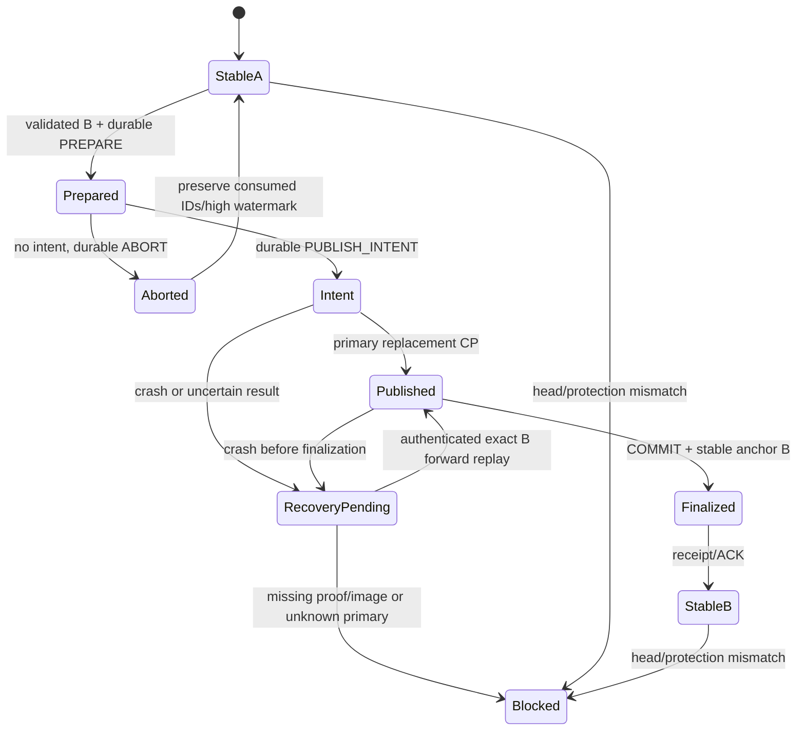

# E01.3.9.1 — Atomic Storage, Protected Head Anchor and Transaction Sequence

Статус: **DESIGN PROPOSAL — НЕ УТВЕРЖДЁН**. Дата: 2026-11-05.

Этот документ не разрешает реализацию storage, broker, journal, anchor,
authority evaluation или recovery. Рекомендации D1–D12 в конце требуют отдельного
решения владельца. A1–A14 и O1–O10 не пересматриваются.

## 1. Основание и границы

- Репозиторий: `olegale-ctrl/Story-Studio-RU-UA-WORK`.
- База: `feat/editorial-e01-3-8-6-schema2-migration`.
- Точный base SHA: `33b92d5af58426c01baf0cf283ef20b6f89f6bc5`.
- Ветка предложения: `docs/editorial-e01-3-9-1-atomic-storage-design`.
- Единственный добавляемый файл: этот документ.

Изучены E00/1 из нормативного коммита
`e520648411b99264688ff66dc61ad0e974201ed3`, утверждённые
`E01_3_7_3_APPROVED_CONTRACT.md`, `E01_3_8_1_APPROVED_CONTRACT.md`, существующие
schema-2 models/codec/attestation/integrity/migration, snapshot integrity,
approval consistency/history. Исполняемый код не создаётся и не меняется.

Сохраняются следующие границы:

1. E00: authoritative editorial state — один canonical JSON snapshot;
   snapshot commit point — замена primary; один writer на production;
   expected_generation, постоянный lock file, проверенный backup.
2. A1/A2: principal определяется OS adapter; права задаёт отдельная явная
   allow-list. Ни actor, ни наличие OS session не предоставляют все права.
3. A4: Ed25519 не обязателен для offline MVP. Внутренний storage MAC ниже —
   отдельный механизм защиты journal, не подпись ApprovalAuthorityEvidence.
4. A8–A10/O10: reconsideration, REVOKE и идемпотентность требуют проверенного
   контекста транзакций; UUID, timestamp и массив approvals его не заменяют.
5. A11: missing/unavailable/mismatched anchor блокирует effective authority,
   но не безопасное чтение и диагностику. Текущий snapshot не становится
   доверенным автоматически.
6. O5/O8: migration увеличивает generation один раз и не создаёт evidence.
   Исторические approvals не получают новых полномочий.

### 1.1 Три разных результата

| Результат | Что означает | Чего не означает |
|---|---|---|
| Snapshot integrity | Кодек, checksum, graph, hashes, rights bindings, evidence согласованы | Подлинность, доверенный head, authority |
| Verified storage head/order | OS-protected lineage связывает exact snapshot с подтверждённой транзакцией | Разрешение конкретному человеку принять решение |
| Effective editorial authority | Будущий evaluator проверил также principal, policy, session, declarations, историю и актуальность | Rights authorization, render/export/commercial readiness |

Предложение проектирует второй слой и границы его взаимодействия с остальными.
Никакой новый флаг в schema 2 не объявляет snapshot доверенным.

## 2. Рассмотренные варианты

### 2.1 Сравнение

| Критерий | A: JSON + файловый journal + внешний anchor | B: SQLite authoritative state + внешний anchor | C: JSON primary + SQLite metadata/journal + внешний anchor |
|---|---|---|---|
| Crash consistency | Явный WAL-протокол ниже; framing/replay надо доказать тестами | DB transaction защищает DB; связь с anchor требует отдельного протокола | DB упрощает metadata, но JSON/DB/anchor всё равно раздельны |
| Durability | Flush файлов и публикации; зависит от OS/накопителя | `synchronous=FULL` в WAL или обоснованный rollback mode; зависит от VFS/диска | Обе стратегии flushing плюс протокол внешних файлов |
| Multi-file atomicity | Не заявляется; pending intent + recovery | DB COMMIT не атомарен с отдельным anchor | SQLite COMMIT не атомарен с primary JSON и anchor |
| Windows | NTFS и service adapter, реальные Windows tests обязательны | SQLite поддерживает Windows, но ACL/service/anchor остаются задачей приложения | Windows SQLite и файловый adapter; больше состояний |
| Backup/restore | Exact snapshot + защищённый journal/checkpoint; старый backup не равен current head | Нужен согласованный DB backup, не копирование только main DB при активном WAL | Согласованный bundle из JSON, DB и anchor receipt |
| Rollback detection | Внешний anchor и authenticated chain; полная пара/система может быть откатана привилегированным противником | SQLite сам не обнаруживает восстановление старой корректной DB/anchor | Аналогично; SQLite metadata не внешняя монотонная опора |
| Complexity | Свой небольшой journal, replay и crash matrix; высокая цена доказательства корректности | Меньше собственного journal кода, но смена authority/layout и E00 commit point | SQL schema/migrations плюс тот же файловый commit/recovery |
| Testing | Framing, torn writes, порядок flush, rename, ACL, все переходы | DB failure injection плюс anchor/IPC/security tests | Все cross-file окна и SQLite lifecycle |
| Maintenance | Versioned storage envelope и ограниченный parser; без DB dependency | Версии SQLite/VFS, DB schema, migrations, WAL/checkpoint policy | Обслуживание двух форматов и согласованности их индексов |
| Portability | Общая state machine, отдельные native adapters | SQL переносим, security/durability adapters всё равно разные | Переносимая модель, больше платформенных поверхностей |
| Совместимость с E00 | Сохраняет authoritative JSON и commit point primary replacement | DB как authority вместо JSON потребовала бы отдельного изменения E00 | Может сохранить E00, если DB COMMIT не объявляется snapshot commit point |

SQLite WAL требует учёта `-wal`/`-shm`, checkpoint и backup semantics. Его
атомарность не распространяется на произвольный внешний JSON или anchor.
Свой файловый WAL также не получает таких гарантий только от названия WAL.

### 2.2 Рекомендация

Рекомендуется **A с отдельным Windows service broker**, а не библиотека,
пишущая anchor от имени интерактивного пользователя. Причины: сохраняются E00,
точные codec/integrity API и один authoritative JSON; путь от pure migration к
storage остаётся явным; защищённая последовательность не зависит от редактируемой
DB или дополнительных полей schema 2.

B не отклоняется как ненадёжная технология: для текущего проекта он меняет
утверждённый источник authoritative state и commit point. C — допустимая
альтернатива при отдельном согласовании; она уменьшает риск собственного
framing parser, но не устраняет основной cross-file протокол. Если последующая
проверка покажет, что собственный journal нельзя убедительно протестировать,
следует вернуться к C, а не ослаблять инварианты A ради простоты.

## 3. Trust boundary и Windows layout

### 3.1 Исполнитель

Предлагается локальная Windows service `StoryStudioBroker` под выделенной
service identity с service SID, без интерактивного входа. Не запускать весь CLI
как Administrator и не делать LocalSystem обязательной identity приложения.
Установка/первичное ACL provisioning требует администратора; обычная работа —
standard user без elevation, сети, GPU или облака.

Доверенная граница: OS, установленный broker и его binaries, service identity,
ACL-protected state, явно установленная policy. Приложение UI/CLI передаёт
типизированные команды; endpoint «сделать присланный JSON доверенным» отсутствует.
Подмена actor или principal_id в клиентском payload не заменяет OS principal.

Same-user directory ACL, hidden attribute, checksum, hash chain без секрета и
DPAPI сами по себе не защищают anchor от приложения, работающего под тем же
пользователем. Dedicated service — существенное требование рекомендуемого уровня
защиты, а не косметическая настройка каталога.

### 3.2 Конкретное расположение

`<P>` — canonical production UUID; `<E>` — отдельный storage epoch UUID;
`<S>` — storage transaction sequence, не timestamp.

```text
%ProgramFiles%\StoryStudio\
  broker\                         установленный доверенный broker, standard user без записи

%ProgramData%\StoryStudio\
  Projects\<P>\
    editorial.json                единственный authoritative editable-content snapshot
    editorial.json.bak            предыдущий проверенный snapshot, не доверенный head сам по себе
    .write.lock                   постоянный OS lock file, никогда не удаляется для unlock
    .pending\<E>-<S>.tmp          sibling temp для публикации на том же volume
  Protected\
    registry\<P>.json             регистрация production/path/file-system identity/epoch
    anchors\<P>.json              внешний authenticated stable/pending anchor
    journals\<P>\<E>\000001.log  защищённый framed transaction journal
    images\<P>\<E>\<full_hash>    проверенные immutable before/after images, не второе authority
    keys\<key_id>.protected        локальный storage MAC key, не в snapshot и не в export
    recovery\<P>\                 quarantined artifacts и явные recovery records
    policies\<policy_id>\<version>.json
                                  отдельная versioned authority/recovery allow-list
    policies\active.json          защищённый выбор policy, не editorial policy_version

%LOCALAPPDATA%\StoryStudio\
  drafts\                         пользовательские editable proposals/imports, не trusted head
  diagnostics\                    без секретов/полных review texts

<пользовательский выбранный каталог>\
  exports\ backups\               переносимые копии; происхождение и head не выводятся из пути
```

Editable-content primary редактируется поддерживаемыми командами broker.
Рекомендуется service-owned registered project directory: standard users имеют
чтение primary, но не запись в active primary, temp, backup и parent directories.
Произвольные пользовательские JSON drafts остаются редактируемыми и читаемыми,
но импортируются как предложения. Это решение о расположении/способе записи
требует согласования D1; оно не делает JSON источником identity или authority.

Если владелец требует raw user-writable primary в произвольном Documents folder,
такой файл можно читать/проверять, но нельзя обещать эту же защищённую запись:
неподконтрольные handles, memory mappings и reparse/parent replacement создают
TOCTOU. До отдельно проверенного adapter такой режим не выдаёт effective
authority. Второй «более доверенный JSON» вместо primary не вводится.

### 3.3 ACL и namespace

- Protected root, keys, journals, anchor и policy: explicit protected DACL;
  запись service SID и SYSTEM; административное обслуживание отдельно.
  Обычный reviewer не получает WRITE_DAC, WRITE_OWNER, DELETE или DELETE_CHILD.
- Service binaries и все ancestor directories защищены от standard-user write.
  Service SID не равен reviewer SID. Наличие Administrator в системе не делает
  каждый его обычный запрос разрешённым на любой gate.
- Не использовать унаследованные широкие ACL пользовательского каталога.
  Перед публикацией temp получает проверенный intended descriptor; replacement
  не должен случайно открыть запись в primary или закрыть доступ service.
- Registry привязывает production к machine/storage identity и проверенному
  local NTFS volume/path. Открывать и проверять native handles, file identity,
  final path и reparse status; отвергать junction/symlink/hard-link escapes,
  UNC, сетевые/синхронизируемые roots и разные volumes. Не полагаться на string
  prefix path check. Использовать только managed UUID-derived names.
- Отсутствие/изменение ожидаемых ACL или ownership означает
  `ANCHOR_UNAVAILABLE` с причиной `PROTECTION_INVALID`, а не предупреждение.

### 3.4 IPC и OS principal

Локальный named pipe имеет явный DACL, remote clients запрещены; client права
ограничены конкретными connect/read/write rights без создания pipe instances.
Broker использует first-instance protection, а client проверяет service endpoint.
На каждом запросе adapter извлекает TokenUser SID из OS-verified client token
с проверкой impersonation success; caller-supplied SID/username/env не принимается.
Impersonation всегда завершается RevertToSelf; privileged storage operations
выполняются в контролируемом service context после проверки policy.

Открытая OS session не доказывает человеческое понимание review. Malware или
скомпрометированная session разрешённого principal может посылать разрешённые
команды от его имени; против этого базовый offline MVP не обещает защиты.

## 4. Отдельный versioned storage envelope

Ни одно поле ниже не добавляется в schema 1/2. Это **предлагаемый**
`storage_protocol_version = 1`, требующий своего approved contract и golden
vectors до реализации. Не менять смысл snapshot_checksum или attestation_digest.

### 4.1 HeadState

| Поле | Предложенный смысл |
|---|---|
| `production_id`, `machine_binding_id`, `storage_epoch_id` | Production и явно созданная локальная lineage |
| `snapshot_schema_version`, `generation` | Exact snapshot version/generation |
| `snapshot_checksum` | Уже утверждённый checksum соответствующей schema |
| `canonical_file_sha256`, `canonical_file_length` | SHA-256 **полных** canonical bytes, включая snapshot_checksum; не заменяет его |
| `committed_tx_seq` | Последний committed storage snapshot transaction в epoch |
| `commit_record_index`, `commit_record_mac` | Проверяемая ссылка на journal commit/genesis |

Никакой timestamp не входит в ключ упорядочивания. Для registered writes
canonical file bytes обязательны; portable input сначала строго декодируется,
проверяется и явно принимается только отдельной процедурой import/genesis.

### 4.2 AnchorState

Anchor содержит version, production/machine/epoch, `stable_head`,
`reserved_tx_high_watermark`, authenticated journal tail `(index, mac)`,
`pending` или explicit null, `key_id`, `mac`.

`pending` содержит `tx_seq`, `request_id`, `review_session_id` или null для
не-review операций, command digest, exact old/new HeadState, prepared-image
reference, prepare record reference и phase `PREPARED`/`PUBLISH_INTENT`.
В stable head нельзя молча подставлять текущий primary при несовпадении.

Один atomically replaced anchor-файл содержит stable и pending одновременно;
два независимых файла stable/pending не считаются атомарной парой. MAC покрывает
все поля, кроме собственного `mac`, включая explicit null и journal tail.

### 4.3 Journal frames и аутентичность

Поток состоит из frames: fixed magic, version, bounded payload length,
canonical UTF-8 payload, fixed-size MAC. Предлагаемые пределы: metadata frame
до 1 MiB; full snapshot image отдельно, не более действующего snapshot limit.
Не принимать trailing garbage как новый record. Unknown version/fields,
неcanonical bytes, повтор sequence/index и неверная длина блокируют replay.

Каждый payload содержит `record_index`, `previous_record_mac`, identity epoch,
record type, transaction/request identity, exact before/after state и относящиеся
к типу поля. Записи `GENESIS`, `PREPARE`, `ABORT`, `PUBLISH_INTENT`,
`SNAPSHOT_COMMIT` и явные administrative recovery records имеют отдельные
closed schemas. Order задаётся authenticated record chain, не именем сегмента.

Рекомендуется HMAC-SHA-256 с независимыми domain prefixes для journal, anchor,
command и recovery metadata. Canonical JSON использует существующее точное
правило сериализации; integers без float, строки без normalization.
MAC не помещается в schema-2 signature fields и не выдаётся за Ed25519,
non-repudiation или proof of human review.

Секрет генерируется один раз будущим trusted provisioning adapter, защищается
service-only ACL; Windows DPAPI защищает его сохранённое представление на этой
машине. DPAPI machine scope не ограничивает доступ одному service без ACL.
Ключ не экспортируется с проектом и не хранится в пользовательском environment.
Не предполагается неподтверждённая non-exportable symmetric-key возможность
любого Windows KSP. Потеря/недоступность ключа блокирует проверку; новый ключ
не создаётся как автоматическое восстановление прежнего доверия.

### 4.4 Проверяемый transaction order

`record_index` — последовательность journal frames. `tx_seq` — независимая
последовательность **snapshot transactions**, резервируемая PREPARE; generation
увеличивается только при committed snapshot write. У abort возможны gaps в
`tx_seq`; номер принятой reservation никогда не используется повторно.
GENESIS использует committed sequence 0. Administrative metadata не притворяется
ApprovalRecord и не создаёт historical approval sequence.

Каждый SNAPSHOT_COMMIT связывает предыдущий head, новый head, request/command,
`tx_seq`, introduced revision/approval IDs и exact approval/evidence digests.
Для каждой новой approval пара `(approval_id, tx_seq)` уникальна; MVP-команда
решения добавляет ровно одну approval/evidence pair. Batch decisions с несколькими
новыми approvals одного exact key в одной транзакции до отдельного контракта
запрещены: array order не может заменять их ordering.

Protected replay строит индекс `approval_id → epoch, tx_seq, full record digest,
evidence digest, exact decision key`. Индекс восстанавливается из authenticated
chain, а не считается доверенным потому, что лежит рядом с snapshot. Проверяется
полное совпадение записей с текущим validated snapshot и append-only lineage.
Изменение/удаление старых approvals через «save snapshot» запрещено. Новые
decision commands обязаны атомарно добавить matching evidence по O8.

Imported/migrated pre-genesis approvals не получают выдуманные sequence values.
Их происхождение/порядок остаются непроверенными, даже если у schema-2 input
были format-valid signatures и digests.

## 5. Writer protocol и commit point

### 5.1 Предусловия и lock

Broker serializes writers per production. OS lock удерживается с reread primary,
anchor и journal до stable finalization либо фиксации unresolved состояния.
Постоянный `.write.lock` использует Windows msvcrt byte-range locking по E00;
native adapter обязан выбрать и протестировать ровно один совместимый lock
convention. Не смешивать flock/msvcrt/LockFileEx ranges без контракта. Process
death освобождает lock; удаление файла или «stale PID timeout» — не unlock.
Busy означает `LOCK_BUSY`, не force recovery. Malicious raw file writers не
считаются соблюдающими advisory lock; защиту дополняют service ACL и handles.

Под lock проверяются native path/ACL, strict integrity, stable anchor chain,
отсутствие pending, exact current HeadState и expected_generation. Head mismatch
не исправляется из caller JSON. Будущий service проверяет principal/policy,
current package, history и session по разрешённому command contract. Для retry
сначала lookup существующего request после аутентификации, потом generation
check для **нового** request; иначе потерянный ответ превратился бы в ложный CAS
conflict после уже выполненного коммита.

### 5.2 Три разных момента

1. **Intent barrier**: durable authenticated PUBLISH_INTENT. Операцию уже нельзя
   отменить или заменить другой: crash recovery может только завершить тот же B
   либо заблокироваться. Это ещё не snapshot commit point.
2. **Snapshot commit point CP**: замена primary `editorial.json` полными bytes B.
   Сохраняется E00. До этого primary A остаётся committed data; после этого B
   committed, даже если клиент не получил ответ.
3. **Finalization/ACK**: journal COMMIT и stable anchor B сохранены и перечитаны.
   Только после этого можно вернуть successful receipt. Это не переносит CP
   на anchor и не объявляет разные записи одной атомарной операцией.

Состояние между intent и finalization блокирует effective authority. Даже если
старый A читабелен, pending нельзя игнорировать и считать A безопасным current
head для новых решений.

### 5.3 Точная последовательность A → B

| Шаг | Действие под writer lock |
|---|---|
| W0 | Проверить предусловия; сохранить frozen canonical command и review context; построить B через pure APIs, generation A+1; validate B и round-trip |
| W1 | Сохранить exact A/B в protected content-addressed image archive; temp/write/flush, проверить длину и hash. Создать sibling `.pending/<E>-<S>.tmp` с B на volume primary; flush и reread |
| W2 | Проверенный A сохранить в backup temp и заменить `editorial.json.bak`; никогда не копировать corrupt primary поверх backup. Append/flush PREPARE с request binding, reserved S, heads и images |
| W3 | Заменить/flush anchor на stable A + pending PREPARED, high watermark S, journal PREPARE tail; reread/MAC проверить |
| W4 | Append/flush PUBLISH_INTENT; заменить/flush anchor на pending PUBLISH_INTENT с соответствующим journal tail. До завершения этого шага primary replacement запрещён |
| W5 — CP | Повторно проверить exact A/native identity и выполнить same-volume replacement sibling temp → primary B; не in-place rewrite |
| W6 | Открыть primary, проверить exact full hash/length/checksum/integrity B и flush опубликованный file handle. Не откатывать primary к A при ошибке после CP |
| W7 | Append/flush SNAPSHOT_COMMIT: request receipt, S, heads, newly introduced approval mapping и session consumption; reconcile только тот же transaction |
| W8 | Заменить/flush anchor на stable B, pending null, high watermark ≥S, journal COMMIT tail; reread и проверить primary/journal/anchor вместе |
| W9 | Освободить lock; вернуть сохранённый receipt. Удаление лишних temp допустимо после finalization, не является условием коммита |

До W4 разрешён детерминированный ABORT: primary не меняется, request/session
reservations остаются consumed tombstones, journal/anchor high watermark не
уменьшается. После появления authenticated PUBLISH_INTENT — только forward
recovery exact B; нельзя трактовать отсутствие ответа как отмену.

Запись valid PREPARE может стать видна в journal до обновления anchor. При
restart проверяется authenticated tail extension старого anchor, включая такой
PREPARE, а reservation не теряется. Удалять complete authenticated tail как
«мусор после anchor» запрещено.

### 5.4 Native replacement и durability

Файлы сначала записываются полностью, language/runtime buffers flush, затем
`FlushFileBuffers` на Windows или `fsync` на поддерживаемом POSIX adapter.
Archive, backup, journal и anchor имеют собственные flush barriers. Temp и
назначение replacement — один проверенный local volume. Cross-volume copy,
`MOVEFILE_COPY_ALLOWED`, deferred reboot move и overwrite-by-stream запрещены.

Предлагаемый Windows adapter использует same-volume `MoveFileExW` с replacement
и write-through options для операции типа `os.replace`, отдельно от уже
подготовленного backup. Его actual namespace/ACL/file-sharing semantics должны
быть подтверждены Windows acceptance tests. Не использовать
`ReplaceFileW(REPLACEFILE_WRITE_THROUGH)` как обещание durability: этот flag
документирован как unsupported. Не выводить гарантию сохранения имени из одного
только успешного flush temp.

Atomic namespace replacement и durable storage — разные свойства. На POSIX
проверенный adapter выполняет также parent-directory fsync. Windows не получает
универсальный эквивалент directory fsync по предположению: API/NTFS/controller
комбинация должна быть испытана. Ни вызов rename, ни write-through flag не
доказывает устойчивость к любому отказу питания/лживому write cache.

На ошибку native publication нельзя отвечать «точно не committed» только по
return code. Под тем же lock нужно reread: exact B означает CP произошёл;
exact A при intent — ещё не опубликовано либо потеряно при crash, но требуется
тот же forward B; missing/unknown/partial primary означает recovery blocked.
Логика никогда не выбирает иной B или A по mtime. Доверенное reread не является
автоматическим доверием произвольному файлу: принимаются только hashes из
authenticated pending transaction.

Гарантия MVP после будущих испытаний: процессный crash не создаёт логически
частичный successful commit; unresolved состояние явно блокирует authority.
Power-loss durability — условная гарантия при соблюдении flush semantics
OS/накопителем, с отдельной матрицей испытанных конфигураций. Против отката всего
диска/witness эта схема гарантии не даёт (§10).

## 6. State machine и crash matrix



В таблице «trusted» означает только storage head, никогда effective authority.
При pending даже криптографически valid old anchor недостаточен для current
authority. Во всех случаях можно безопасно показывать bounded decoded данные
и ошибки; никаких запусков media/URL или внешнего кода при диагностике.

| Остановка | Уже записано | Committed / uncommitted | Что читать | Recovery и доверие anchor | Безопасное повторение |
|---|---|---|---|---|---|
| До W0 / CAS failure | Stable A | A committed; B отсутствует | A, если exact anchor match | Не нужно; stable A проверяется | Новый request после корректного CAS; отказ не сохраняет decision |
| В W1, частичный temp/image | A, unreferenced partial files | Только A committed | A; temp не current | Orphans можно quarantine; не выбирать их как snapshot | Незавершённый, не bound request требует valid live session |
| После W1/backup, до полного PREPARE | A и valid images B/backup A | A committed; B uncommitted | A | Stable A; наличие image не означает accepted command | Не восстанавливать B по имени temp; новый valid request |
| Во время append PREPARE, anchor ещё старый | Полный или torn frame | A committed | A; journal только после проверки framing/MAC | Complete valid PREPARE нужно учесть и abort; torn unreferenced tail обрабатывается по §6.1 | IDs complete PREPARE consumed; иначе session после restart invalid |
| PREPARE durable, до/в W3 anchor update | PREPARE, A/B images, old/torn/new anchor | A committed; reserved S uncommitted | A labelled pending | Valid tail extension → ABORT до intent; damaged/missing anchor не реконструировать автоматически | Идентичный request получает ABORTED_PRECOMMIT либо pending, не новую decision |
| W3 complete, до intent | Anchor pending PREPARED | A committed; S reserved | A labelled pending | Durable ABORT и high watermark; до этого authority blocked | Старые request/session не использовать для нового review |
| Полный intent в journal, anchor ещё PREPARED | Authenticated intent, B image | A пока committed; B обязательно завершить | A labelled pending | Нельзя abort: полный intent уже barrier. Довести anchor pending и forward B | Только тот же request/B; не новое generation |
| W4 complete, до W5 | Intent и pending anchor | A committed; B uncommitted до CP | A labelled pending | Проверить proof/images и выполнить W5–W8 exact B | Safe forward replay; API pending, не окончательный failure |
| В W5 / native error | Primary может быть A, B либо недоступен | CP зависит от actual namespace publication; не от ответа API | Exact A/B только с pending label | B → finalize; A → forward B; unknown/missing → blocked explicit recovery | Никогда не повторять команду как новое решение |
| После CP, до W6 flush / после power loss | B либо переупорядоченные persisted artifacts | B логически committed при CP; durability не доказана | B если exact; A не принимать как rollback | Pending intent требует восстановить exact B; неверные доказательства блокируют | Та же транзакция, без второго event/approval/generation |
| W6 complete, до/во время COMMIT append | Exact B, valid/torn commit tail | B committed; receipt ещё не finalized | B labelled finalization pending | Reconcile один COMMIT, затем anchor; torn tail только по §6.1 | Request pending/committed, не повторная запись |
| COMMIT durable, anchor ещё pending | B и valid COMMIT | B committed | B, но authority blocked до согласованного anchor | Проверить linked chain и finalization exact B | Возобновить W8, вернуть сохранённый receipt |
| В W8 anchor replacement | B/COMMIT и old/new/torn anchor | B committed | B для inspection | Valid pending → finalize; damaged/missing → ANCHOR_UNAVAILABLE/MISSING, explicit recovery | Не создавать anchor из одного B |
| После W8, до ACK / потерян ответ | Stable B, COMMIT receipt | B committed | B после полного cross-check | Stable B trusted storage head | Идентичный retry возвращает прежний receipt |
| После ACK, при temp cleanup | Stable B плюс лишние temps | B committed | B | Cleanup не меняет head/ledger | Повтор — тот же receipt; cleanup можно повторить |
| Stable primary изменён на C/старый backup | Valid anchor B, primary не B | B recorded committed; C не trusted | C только как untrusted inspection; archive B отдельно | ANCHOR_MISMATCH; никакого автоматического принятия C | Только explicit repair exact B либо approved recovery procedure |
| Повреждён/удалён protected state | Нет проверяемого anchor/chain/key | Нельзя установить current trusted commit | Snapshot read-only с диагностикой | MISSING/UNAVAILABLE/MISMATCH; не восстановление по max generation | Новые writes/authority blocked; отдельная recovery permission |

### 6.1 Правила replay

На restart сначала проверяются protection, anchor MAC и chain prefix; затем
только contiguous authenticated extension с допустимыми state transitions.
Сегменты не сканируются в поиске «самого нового по имени/времени».

- PREPARE без какого-либо полного authenticated intent → явный ABORT record,
  consumed IDs, сохранение high watermark, стабильный A после проверки.
- Любой полный authenticated intent → forward-only B. Даже если primary снова
  A, нельзя отличить crash до CP от последующей подмены A; оба случая решаются
  восстановлением **того же B**, а не забыванием операции.
- Изменённый C, отсутствующий authenticated B image, неверная chain или anchor
  не дают права перезаписать пользовательские данные. Состояние blocked,
  артефакты сохраняются для explicit recovery.
- Torn trailing frame можно удалить только если anchor не ссылается на него,
  весь подтверждённый prefix валиден, и независимые pending/head proofs
  однозначно допускают это действие. Полный frame с неверным MAC или missing
  frame, на который ссылается anchor, — corruption, не benign tail.
- Replay идемпотентен по epoch/tx_seq/request/heads: повтор не выделяет новый
  ApprovalRecord UUID, event, session, request или generation.
- Механическая finalization previously authenticated intent — не first trust
  establishment. Она не создаёт anchor, если anchor отсутствует/повреждён, и
  не принимает неизвестный snapshot как head.

## 7. Latest applicable target и REVOKE barrier

Будущий evaluator сначала требует stable matching head, complete authenticated
sequence и существующие integrity/consistency/history проверки. Только затем
он читает immutable approval order index из проверенного journal replay.

Для exact key `(gate, editorial policy_version, full object_ref,
dependency_digest)` latest applicable означает максимальный **verified tx_seq**
с соответствующей recorded decision в текущей lineage. Не максимальный UUID,
timestamp, generation без journal binding или индекс approval в JSON.

Для нового APPROVE:

1. Under lock определить последнюю применимую decision по verified order.
2. REJECT/REVISE/REVOKE target должен совпадать с явным reconsideration link,
   иметь тот же exact key и быть до новой transaction sequence.
3. Требовать новую review session, полный набор declarations, current integrity,
   explicit principal/policy permissions; REVOKE grant проверять отдельно.
4. После committed REVOKE старый APPROVE не возрождается через active refs,
   пересчёт checksum, старый backup или повтор старого request.
5. Поддерживать existing A6 diagnostics. Conflicting same-time history не
   «исправляется» выбором UUID или перестановкой массива. Допустимая verified
   transaction последовательность и правила снятия исторической ambiguity
   требуют отдельного authority contract; до него ambiguity блокирует authority.

Journal подтверждает последовательность поддерживаемых операций от genesis,
а не реконструирует прошлое imported snapshot. Если latest target зависит от
pre-genesis legacy negatives или непроверенной foreign sequence, результат
остаётся `UNVERIFIED_ORDERING`/`LEGACY_ORDER_UNVERIFIED`. Нельзя присвоить старым
записям порядок по JSON ради получения нового effective APPROVE. Для такого
exact key требуется отдельно утверждённое разрешение legacy-order ситуации;
административная кнопка «доверять всем approvals» запрещена.

Fresh review другого exact content key допустим только по обычному approved
workflow, не путём стирания history/REVOKE или подмены policy version. Этот
документ не вводит authority evaluator и не ослабляет существующие блокировки.

## 8. Request ID и review-session lifecycle

### 8.1 Предлагаемый command identity

Versioned command envelope отдельно от schema 2 фиксирует operation, production,
epoch, request ID, review-session ID, authenticated principal, exact key,
authority policy ID/version, expected generation/head, decision/reason,
ordered confirmed codes и значения, определяющие создаваемую запись.
Canonical digest не включает transport connection/attempt number или новое
время retry; не нормализует текст. Server-supplied record/event IDs и descriptive
time фиксируются один раз при acceptance и сохраняются в PREPARE. Конкретный
command schema утверждается отдельным этапом, не появляется скрыто в codec.

Lookup key: `(production_id, storage_epoch_id, request_id)`; одинаковый ID с
другим principal/session/содержимым — conflict/denied, а не новый request.
Receipt lookup не раскрывает данные неавторизованному principal. Повтор после
изменения policy может вернуть исторический receipt разрешённому читателю,
но не создаёт новую decision и не подтверждает её current effective authority.

### 8.2 Полный жизненный цикл

```text
OS-authenticated connection
  → OPEN session (one principal, policy, exact key, process incarnation)
  → explicit confirmations of every required declaration
  → READY + current revalidation under lock
  → durable PREPARE binds request/session/content and consumes reservation
  → PREPARED → ABORTED_PRECOMMIT
          or → PUBLISH_INTENT → PRIMARY_COMMITTED → FINALIZED(receipt)
```

Unbound sessions могут оставаться in-memory: после restart они invalid и
требуют reauthentication/new review; client не восстанавливает confirmations
из собственных claims. Durable PREPARE сохраняет exact confirmation context
уже принятой операции и session/request consumption. Одна review session не
используется для другого key или второго request; aborted reservations также
не освобождают IDs для переприсвоения.

Wall clock не доказывает порядок или пригодность session. Для текущего процесса
возможна monotonic timeout policy; после restart unbound sessions прекращаются.
Durable intent завершается как уже принятая exact transaction, а не как новый
review с искусственно продлённой session. Новые policy decisions и recovery
действия требуют отдельного актуального допуска.

| Ситуация | Ответ/следствие |
|---|---|
| До durable PREPARE, процесс пропал | Ничего не committed; прежняя unbound session после restart invalid; новый review/new IDs |
| PREPARE есть, intent нет | Recovery записывает ABORTED_PRECOMMIT; идентичный retry получает прежний terminal abort, а не новую approval |
| Intent есть, primary ещё A | PENDING_RECOVERY; завершить тот же B, нельзя отменить/повторно сгенерировать запись |
| CP прошёл, ответ потерян | По protected ledger найти transaction, завершить finalization и вернуть сохранённый receipt |
| FINALIZED, тот же canonical request | Возвратить существующие IDs/heads/receipt без generation/event изменений |
| Тот же request ID, другое содержание/session | IDEMPOTENCY_CONFLICT; старые данные не менять |
| Старый pre-REVOKE session/request | Receipt старой операции не действует как новый APPROVE; новая попытка требует новой session и latest-target checks |

Ledger/tombstones не очищаются по текущему времени или «давности». MVP replay
восстанавливает их из retained authenticated journal. Compaction должна
сохранять exact lookup semantics и требует отдельного approved checkpoint
формата. Произвольное удаление старых request IDs нарушило бы A10.

## 9. Initialization, import, transfer и recovery

Эти процедуры различаются и не вызываются автоматически по ошибке anchor.
В каждой нужен authenticated principal с явным recovery/initialize permission;
обычная gate APPROVE permission этого права не подразумевает.

| Процедура | Проверки и результат | Что запрещено |
|---|---|---|
| First-time new production | Installer provisioned explicit policy; authenticated initializer проверяет draft, UUID, canonical checksum; создаётся GENESIS epoch с seq 0 и matching anchor | Автоматически доверять любому найденному editorial.json; выдать инициатору все gate grants |
| Import schema 1 | Strict decode + full integrity; сохранить исходные bytes для диагностики; explicit genesis capture без historical order; migration затем отдельной storage transaction вызывает existing pure API | Создать evidence/sequence старым approvals или считать migration trust initialization |
| Import schema 2 | Strict schema-2 integrity; показать legacy/unverified evidence/history; explicit new local epoch binds exact state, не удостоверяет прошлые решения | Принять foreign principal/signature-shaped fields как identity; переносить effective authority по одному JSON |
| Migration registered schema 1 | Under same lock/expected head вызвать pure migration с authenticated-service descriptive metadata; generation +1; empty evidence; записать через W0–W9 | Менять pure API, ещё раз увеличить generation в writer, создать anchor из отсутствующего |
| Transfer на другой ПК | Source consistent export/checkpoint manifest; destination independently authenticates recovery principal, validates bytes, creates **new machine-bound epoch** and explicit local policy mapping | Экспортировать MAC key, автоматически доверять source SID/anchor или сохранять verified foreign order без отдельной cross-machine proof scheme |
| Restore exact current head | Проверить current protected anchor/chain, найти exact image по anchored full hash; явно разрешённый repair восстанавливает те же bytes и sequence | Подбирать backup по mtime/max generation; считать checksum равным proof of current head |
| Restore более старого backup при живом current lineage | Показать old/current heads; это content proposal на текущем head с новой generation/transaction, сохранением всей decision/revocation history; валидация и свежий review при необходимости | Заменить primary старой generation и «отмотать» anchor/ledger; удалить REVOKE, чтобы оживить APPROVE |
| Crash с valid pending proof | Механический ABORT до intent или exact forward completion после intent по §6; никаких новых permissions | Автоматически принять unknown primary; восстановить отсутствующий anchor по одному journal/snapshot |
| Administrative trust recovery при потере trusted store | Сохранить forensic копии; отдельная recovery-authorized процедура показывает неопределённость, backup generations, history и последствия; explicit new epoch, отдельный authenticated recovery record/receipt | Называть прежний order доказанным, стереть revocation barrier, silently make approvals effective |

### 9.1 Genesis и cross-machine proof

GENESIS фиксирует сознательно принятый baseline, не доказывает исходное
авторство, происхождение legacy records или правомерность прошлых решений.
Полноценная activation GENESIS проходит такой же recoverable intent/publication
процесс в registry/anchor namespace: статус `INITIALIZING` блокирует authority;
если anchor отсутствует после сбоя, продолжение требует исходного initialize
authorization, а не автоматического trust current snapshot.

Для bootstrap нет фиктивного stable A: только в состоянии `INITIALIZING`
`stable_head` допускает null. Последовательность отдельной initialize операции:
проверить explicit permission/подтверждение baseline → сохранить authenticated
registry intent с exact input hash, новым epoch и initialize request ID →
сохранить проверенный genesis image/journal и anchor с pending GENESIS →
опубликовать canonical primary в ранее неактивном managed project directory →
записать GENESIS receipt и stable anchor seq 0 → отметить registry ACTIVE.
До последнего cross-check authority недоступна. Первый data publication имеет
точку видимости rename primary; ACTIVE — только окончание trust activation.
Новый genesis сам по себе не увеличивает supplied generation и не меняет
approvals; subsequent migration увеличивает её отдельной транзакцией.

Crash INITIALIZING не разрешает отыскать «подходящий» JSON: continuation
проверяет тот же initialize authorization и exact pinned genesis image.
ACTIVE registry с отсутствующим anchor — ANCHOR_MISSING, а не новый bootstrap.
Если authorization/proof утрачены, нужен отдельный administrative recovery.
Повтор initialize request возвращает тот же receipt/epoch, не создаёт новый
baseline. Fault matrix для этой операции дополнительно проверяет каждый
registry/anchor transition, включая отсутствие primary и потерянный ACK.

Machine-local HMAC нельзя проверить на другой машине без передачи секрета,
которую это предложение запрещает. Переносимый bundle поэтому не называется
authenticated transfer только из-за manifest checksum. По умолчанию transfer —
explicit new local baseline с непроверенной pre-genesis authority history.
Optional future signed transfer receipts потребуют отдельно доверенных ключей,
revocation и mapping principal/policy; A4 не превращается в обязательную
Ed25519-подпись всех approvals.

### 9.2 Retention и backups

Backup `editorial.json.bak` — восстановимая data copy, не anchor. Каждая новая
публикация сохраняет проверенный A до CP; protected archive содержит pending B,
текущий stable image и в предлагаемом MVP все committed afterimages. Names по
full hashes, не времени; journal хранит связи между ними. Archive — evidence и
repair replica; авторитетное current content остаётся primary, сопоставленное
с внешним protected head.

MVP не удаляет journal, request tombstones или approval-order proofs.
Для обычного ПК необходимы настраиваемые quotas/предупреждения: 1,000 полных
32 MiB snapshots могут потребовать около 32 GiB до накладных расходов. При
нехватке места отказать до intent; после intent сохранять pending и блокировать
новые операции, пока нельзя безопасно завершить, а не перезаписывать историю.
Автоматическая pruning/compaction не подразумевается. Будущий checkpoint
потребует полной protected order/idempotency map, chain binding и отдельно
утверждённой процедуры удаления images/segments.

Consistent backup bundle создаётся under writer lock из stable head, snapshot,
нужного journal/checkpoint prefix и protection-independent manifest. Секреты не
попадают в обычный export. Защищённый disaster-recovery backup keys/state —
отдельная административная политика; наличие такой копии не устраняет риск
полного rollback и не разрешает автоматический restore старой epoch.

## 10. Threat model и остаточные риски

| Угроза | Предлагаемая защита | Граница/остаток |
|---|---|---|
| Случайная corruption | Existing integrity + full image hash + journal/anchor MAC, bounded parser | Нет автоматического исправления corrupt bytes |
| Concurrent cooperating writers | OS lock, broker serialization, expected_generation/head CAS | PID/mtime не lock; неподдерживаемые raw writers не получают grant |
| Прерванная запись | Prepared images, authenticated intent, exact recovery state machine | После CP может требоваться finalization; ACK не выдаётся раньше |
| Rollback только snapshot/backup | Anchor head/sequence и journal binding не совпадут | Hash/checksum старой копии сам по себе может быть корректен |
| Подмена snapshot с пересчитанными digest/checksum | Full head hash, protected lineage и command invariants | Integrity без anchor всё ещё не аутентификация |
| Подмена/перестановка journal | Service ACL, HMAC chain, index и anchor tail | Compromised service/key способен создавать достоверные на вид records |
| Truncation journal | Anchor tail/pending и retained proofs выявляют отсутствие committed prefix | Нельзя считать любой tail benign; full rollback всей protected state отдельно |
| Удаление anchor | ANCHOR_MISSING; safe inspection, authority blocked | Не восстанавливать автоматически даже при valid snapshot/journal |
| Недоступный/повреждённый anchor/key/ACL | ANCHOR_UNAVAILABLE с точной причиной | Никакого fallback grant или новой auto-generated identity/key |
| Старый согласованный bundle snapshot+journal без current anchor | ANCHOR_MISMATCH/current registry binding | Cross-machine clone также не имеет исходного локального key/protection |
| Изменение часов | Sequence задаётся проверенным журналом; timestamps descriptive | Нет trusted wall-clock, audit time может быть неверным |
| Пользователь без service-write прав | Нет прямой записи ключа/anchor/policy; typed commands + explicit permissions | Его разрешённая OS session всё равно может быть использована malware |
| Administrator/полный OS compromise | Ограничения явно сообщаются | Administrator может take ownership, заменить binary, получить секрет или восстановить диск |
| Полная клонированная пара snapshot+anchor+полный protected store/keys/OS | Локальных достаточных средств обнаружения нет | Аутентичные старые MAC/chain также откатаны; нужен внешний monotonic witness/TPM protocol/independent evidence |

Ни `%ProgramData%`, ни DPAPI, ни HMAC не создают абсолютную anti-rollback память.
Если привилегированный противник восстанавливает **всю** пару и локальную
защищённую среду согласованно, локальный verifier не может отличить её от прежней
легитимной машины. Machine binding полезен против случайного переноса/частичной
подмены, но не против полного system image restore с секретами и registry.

TPM-backed monotonic storage или offline внешний witness можно проектировать
позже. Обязательного TPM, cloud account, интернета, NVIDIA или другого GPU это
предложение не вводит. Новая внешняя опора потребует собственного threat model,
доступности, backup и recovery contract.

### 10.1 Диагностика anchor

| Код | Условие | Поведение |
|---|---|---|
| ANCHOR_MISSING | Ожидаемый зарегистрированный anchor отсутствует | Read-only inspection; никакой auto-init |
| ANCHOR_UNAVAILABLE | Доступ, key, MAC/format/protection или adapter не позволяют проверить anchor | Fail-closed, конкретная nested reason/path |
| ANCHOR_MISMATCH | Проверенный anchor не соответствует production/epoch/head/journal binding | Fail-closed, показать сравниваемые IDs/hashes без секретов |
| TRANSACTION_PENDING / RECOVERY_REQUIRED | Valid proof, но процесс не достиг stable finalization | Inspection; никакого effective authority; exact recovery по протоколу |

Отдельные codes для `LOCK_BUSY`, `EXPECTED_GENERATION_MISMATCH`,
`IDEMPOTENCY_CONFLICT`, `JOURNAL_CORRUPT`, `IMAGE_MISSING`, `DISK_FULL`,
`REPLACE_FAILED` не скрываются общим INVALID_SNAPSHOT. Receipt успешной прошлой
транзакции и current authority evaluation — разные ответы.

## 11. Platform adapters и интеграция

### 11.1 Проектируемые interfaces, без реализации

| Interface | Минимальный контракт |
|---|---|
| PrincipalAdapter | Authenticated local connection → canonical principal ID/display; unavailable fail-closed |
| ProtectionAdapter | Provision только explicit initializer; проверить ACL/owner/namespace/key; не создавать trust при read failure |
| WriterLockAdapter | Постоянный lock file, acquire/release, LOCK_BUSY, process-death semantics |
| DurableFileAdapter | Bounded exact read, write-new temp, flush, same-volume replacement, reread identity, platform durability report |
| JournalAdapter | Strict framing/MAC chain, append/flush, verified prefix/tail, deterministic replay; no silent truncation |
| AnchorAdapter | Read/verify stable+pending; atomic-replace одного anchor; unavailable/missing/mismatch distinct |
| StorageCoordinator | Единственная реализация W0–W9/replay/CAS, immutable receipts, no authority defaults |
| PolicyProvider | Protected exact policy versions и permissions, независимо от editorial policy_version |

Coordinator принимает только resolved typed command/proposal после будущих
service validators. Эти interfaces — specification outline, не добавленные
Python API и не разрешение обойти pending будущими convenience save functions.

### 11.2 Windows и будущие POSIX adapters

Основная цель — Windows 10/11, local NTFS, обычный offline Intel-PC. Не считать
сетевые shares, OneDrive-synced directories, FAT/exFAT или removable volumes
поддержанными authoritative roots. Открытые handles/антивирус/backup software
могут дать sharing violation; не force delete, не менять ACL ради обхода.

На Linux/macOS будущий broker должен использовать отдельную service identity,
защищённые parent directories, native peer credentials и key storage; daemon
того же UID не даёт автоматически нужной изоляции. `flock`, same-filesystem
rename, file и directory fsync — кандидаты для POSIX adapter. Peer-credential,
ACL, symlink handling и macOS durability отличаются и требуют отдельных tests.
Проект не заявляет готовность этих платформ по результатам Linux unit tests
чистых моделей. Windows acceptance также не объявляется пройденным этим design.

### 11.3 Существующие модули остаются неизменными

- Schema-1 и versioned codec отвечают за прежние wire contracts. Storage envelope
  не попадает в editorial JSON и не расширяет Event action vocabulary.
- Schema-2 integrity остаётся pure API с `UNVERIFIED_ORDERING`; future storage
  verifier выдаёт **отдельный** proof/result, а не изменяет её значение задним
  числом или добавляет boolean в snapshot.
- Pure migration сохраняет свой API. Broker обеспечивает origin actor/at/id,
  проверяет external head и публикует ровно generation, которую вернула migration.
  ALREADY_MIGRATED не означает trusted/valid; no-op не создаёт storage write.
- Approval attestation bytes и excluded signature fields неизменны. Storage MAC
  и command digest имеют собственные namespaces и не подменяют их.
- Existing approval history/consistency сохраняют semantics. Future authority
  composition получает verified order отдельно и не переписывает old decisions,
  не выбирает UUID для ambiguity и не выдаёт readiness.
- Initial import и administrative recovery records находятся в новом versioned
  journal, а не маскируются существующим Event action. Если понадобится новое
  snapshot Event action, нужен отдельный approved wire change; здесь его нет.

## 12. Инварианты безопасности

1. Ни один effective decision не выводится из checksum/actor/status/UUID.
2. Нет ordinary write без stable matching anchor и expected head CAS.
3. Ни old stable head, ни integrity pass не обходят pending transaction.
4. До authenticated intent primary не меняется; после intent нельзя abort B.
5. CP — primary replacement, а не PREPARE, DB COMMIT или ACK.
6. После CP нет silent rollback к A; ошибка ответа не создаёт вторую decision.
7. Snapshot, journal и anchor не считаются атомарной файловой группой.
8. Только exact authenticated A/B hashes допускаются при механическом replay.
9. Complete authenticated tail не удаляется из-за старого anchor pointer.
10. Request/session reservations и tx sequence не переиспользуются после abort.
11. Sequence не выводится из timestamp, UUID, filename, mtime или array position.
12. Старые approvals/revisions неизменны; новый decision имеет matching evidence.
13. REVOKE barrier не исчезает при backup restore, ref selection или retry.
14. Imported/legacy records не получают синтетического evidence/order/trust.
15. Missing/unavailable/mismatch anchor никогда не вызывает automatic trust.
16. Recovery/initialize permission отдельно от gate approval permissions.
17. Local service protection не обещает устойчивость к administrator/OS compromise.
18. Ни успешный storage commit, ни recovery не означают rights/readiness grant.

## 13. Fault-injection и Windows acceptance plan

Тесты сейчас не создаются: executable implementation отсутствует. После approval
каждый persistent boundary W1–W9 должен иметь fault-injection hooks до/после
write, flush, replacement и acknowledgement. Проверять actual files, а не только
mock последовательность вызовов.

### 13.1 Протокол

- Kill writer/process на каждой строке crash matrix, затем повторный restart
  во время самого replay. Assert exact A/B, no extra generation/event/approval,
  один receipt, immutable old history, fail-closed unresolved cases.
- Partial/zero-length writes, torn frames/anchor, lost tail, reorder of durable
  writes, disk-full на каждом target, flush failure, native error after rename.
- Primary A/B/C/missing + stable/PREPARED/INTENT anchor + present/missing/corrupt
  images/journal: исчерпывающая таблица allowed/blocked transitions.
- Duplicate/out-of-order frames, forged MAC, segment truncation, replay old
  valid segment, wrong epoch/key/production, missing committed prefix.
- Два writers на одинаковом и разных production, CAS race, dead process с
  существующим lock file; no stale-PID unlock и no inode replacement.
- Lost ACK и reconnect retry, conflicting content/session/principal, aborted
  ID reuse, policy change between retry and receipt lookup, session restart.
- REJECT/REVISE/REVOKE → fresh review → APPROVE, stale target, pre-REVOKE session,
  legacy-order gap, conflicting same-time history; никаких случайных grants.

### 13.2 Реальные Windows 10/11 проверки

Standard reviewer, другой standard user, service account, UAC filtered token,
elevated administrator и service stopped/uninstalled состояния проверяются
отдельно. Проверить TokenUser SID provenance, named pipe impersonation failure,
remote/anonymous connection denial, pipe-instance spoof attempt, service endpoint
identity, ACL inheritance/ownership changes и отсутствие service-key access у UI.

На local NTFS проверить Unicode/длинные пути, locked primary, antivirus/indexer
handles, backup readers, junction/symlink/hardlink escape, registered volume
changes, temp/primary DACL после replacement, writer lock process death,
Windows service restart и reboot. SMB/OneDrive/exFAT должны отклоняться явно.

Process kill tests не называются power-loss tests. Для durability отдельно
нужны VM hard-reset tests с фиксацией write-order faults и испытания реального
накопителя/контроллера с внезапным питанием; документировать Windows build,
filesystem, cache/flush configuration и observed guarantees. Отказ/потеря
доказательств после reboot должен давать blocked diagnostic, а не auto-trust.

### 13.3 Проверка границы угроз

Отдельно продемонстрировать: rollback только primary обнаруживается; rollback
journal при current anchor обнаруживается; удаление anchor блокирует authority;
копия на другой ПК не активирует foreign order. Полное восстановление согласованного
system image показать как **необнаружимый в этой модели остаточный риск**, а не
провал теста, который скрывается workaround с текущим timestamp.

## 14. Предлагаемые этапы после утверждения

| Этап | Проверяемый результат | Что ещё не включается |
|---|---|---|
| S1: approved storage/command boundary contracts | Closed v1 frame/head/anchor/receipt schemas, canonical/MAC domains, transition tables, owner D decisions | Файловые writes, authority grants |
| S2: pure transaction/replay model | Golden vectors, deterministic state machine, journal proofs/order/idempotency logic | Windows service, реальные файлы |
| S3: Windows protection/locking adapters | ACL/namespace/IPC principal tests, key lifecycle, stable lock semantics | Effective approval evaluator |
| S4: file/journal/anchor adapters | Bounded IO, native replacement, flush results, crash/fault matrix | Arbitrary save/auto-recovery shortcuts |
| S5: coordinator + migration publication | W0–W9, exact pending replay, expected generation, no-op semantics | Decision command permissions по умолчанию |
| S6: explicit initialize/transfer/restore | Authorized procedures, diagnostic UI/CLI contract, forensic preservation | Automatic trust or legacy-order manufacture |
| S7: authority/review/write integration | Отдельно утверждённые principal/policy/session rules и append-only pairs | Production readiness/rights authorization |
| S8: platform/security audit | Actual Windows matrix, power-loss limits, operator documentation | Непроверенные Linux/macOS promises |

Каждый этап — отдельное задание, review и решение владельца. Это не разрешение
выполнить весь список подряд. До S1 нельзя начинать storage implementation.

## 15. Проверка этого документа

Это design-only изменение. Unit/runtime tests не запускались и не заявляются:
нового исполняемого кода нет. Проверяются единственный добавленный файл,
`git diff --check`, `git diff --cached --check`, опубликованный diff относительно
точной базы, совпадение local/remote SHA и clean working tree после публикации.
Коммит и ссылка на этот документ передаются в итоговом сообщении.

## 16. Справочные platform sources

Источники использованы для уточнения ограничений, а не как доказательство
готовности предложенного adapter:

- [Windows MoveFileExW](https://learn.microsoft.com/en-us/windows/win32/api/winbase/nf-winbase-movefileexw): replacement/write-through options и ограничения move.
- [Windows ReplaceFileW](https://learn.microsoft.com/en-us/windows/win32/api/winbase/nf-winbase-replacefilew): backup/replacement semantics; unsupported WRITE_THROUGH flag.
- [FlushFileBuffers](https://learn.microsoft.com/en-us/windows/win32/api/fileapi/nf-fileapi-flushfilebuffers): explicit buffer flush, не обещание общей multi-file atomicity.
- [SERVICE_SID_INFO](https://learn.microsoft.com/en-us/windows/win32/api/winsvc/ns-winsvc-service_sid_info): service SID в Windows security model.
- [Named Pipe Security](https://learn.microsoft.com/en-us/windows/win32/ipc/named-pipe-security-and-access-rights) и [client impersonation](https://learn.microsoft.com/en-us/windows/win32/ipc/impersonating-a-named-pipe-client): явные access rights и происхождение client token.
- [SQLite atomic commit](https://sqlite.org/atomiccommit.html), [WAL](https://sqlite.org/wal.html), [synchronous](https://sqlite.org/pragma.html#pragma_synchronous): границы DB transactions, syncing и зависимости от OS/storage.

## 17. Решения владельцу — рекомендации не утверждены

Рекомендуемый вариант — **A: authoritative JSON, protected authenticated journal
и внешний anchor, записываемые отдельным локальным Windows broker**. Основные
угрозы — cross-file crash windows, same-user доступ к protected state, rollback
и потеря доказательств sequence. Цена решения — установка service, Windows ACL/
IPC/adapters, собственный bounded journal/replay и существенный fault-injection
план. Простота JSON не означает простоту безопасного storage.

B не рекомендуется без пересмотра E00; C остаётся серьёзной альтернативой при
высокой стоимости доказательства собственного journal. Ни один вариант не
защищает от полного administrator-controlled system rollback только благодаря
transaction/checksum механизмам.

| ID / вопрос | Рекомендуемый вариант | Последствия альтернативы |
|---|---|---|
| D1: граница защиты и active project location | Выделенный service SID, protected ProgramData managed root, edits через broker; arbitrary drafts отдельно | Same-user writable root/anchor не даёт заявленной защиты; допускается inspection-only режим без effective authority |
| D2: storage engine | A с E00 primary replacement CP; approve exact protocol перед реализацией | B требует отдельного пересмотра authoritative layout; C сохраняет CP, но добавляет DB lifecycle и cross-file coordination |
| D3: local journal authenticity | Service-only key, domain-separated HMAC, DPAPI + ACL; без обязательного Ed25519 | ACL-only слабее при copied/tampered artifacts; обязательные asymmetric signatures требуют нового key registry/lifecycle и не устраняют full rollback |
| D4: recovery после intent | Forward-only exact previously authenticated B; pending блокирует новые операции до finalization | Полностью manual recovery безопасен, но требует оператора после каждого такого crash; abort после intent нарушил бы rollback/idempotency guarantees и не предлагается |
| D5: imported legacy order gaps | Не создавать historical sequence; fail-closed для зависимого same-key reconsideration до отдельного контракта | Выбор timestamp/array order запрещён O10; сохранение удобства требует отдельно спроектированного legitimate legacy-resolution workflow |
| D6: перенос на другой ПК | Explicit new machine-bound baseline, foreign history unverified, no MAC-key export | Сохранение verified foreign authority требует separately trusted signed transfer scheme и policy/principal mapping; checksum bundle недостаточен |
| D7: backup/retention | Retain journal/tombstones и committed images в MVP, quotas и disk-full отказ; compaction позже отдельным форматом | Ограничение диска требует более сложного authenticated checkpoint/index и доказательства, что idempotency/REVOKE не потеряны |
| D8: durability claim | Испытанная process-crash safety; условная Windows power-loss durability с явной hardware boundary | Абсолютный anti-rollback/power-loss claim без внешнего witness/hardware нельзя принять; обязательный TPM/внешняя опора расширяет MVP |
| D9: bootstrap permissions | Installer/owner явно назначает initialize/recovery permissions; ни одного default all-gate grant | Без административной установки можно оставить safe draft mode; OS login не становится default authority |
| D10: v1 transaction schemas | Утвердить отдельно head/anchor/journal/receipt/command schemas и MAC domains до кода | Нельзя скрыто добавить transaction_seq в schema 2 или использовать существующие hashes в новом смысле |
| D11: время и sessions | Unbound sessions invalid после restart; accepted durable intent завершается exact replay; sequence независимо от часов | Resumable unbound sessions/долговременные expiry потребуют отдельного защищённого session lifecycle, не wall-clock предположения |
| D12: подтверждение Windows scope | Windows 10/11 + local NTFS + ordinary offline Intel-PC; Linux/macOS отдельные будущие adapters | Расширение на NAS, sync folders, removable media или другие OS требует новой testing/durability матрицы до claims |

Открытые технические acceptance вопросы: конкретные supported Windows builds и
filesystem/cache configurations; installer/service deployment и privileges;
native msvcrt lock convention; exact quotas/backup policy; новый approved
command envelope и policy provisioning; допустимый операторский workflow при
legacy-order блокировке. Предложенные решения дают основу этапам S1–S8, но не
считаются согласованными по факту публикации этого документа.

После публикации E01.3.9.1 работа останавливается. Storage, anchor, transaction
journal, recovery и следующие этапы без отдельного утверждения не реализуются.
