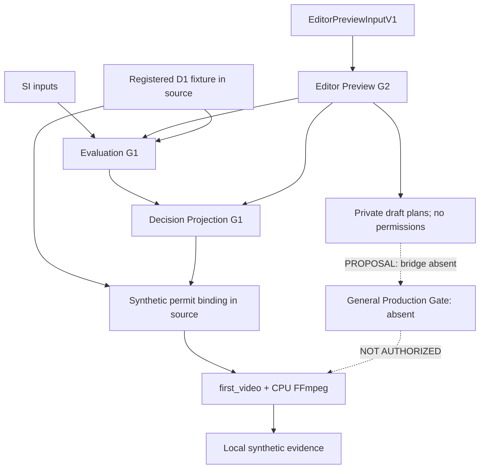

# G3.0 — зависимости и переходы

Дата аудита: 2026-11-17 (Europe/Kyiv). **G3.0 / DOCS ONLY / READY_FOR_OWNER_REVIEW.**

База: `7166902820731984ceb56d79275a70f83f665b23`; base tree: `504881fec0b293fa1eb0808f666e63cd30bf5c7c`. Исследованный source PR #11: `6cfa7b4b535b0171ae2871b7e68e545b48ba332a`; source tree: `2850e0977af749569a5d363ffc1f540ffd788f2d`.
Все новые рекомендации интеграции — **PROPOSAL**. Этот пакет не утверждает G3 implementation, production permissions, merge или release.

## Реальная топология

D1 не импортирует `editor_preview` и не принимает его `preview-status.json`, карты или планы. Он заново вызывает evaluator/Projection с fixture inputs и использует собственные plans. Равенство evaluation_inputs двух examples проверено; весь `plans` D1 не равен `scene_drafts` G2. Конвертер/сопоставление output не реализован, общий токен готовности отсутствует. В схеме пунктир не означает контракт реализованного API.

## Каждый переход целевой цепочки

| Переход | Что реализовано | Что подтверждено | Только контракт / блокер | Нужный допуск |
|---|---|---|---|---|
| Topic → Evaluation | G1 принимает явные SI records/refs/context/ratings/findings. Source D1 содержит готовую synthetic fixture; G2 хранит metadata отдельно от SI | D1 source tests на двух Linux Python вызывают настоящий evaluator; G2 tests опубликованного PR #13 проверяют missing/INVALID/STALE | Нет исследования произвольной темы/источников и семантической привязки topic metadata к SI. Отсутствующие findings не выдумываются | Для synthetic только точная fixture. Для real — источники, review человека и отдельный research scope |
| Evaluation → Projection | G1 `project_evaluation` повторно проверяет input/result association, выдаёт RU/UK private card или UNAVAILABLE | source D1 positive: два real calls; base G1/G2 regression evidence в PR #13 | DISPLAYABLE/creative eligibility не editorial approval, scientific truth или production clearance | Private display scope; публичный экспорт карточек отдельно |
| Projection → Editor Preview | G2 CLI сохраняет собственные status/evaluation/cards/plans; Preview сам вызывает evaluator и Projection | PR #13: 21 target case с Windows junction skip; source D1 этот шаг не выполняет | Внешнего consumer от detached Projection card к Preview нет; вход Preview — EditorPreviewInputV1 | Private local directory; V07 trust/TOCTOU assumptions |
| Editor Preview → Production Gate | Готовые draft plans и фиксированное NOT_ASSESSED / permissions_granted=false | G2 tests и smoke предыдущего G2 packet; отсутствие bridge проверено AST/code review | Общий Production Gate API и adapter отсутствуют. Шесть future_checks в Preview — требования будущего review, не исполняемый разрешающий gate | Отдельное утверждение identity, exact inputs/material rights, human approvals, intended use, revocation/freshness, export boundary |
| Gate → Synthetic Render | Только source D1 локальный predicate: закрытый permit + registered digest + eligible eval + displayable cards + exact WAV before build | 3 source unittest на каждом Python; negative variants проверяют build.assert_not_called | Это fixture admission, не общий gate и не потребитель Preview. Existing first_video отдельно вызываем без D1, следовательно D1 не глобальный security boundary | Повтор exact synthetic fixture допустим в тестовом scope; это не право реального рендера |
| Synthetic Render → Evidence | Source: два MP4, project JSON, manifest, evaluation/cards/plans; ffprobe codec/duration + brightness probe | Positive test дважды рендерит RU/UK, сравнивает JSON bytes, H264/AAC, 1.4s, subtitle timing/brightness | Нет MP4 byte identity guarantee, подтверждения смысла/читаемости текста, custody/authenticated evidence index или per-video digest в manifest | Локальное тестовое evidence; публикация/retention/access требуют отдельного owner решения |

## Минимальная замкнутость D1

Прямые runtime imports D1: `scripts.first_video`, `story_intelligence.codec_v1`, `evaluate_v1`, `decision_projection_v1` — **уже в main и byte-identical source**. Стандартная библиотека: argparse/hashlib/io/json/pathlib/subprocess/sys/tempfile/wave. Никакой прямой или транзитивной runtime связи с `editorial.storage_transaction_model_v1` или `editorial.windows_lab` нет.

`first_video` использует core schema/media/subtitles/FFmpeg. В его функции есть optional Silero import, но D1 всегда передаёт `audio_dir` с локально созданной тишиной, не `silero_model`; этот путь не требует torch, модели, голоса, GPU или сети. Статический граф намеренно включает возможные вложенные imports; это не утверждение, что они выполнялись. Test helper `tests.test_story_intelligence_decision_projection_v1.stale_args` уже в main; тестовые зависимости не равны production dependencies.

## Source Python: фактические imports и data edges

Строки охватывают все оставшиеся Python-файлы. Обозначения R/B раскрываются в реестре и ниже. Для D1 fixture edge означает выбранный CLI input; JSON не импортируется как Python. Ни один DEFER не становится обязательным от одного упоминания в Markdown.

| Source Python / ID | Local imports/data dependencies | External import roots | Объявленных test_* | Для D1 |
|---|---|---|---:|---|
| `editorial/approval_attestation.py` / R167 | B024, B025, B028, B031 | hashlib, json | 0 | Не требуется |
| `editorial/approval_consistency.py` / R168 | B024, B028, R175 | dataclasses, enum | 0 | Не требуется |
| `editorial/approval_history.py` / R169 | B024, R168, B028, B029, R175 | dataclasses, enum, re | 0 | Не требуется |
| `editorial/current_package.py` / R170 | B024, R171, B028, B029 | dataclasses | 0 | Не требуется |
| `editorial/dependency_digest.py` / R171 | B024, B028, B029 | hashlib, json | 0 | Не требуется |
| `editorial/schema2_integrity.py` / R172 | B024, R167, R169, B026, B027, B028, B030, B031, R175, R177 | dataclasses, hashlib, json | 0 | Не требуется |
| `editorial/schema2_migration.py` / R173 | B024, B025, B028, R172, B031, R175, R177 | dataclasses, enum | 0 | Не требуется |
| `editorial/snapshot_checksum.py` / R174 | B024, B025, B028 | hashlib, json | 0 | Не требуется |
| `editorial/snapshot_integrity.py` / R175 | B024, R170, B026, B027, B028, B030, R174 | dataclasses | 0 | Не требуется |
| `editorial/storage_transaction_model_v1.py` / R176 | B024, R172, R173, R175, B032, R177 | copy, dataclasses | 0 | Не требуется |
| `editorial/versioned_codec.py` / R177 | B024, B025, B028, B031 | dataclasses, json | 0 | Не требуется |
| `editorial/windows_lab/__init__.py` / R178 | Нет | Нет | 0 | Не требуется |
| `editorial/windows_lab/dispatcher.py` / R179 | B024, B032, R176, R178, R180, R181 | dataclasses, hashlib, threading | 0 | Не требуется |
| `editorial/windows_lab/fixtures.py` / R180 | B024, R167, B025, R170, B027, R173, B031, B032, R176, R177, R181 | copy, hashlib, json, uuid | 0 | Не требуется |
| `editorial/windows_lab/protocol.py` / R181 | B024, B032 | hashlib, json, re, uuid | 0 | Не требуется |
| `scripts/topic_to_video.py` / R185 | R182, B039, B043, B045, B046 | argparse, hashlib, io, json, pathlib, scripts, subprocess, sys, tempfile, wave | 0 | Runtime |
| `tests/test_editorial_approval_attestation.py` / R187 | B024, R167, B025, B028, B031, R177, R186 | base64, contextlib, copy, dataclasses, json, pathlib, unittest | 35 | Не требуется |
| `tests/test_editorial_approval_consistency.py` / R188 | B024, R168, B025, R170, B026, B027, B028, R174, B055, B061, R196 | copy, dataclasses, pathlib, subprocess, sys, unittest | 29 | Не требуется |
| `tests/test_editorial_approval_history.py` / R189 | B024, R169, B025, R170, B026, B028, R174, R188, B055 | copy, dataclasses, pathlib, subprocess, sys, unittest | 31 | Не требуется |
| `tests/test_editorial_current_package.py` / R190 | B024, B025, R170, R171, B028, B029, B055, B061 | copy, dataclasses, pathlib, subprocess, sys, unittest | 16 | Не требуется |
| `tests/test_editorial_dependency_digest.py` / R191 | B024, B025, R171, B028, B029, B055, B061 | copy, json, pathlib, subprocess, sys, unittest | 16 | Не требуется |
| `tests/test_editorial_schema2_codec.py` / R192 | B024, B025, B028, B031, R177, B055 | builtins, copy, json, socket, unittest | 42 | Не требуется |
| `tests/test_editorial_schema2_integrity.py` / R193 | B024, R167, B025, B026, B027, B028, B030, R172, B031, R174, R175, R177, R196 | base64, contextlib, copy, dataclasses, json, pathlib, subprocess, sys, unittest | 52 | Не требуется |
| `tests/test_editorial_schema2_migration.py` / R194 | B024, R168, R169, B025, R170, B026, B027, B028, B030, R172, R173, B031, R174, R175, R177, R189, R193, R196 | contextlib, copy, dataclasses, json, pathlib, subprocess, sys, unittest | 50 | Не требуется |
| `tests/test_editorial_snapshot_checksum.py` / R195 | B025, R174, B055 | copy, dataclasses, json, pathlib, subprocess, sys, unittest | 15 | Не требуется |
| `tests/test_editorial_snapshot_integrity.py` / R196 | B024, B025, R170, B026, B027, B028, B030, R174, R175, B055, R190, B061 | copy, dataclasses, pathlib, subprocess, sys, unittest | 27 | Не требуется |
| `tests/test_storage_recovery_adversarial_v1.py` / R197 | B024, B032, R176, B074, R198 | contextlib, copy, dataclasses, hashlib, hmac, json, unittest | 13 | Не требуется |
| `tests/test_storage_transaction_model_v1.py` / R198 | B024, R167, B025, R170, R173, B031, B032, R176, R177, R196, B074 | copy, dataclasses, hashlib, inspect, json, os, pathlib, socket, sys, unittest | 87 | Не требуется |
| `tests/test_topic_to_video_d1.py` / R199 | R182, R185, B080 | copy, json, pathlib, scripts, shutil, tempfile, unittest | 3 | Regression |
| `tests/test_windows_lab_dispatcher_v1.py` / R200 | B024, B032, R176, R178, R179, R180, R181, R201 | builtins, copy, dataclasses, hashlib, os, socket, subprocess, unittest, uuid | 24 | Не требуется |
| `tests/test_windows_lab_protocol_v1.py` / R201 | B024, B032, R178, R181, B074 | copy, hashlib, json, unittest | 10 | Не требуется |

## Общие dependencies, уже в approved main

Для всех B-строк `(mode,type,blob)` source совпадает с base; перенос запрещён как дублирующий. Список объединяет ссылки remaining и консервативное транзитивное import closure D1, включая optional imports. Документальные ссылки не означают вызов runtime.

| ID | Путь | Общий Git blob SHA-1 | Mode |
|---|---|---|---|
| B001 | `COMMERCIAL_VOICE_LICENSE_GATE.md` | `e9b9cc6027e727c686bd00461e78358e52a38666` | `100644` |
| B002 | `LICENSES/IMPORT_LICENSE_GATE.md` | `8c54fed2c2595c30f186b7539c9e6b41b3dbdbb1` | `100644` |
| B003 | `LICENSES/RELEASE_COMPLIANCE_CHECKLIST.md` | `7599170be57a0756162626c6342c6f9297248772` | `100644` |
| B004 | `LICENSES/UNRESOLVED_ITEMS.md` | `3b2ddebf6bd2e1f1f0f293e78a12c4b990e623a4` | `100644` |
| B005 | `MASTER_PROMPT.md` | `2817c6649916bc5ed0fe81be1ee44ce20e44d529` | `100644` |
| B006 | `SPRINT_25_1_REPORT.md` | `5d45aa093df585477487a1568acab41da999c40f` | `100644` |
| B007 | `core/bundle_integrity.py` | `3e6fcdaa4f9dab0df32cddb8e34b3aa68cfbc7e4` | `100644` |
| B008 | `core/cli.py` | `6f488fd5a98166129cdfefd8873aa7b11fbd0414` | `100644` |
| B009 | `core/export_bundle.py` | `a89a3378fdbfaf038ee404651e8179616ee654f1` | `100644` |
| B010 | `core/media_manifest.py` | `bd10633d849fb5257ff398c02a5c827464efd64a` | `100644` |
| B011 | `core/media_paths.py` | `61988d73ba05bf3bd96ed59e158bfe98fbe0c218` | `100644` |
| B012 | `core/mp4_render.py` | `860be5c2684cfd189ebef0be414b19b386d1ea2f` | `100644` |
| B013 | `core/project_schema.py` | `ef778c579585508c1ee6288cc3bb43723a6fe78f` | `100644` |
| B014 | `core/subtitles.py` | `1415a74808aabc839dae7f4dcc02094e7302f647` | `100644` |
| B015 | `core/timeline_audit.py` | `92f285f1d000c22f233dfe48242cec2b5a270ee0` | `100644` |
| B016 | `docs/ADR-0003-TIMELINE-V2.md` | `8c6852392a4467c68194072326e52170835f783d` | `100644` |
| B017 | `docs/CLI_WINDOWS.md` | `16ba25dd1fc0735d7d2b597870ed1591cafa7931` | `100644` |
| B018 | `docs/ORIGIN_AND_ATTRIBUTION.md` | `e339324ae3d0456399dc3ddb074930fdacbb90e6` | `100644` |
| B019 | `docs/PROJECT_STRUCTURE.md` | `6cefd35f5091b7a9bd1ca602ce2867cfe4c8b8de` | `100644` |
| B020 | `docs/SPRINT26_FIRST_VIDEO_WINDOWS.md` | `8acf976cb4f1e137817bfd849bab9a7263262508` | `100644` |
| B021 | `docs/UPSTREAM_TECHNOLOGY_IMPORT.md` | `62b976b5ea9b7b319e325f712861775a7879056c` | `100644` |
| B022 | `docs/tasks/SI_PRODUCT_02_2_2A_V07_FIX_RESULT.md` | `9130d048b75f905b01e9169e90a2a927ffb575e5` | `100644` |
| B023 | `docs/tasks/SI_PRODUCT_02_2_2_RESULT.md` | `64feaa430791e035bfd4f53c23fda4171dfb3582` | `100644` |
| B024 | `editorial/__init__.py` | `74f658b8b3f2c5b56ea7b9e66c4f4b46849d34ba` | `100644` |
| B025 | `editorial/codec.py` | `79672d71c3b8b5ffe1a590d9c2894006304c7c09` | `100644` |
| B026 | `editorial/graph.py` | `ea0ac5143a41ec0cd8aa1316fbc521d5dddc562a` | `100644` |
| B027 | `editorial/integrity.py` | `db1d67cb988ed204fed06fb2b4e891e851d091a3` | `100644` |
| B028 | `editorial/model.py` | `3f74177913f3b70dd55ee38e1ac9e35e7b73d4db` | `100644` |
| B029 | `editorial/package.py` | `1e2adff593b541b9161fd891232669dbc5d3c4a4` | `100644` |
| B030 | `editorial/rights_binding.py` | `1388d69f8d0e29092dd856fbab3591a973caa211` | `100644` |
| B031 | `editorial/schema2_model.py` | `870980d22ffa377d424402c97ccc5ff9749c839c` | `100644` |
| B032 | `editorial/storage_protocol_v1.py` | `5484f5f5e7228f6a36bde7e2ce71fcf5feda1598` | `100644` |
| B033 | `examples/first_video_plan_ru.json` | `0223765c0c115f9a3031a5368a16cf5a6a46e82a` | `100644` |
| B034 | `examples/first_video_plan_uk.json` | `d18917077a6bd42d1f33b3d5c623b323a401756c` | `100644` |
| B035 | `integrations/silero_local.py` | `c41d312e030c73c5f3e7be9011a41960a70d071e` | `100644` |
| B036 | `locales/ru/ui.json` | `3cb6b771cfd5bfb6336718f2fbd478b15267f52d` | `100644` |
| B037 | `locales/uk/ui.json` | `324158bb66403787fcd23e2809ec688f6d23fed2` | `100644` |
| B038 | `project-log/NEXT_SESSION.md` | `9fe400d1aeb9601806ca06114bfc6c9a773de366` | `100644` |
| B039 | `scripts/first_video.py` | `b0f60d36bbf16e7cabc609a8393e5e4b9bb0f2e1` | `100644` |
| B040 | `scripts/setup_dependencies.py` | `84b9eb074009ad33a11b2a581e950a9a1f0a8ae8` | `100644` |
| B041 | `scripts/voice_studio.py` | `d30ed3c01acb4947c7a890a9a455cd46c3d509e9` | `100644` |
| B042 | `story_intelligence/__init__.py` | `b52609f19002d13221fb5e8aaac9800147720cb2` | `100644` |
| B043 | `story_intelligence/codec_v1.py` | `0adc80d4616d4dfee8f10fe9992055b2bf1b7599` | `100644` |
| B044 | `story_intelligence/currentness_v1.py` | `39c82fe191b738304c0dd80bc9ab7a83f9416909` | `100644` |
| B045 | `story_intelligence/decision_projection_v1.py` | `1fbf216d6fd42f6be10228608270a81a50cb09b0` | `100644` |
| B046 | `story_intelligence/evaluate_v1.py` | `cd9e6c461d7d298ebf03b0c5f5a9e01bbfeab43f` | `100644` |
| B047 | `story_intelligence/model_v1.py` | `35c439c8e4a795b20b9ecf8b7d70b4d313f5b53e` | `100644` |
| B048 | `story_intelligence/provenance_v1.py` | `6d064a2910d10de73419b4dcb898c991e5f5b9c1` | `100644` |
| B049 | `story_intelligence/records_v1.py` | `eac3928c81d4b84bbfc9ae5240f61b6abee76442` | `100644` |
| B050 | `story_intelligence/resolver_v1.py` | `c7fcf0ca1f1519c4a0dfadf74c2e95e4378ddecb` | `100644` |
| B051 | `tests/demo_media_support.py` | `f256445158c76d58665ba709652b6ae8b81b7756` | `100644` |
| B052 | `tests/fixtures/project_v3.json` | `5c247bd3d68fb84f09336721af5eea3e645a081a` | `100644` |
| B053 | `tests/story_intelligence_evaluate_fixture_support.py` | `b8c7c08009dbd4f260c83388632bca1afc7d1eea` | `100644` |
| B054 | `tests/test_cli.py` | `f5ef85ce37fbd05dbb9d2dc54479c7851cefc789` | `100644` |
| B055 | `tests/test_editorial_codec.py` | `1deecfbe41444482af21735d482f39b0c8e94811` | `100644` |
| B056 | `tests/test_editorial_content.py` | `94be17c556309ea48c9abbecceb3807eb2f7819d` | `100644` |
| B057 | `tests/test_editorial_encoder.py` | `2a274dc438e7c8c6bb2edafa288df120bece2ddf` | `100644` |
| B058 | `tests/test_editorial_graph.py` | `44dbe9cc3c1ecd75b84881b890bd5582f2ec2930` | `100644` |
| B059 | `tests/test_editorial_hashes.py` | `552347d6abc96e2c375fc40af99d3f1b778850cc` | `100644` |
| B060 | `tests/test_editorial_model.py` | `f564e322ae8e05ca994e5ac0cc7a67e864c6c29d` | `100644` |
| B061 | `tests/test_editorial_package.py` | `40b8784634de56dbc5faaf26cd90734f9a1d2104` | `100644` |
| B062 | `tests/test_editorial_rights_binding.py` | `67dbe9d55e39f7e93f873d203409f32b3ec0bbd4` | `100644` |
| B063 | `tests/test_editorial_schema2_model.py` | `ac0752f62a07be22120ebb2ac71ff9e7ba72228c` | `100644` |
| B064 | `tests/test_editorial_types.py` | `7c0caf11302d5fc1c030511374653dae1cd75c24` | `100644` |
| B065 | `tests/test_project_schema.py` | `db158ae742b32322eaa0493c6f41abd959a99f02` | `100644` |
| B066 | `tests/test_sprint11.py` | `ea1d9368a3c5a72d272792a7e7a94417f89c3617` | `100644` |
| B067 | `tests/test_sprint12.py` | `167ec47232701483a96b32117226d3dedab61350` | `100644` |
| B068 | `tests/test_sprint13.py` | `6a38320c2341e4458ddcfbbb38ffa83f42e2e432` | `100644` |
| B069 | `tests/test_sprint20.py` | `f738efa42eef90f9ba80b9dd6df99e6e0079fca2` | `100644` |
| B070 | `tests/test_sprint23_1.py` | `5ce48bb349b843d81e8503bc03c9aa878c3f8a96` | `100644` |
| B071 | `tests/test_sprint23_2.py` | `5aa5dc884f7225ddd12ef63963566c8b6b5152c9` | `100644` |
| B072 | `tests/test_sprint25_1.py` | `ffa3c1f1ec91fa4276779a5ffe4cc3e910ad16e3` | `100644` |
| B073 | `tests/test_sprint26.py` | `1883225efbcecdd5cfc72f7edae5da84fe2b0e6b` | `100644` |
| B074 | `tests/test_storage_protocol_v1.py` | `b0d0598d270edfaed8ea22391f335cf249b02431` | `100644` |
| B075 | `tests/test_story_intelligence_codec_v1.py` | `5b9574b5512fdb54b2b8174fe96458c62b6031bb` | `100644` |
| B076 | `tests/test_story_intelligence_currentness_eref_f1.py` | `6f784a49433e10e347d02d0e18272106f96b6c29` | `100644` |
| B077 | `tests/test_story_intelligence_currentness_v1.py` | `5324d653bd0a39b3dbc0251655b6a5fdc835d437` | `100644` |
| B078 | `tests/test_story_intelligence_currentness_vectors_v1.py` | `68b7f30aacb883cc65daa64afa4a97cbd25bdc7e` | `100644` |
| B079 | `tests/test_story_intelligence_decision_projection_oracles_v1.py` | `5d2661fe0323388cc9081951fc068ada6221f26d` | `100644` |
| B080 | `tests/test_story_intelligence_decision_projection_v1.py` | `b99a250fe26e7c610d5fe36a63fb0bcb7d744c53` | `100644` |
| B081 | `tests/test_story_intelligence_evaluate_oracles_v1.py` | `6af2fa185279241fd87536841586fbe082bd80ff` | `100644` |
| B082 | `tests/test_story_intelligence_evaluate_v1.py` | `b5c9f2f8ac5d4162719816979be5aba590257ad9` | `100644` |
| B083 | `tests/test_story_intelligence_model_v1.py` | `89886801dfb19149bde19a4b13ae284706bebefa` | `100644` |
| B084 | `tests/test_story_intelligence_provenance_v1.py` | `0d9a8c23d8585ed6adf52f3a862b873028ecc3a4` | `100644` |
| B085 | `tests/test_story_intelligence_provenance_vectors_v1.py` | `6919c3541ecd75b9a7653fd32915c3e9cad98682` | `100644` |
| B086 | `tests/test_story_intelligence_record_vectors_v1.py` | `c751fca69e9120cfd3cd0e5b8471603a2f9be0a9` | `100644` |
| B087 | `tests/test_story_intelligence_records_v1.py` | `21cfbf9d03e168ae66286d440a7f66cd0a74b1e6` | `100644` |
| B088 | `tests/test_story_intelligence_resolver_v1.py` | `b130a8de2085d6820558f0a19e3b8628dcd4e406` | `100644` |
| B089 | `tests/test_story_intelligence_resolver_vectors_v1.py` | `311aa23bfc103d2c29c09dcbccd61663fd914d40` | `100644` |
| B090 | `tests/test_subtitles.py` | `4c78794c8a18b0ea7535573780effcd4d5212b2b` | `100644` |
| B091 | `upstream/konlu-story-studio/modules/history-writing/GUIDE.md` | `05afd245004881c4cdbc794ff748927b2ae529c0` | `100644` |

## Отдельные от MVP направления

| Группа | Реальная зависимость | Решение G3.0 |
|---|---|---|
| current_package → dependency_digest → package/model | Проверка выбранной coherent цепочки, hashes, exact refs | DEFER: D1 ничего из этого не вызывает |
| snapshot_integrity → current_package/graph/rights/checksum | Pure read-only целостность, не trust/OS persistence | DEFER, не средство Production Gate |
| approval_consistency/history → snapshot_integrity | Consistency/history сохранённых решений; не аутентификация | DEFER, отдельный contract/trust consumer |
| schema2_integrity/migration/versioned_codec/attestation | Составная pure schema-2 validation/migration; caller-supplied metadata | DEFER; migration не создаёт authority |
| storage_transaction_model_v1 → wire + nested schema/integrity/migration | In-memory W0–W9 model, simulated crash/recovery | DEFER; нет дискового writer |
| windows_lab dispatcher → fixtures/protocol/model | Portable RAM lab с injected principal, синтетическими ключами и replay | DEFER; нет Windows service/native identity/ACL |
| Storage S3 native | В source есть design/preflight и PURE_ONLY acceptance; host-specific native часть BLOCKED | Не dependency синтетического MVP. Если потребовать protected production storage — отдельный обязательный project/gate, не заглушка |

Поиск зависимостей: AST всех source `.py`, включая imports внутри функций и literal `__import__`; ручное чтение входов D1/Preview, renderer, контрактов. Произвольные вычисляемые plugins/import strings не разрешаются этим методом. Закрытый D1 путь не содержит plugin loader. Runtime qualification следует выполнять на будущем exact integration tree, не подменять static closure доказательством интеграции.
