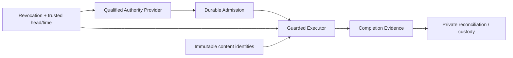

# P5 — Operational Governance alternatives and qualification gates

**DECISION_PROPOSAL — NOT APPROVED.** SI-INTEGRATION-G3.2.0c; 2026-11-17 (Europe/Kyiv).
Base `0d6d9076ab535c1b258206beb4e4fe9c005e79e1`, tree `e55c00d0e7a95218e0978dd9677172608395ff5f`.

Primary OP-12/15/16/17/19/20/21/23/28: nine OPERATIONAL planning parameters, all unresolved whole choices. This document proposes protocol/qualification questions; **no providers, real identities, services, grants, render or native tests were connected/executed**. Exact source requirements/owner questions are in [dossier](G3_2_0C_OPEN_PARAMETERS_DECISION_DOSSIER.md).

## 1. Trust chain and what cannot be inferred

Every arrow is a **future required protocol property**, not a working service. Content/rights/human evidence also required; no component manufactures it. A JSON head/signature/capability-shaped record is not a trust root. At-most-one durable admission can be a target property; **exactly-once physical execution is not proved** and not promised. A crash can leave actual work UNKNOWN even when a request was reserved.

Design-decision dependencies in dossier are acyclic. Real implementation/qualification integration has mutual interface constraints, but those do not require P1 to wait for a live provider. Reviewing this architecture never authorizes service installation, admin actions or production operation.

## 2. OP-12 — revocation freshness

- **Alternatives:** authenticated per-attempt lease/checkpoints versus bounded polling with explicit stale/outage cancellation semantics. Neither polling interval nor lease duration selected.
- **Trust/external authority:** actual revocation issuer, latest authenticated head, chosen clock/uncertainty and executor able to observe/check before start and successful completion.
- **Failures:** network/provider outage, stale replayed state, missed poll, revocation racing spawn/commit. No cached APPROVE fallback or assumption a revoked approval is still safe because render began.
- **Recovery:** uncertain observation → no successful commit; cancel/quarantine/reconcile using actual known attempt state. Do not delete evidence or silently restart under same grant.
- **Native qualification:** bounded actual detection/cancel behavior, process scheduling/restart, clock rollback and failure observations on selected host, not a pure dict test.
- **Privacy/security:** revocation events/private decision links must not leak real principal or material identifiers publicly.
- **Owner decision:** choose monitoring protocol, max observation lag, outage/expiry handling and evidence required in a later scoped qualification task. Dependencies OP-10/11/15/23; P02-05/P02-06/P04-06. Status OPEN.

## 3. OP-15 — authority/state provider

- **Alternatives:** separately qualified protected local S3/broker track; independently qualified alternative authority/storage system with equivalent properties; or defer production and retain Preview/synthetic diagnostics.
- **Trust/external authority:** real OS-derived principal/policy grants, authentic current heads/epochs, anti-rollback, review session provenance and authorized operator/custodian. No default all-gate current user.
- **Failures:** substituted provider/key/registry, stale head, missing protected anchor, policy version mismatch, partial migration or compromised state.
- **Recovery:** fail closed for effective approvals/admission until explicit trust restoration; historical/draft diagnostics may remain readable without becoming grants. No file/SQLite workaround automatically declared equivalent.
- **Native qualification:** separate identity/IPC/store/service/runtime/OS proof as selected, actual admin/host authorization and independent audit coverage.
- **Privacy/security:** minimize identity/decision disclosure; synthetic credentials/key fixtures are not real authority.
- **Owner decision:** select a provider-design/qualification project or explicitly keep production blocked. Dependencies OP-14/24; P02-05/P04-04/P04-10/NATIVE-03. Status OPEN. **Storage S3 is an internal track, not Amazon S3, and is not production-qualified.** PURE_ONLY models/LAB acceptance do not prove native service/durability. Existing disabled PUBLISH_REVISION/partial reconstruction boundaries not changed.

## 4. OP-16 — durable admission and single-attempt recovery

- **Alternatives:** qualified protected single-store ledger versus separately qualified transactional service; both require exact request/subject/grant/attempt/executor/epoch binding. RAM-only state is not enough.
- **Trust/external authority:** real issuer and authenticated durable state; admission reserve committed before spawn; conflict/replay decision atomic for simultaneous requests.
- **Failures:** lost ACK, crash before/after spawn, OS restart, duplicate concurrent consume, rollback, unknown terminal write. Request_id equality without full bytes is insufficient.
- **Recovery:** exact lookup/reconciliation may return verified known outcome or UNKNOWN/INDETERMINATE. Never infer zero execution and rerender automatically after uncertain crash; a new actual attempt requires separate authorized scope/new grant as policy specifies.
- **Native qualification:** concurrency/durability/restart/fault evidence, exactly which operations persisted and when; process-kill testing is not power-loss certification.
- **Privacy/security:** request/receipt/session identities private; no raw keys in logs/Git.
- **Owner decision:** approve protocol event/replay/lookup/incarnation semantics and future qualification scope, not a current grant. Dependencies OP-08/15/23; P04-04/P04-05/P05-05. Source status PROPOSED, whole protocol unresolved.

## 5. OP-17 — immutable resolver / guarded inputs

- **Alternatives:** qualified content-store/broker handing stable identities/handles versus a qualified private snapshot/package with anchored opens. A private-looking path string alone is not a secure resolver.
- **Trust/external authority:** access controls/runtime/source/tool identity, real immutable content, qualified file/descriptor/handle lifecycle and containment.
- **Failures:** TOCTOU path swap, POSIX symlink, Windows junction/reparse, UNC/device/alternate stream, mount/drive remap, PATH/cwd executable substitution, same name with different bytes.
- **Recovery:** deny/abort/quarantine on identity/hash/profile mismatch; never fetch replacement materials from network or widen trusted roots to pass. Recovery only under explicit selected protocol.
- **Native qualification:** actual opened-object identity and no out-of-scope reads/writes, NTFS/reparse behavior, lifetime containment and cleanup on selected host. Repeated lstat/string-prefix checks do not close these oracles.
- **Privacy/security:** private content/material/license bytes and exact locations under custodian policy; avoid logging raw paths/IDs publicly.
- **Owner decision:** choose resolver/store/OS threat model and evidence requirements. Dependencies OP-22/23; P04-07/NATIVE-01. Status OPEN.

## 6. OP-19 — completion evidence / atomicity

- **Alternatives:** qualified single-store atomic index/state protocol versus qualified journal/commit+reconciliation protocol across stores, with explicit failure states.
- **Trust/external authority:** authentic admission/attempt lineage, actual output bytes/toolchain inspection and independent completion witness/custody.
- **Failures:** RU exists but UK failed; full video with truncated evidence; index/head mismatch; orphan outputs; crash/OS restart between write/flush/index/head; forged terminal manifest.
- **Recovery:** private quarantine and reconcile to verified terminal state or INDETERMINATE; no success from MP4 existence/last marker. Do not invent receipt/hash/observation after the fact or silently partial-reconstruct forbidden state.
- **Native qualification:** actual atomic/flush/restart semantics on chosen filesystem/profile, disk-full/access/error tests and observer; distinguish process-qualified from power-loss-qualified.
- **Privacy/security:** input/outputs/private manifests and stderr never automatically published; preserve failure history and exact actual hashes privately.
- **Owner decision:** select durable completion/witness protocol, invariant ledger↔index↔bytes and qualification plan. Dependencies OP-16/17/18/23; P05-03/P05-04/P05-05/P05-06/NATIVE-02. Status OPEN.

## 7. OP-20 — host/platform qualification

- **Alternatives:** explicit isolated Windows10/11 CPU-only profile versus another explicitly selected platform profile; diagnostics-only defer when no host/permissions.
- **Trust/external authority:** identified authorized host/admin owner, supported OS/build, runtime/source/artifact/profile hashes, isolation/rollback/evidence custodian. No real host or admin permission supplied by this dossier.
- **Failures:** unsupported/mismatched OS/runtime/fonts/codec/libass, wrong volume/reparse/mount assumptions, leftover tokens/privileges, unobserved writes or unqualified shared/sync filesystem.
- **Recovery:** STOP/re-pin/review/requalify after relevant change; no privilege/ACL broadening or different host fallback to achieve PASS.
- **Native qualification:** actual CPU-only media/Unicode/subtitle/playback/path behavior plus selected security/identity/durability oracles, each correctly scoped. Linux synthetic CI is not Windows qualification; no GPU/paid-service dependency inferred.
- **Privacy/security:** private machine identifiers/credentials/traces outside Git; only approved redacted summary if any.
- **Owner decision:** choose future exact host/profile, bounded test/admin operations and independent evidence scope. Dependencies OP-12/17/19 are **design requirement inputs**, not instruction to operate before host approval. NATIVE-01/02/03. Status OPEN.

## 8. OP-21 — privacy, retention and disclosure

- **Alternatives:** private local custodian/readers only versus separately reviewed redacted evidence export with exact allowlist. No automatic CI upload/public sharing.
- **Trust/external authority:** legitimate purpose/access/rights/privacy policy and custodian; hashes may reveal membership and are not anonymity.
- **Failures:** script/cards/licenses/identity/raw stderr/MP4 exposure, retention beyond purpose, inaccessible audit evidence, deletion destroying required negative decision proof.
- **Recovery:** quarantine/limit disclosure and follow explicit remediation/retention policy; no unilateral purge or reclassification of old private data as public.
- **Native qualification:** actual permissions/custody/backup/erase/access controls on selected store/host, not a schema flag.
- **Privacy/security:** choose retention/legal obligations and redaction policy jointly with OP-28 tombstones; minimizing PII must not resurrect old approvals. No duration guessed here.
- **Owner decision:** select readers/custodian/content/retention/erase/export boundaries. Dependencies OP-14/19/23; P05-07/NATIVE-03. Status OPEN.

## 9. OP-23 — evidence payload and operational protocol schemas

- **Alternatives:** qualified protected broker receipts/manifest interfaces versus separately qualified signed receipts with authenticated key registry/channel. Format alone never trust.
- **Trust/external authority:** actual identity/grant/admission/completion/inspection/source/environment producers, protocol/schema versions, registry and transport trust roots. Signing-key presence/algorithm not proof of authority.
- **Failures:** unknown schema/version/producer, partial signature tuple, wrong request/subject/policy/epoch, forged code manifest, arbitrary opaque ByteRef read as verified receipt.
- **Recovery:** deny recognition/operation; explicit re-pin/version compatibility/trust restoration, no fake trusted=true/simulated provider in production.
- **Native qualification:** selected service/channel/identity/store/runtime properties and independent audit of attempted effects, not only unit fixtures.
- **Privacy/security:** minimal safe fields/public error projection, bounded payloads and no secrets/raw exception dumps in artifacts.
- **Owner decision:** commission exact payload/protocol/trust-root design scope before final schema freeze; no implementation started. Dependencies OP-09/15/24; P01-01/P02-01/P03-01/P04-10/P05-01. Status OPEN.

## 10. OP-28 — tombstones, history and validity

- **Alternatives:** protected append-only history with qualified reconciliation versus independently anchored qualified history; both retain negative decision semantics and exact key binding.
- **Trust/external authority:** authentic current head/history/order and original per-decision authority. Timestamp/revision/list order alone not latest proof.
- **Failures:** expired REVOKE mistakenly revives old APPROVE; rollback removes tombstone; wrong-key reconsideration; legacy evidence promoted through migration; retention erases deny semantics.
- **Recovery:** no resurrection from expiry/deletion/cache. New authentic decision may restore only its exact scope via explicit predecessor/history/policy; ambiguous/missing trusted history denies recognition. Retention/privacy policy may need protected minimal records, never silent loss of negative state.
- **Native qualification:** actual persistence/anti-rollback/restart/replay/revocation behavior and chosen operator procedures.
- **Privacy/security:** preserve necessary negative-state proof while minimizing personal data under selected policy; no ad hoc purge or public identity disclosure.
- **Owner decision:** approve event-validity/history/authority/recovery interaction, separately from operational implementation and retention choices. Dependencies OP-12/15/16/23; P02-04/P02-05/P02-06/P02-07. Source PROPOSED, whole protocol unresolved.

## 11. Governance sequence and remaining blockers

First owner reviews [P1](G3_2_0C_P1_CANONICAL_FOUNDATION.md) choices, then pure reference/accounting/policy projections; no provider connection required. Later design can choose concrete trust protocols/host and seek explicit narrowly scoped implementation/qualification tasks. No current owner role, actual material license, operational grant or production attempt is authorized by selecting an architectural alternative.

Missing prerequisites: exact protocols/roles/policies/clock/ledger/store/host/evidence/custody and independent qualification evidence. S3 is not declared production-qualified; PUBLISH_REVISION and partial reconstruction restrictions remain unchanged. No exactly-once physical execution claim, no automatic repair/retry/privilege fallback, no renderer/service installation or G3.2.1. **STOP for independent review and owner decision.**
